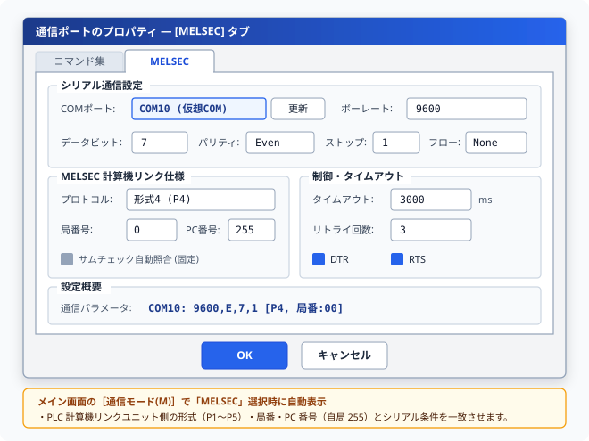
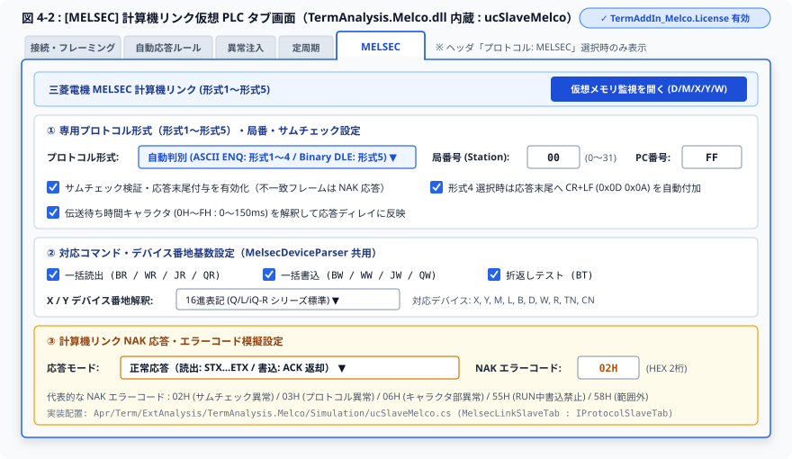

# Melco（三菱電機 MELSEC 計算機リンク）アドイン取扱説明書

👉 [← TermAddIn_Melco 製品トップに戻る](../README.md)  
👉 [← プロパティ設定画面取扱説明書（共通）](../プロパティ設定画面取扱説明書.Md) ／ [← TermEmulator 操作説明書（共通）](https://github.com/Monaca-App/TermEmulator/blob/main/Manual/TermEmulator操作説明書.Md) ／ [← マクロスクリプト取扱説明書（共通）](../マクロスクリプト取扱説明書.Md)

---

本書は、**TermAddIn_Melco**（`TermAnalysis.Melco.dll`：三菱電機 MELSEC 計算機リンク 形式 1〜5 通信エクステンション）の **取扱説明書 兼 機能解説書** です。計算機リンクの基礎仕組み、プロパティ設定画面の **「MELSEC」タブ**、**TermEmulator の `[MELSEC]` 仮想スレーブタブ**、および全 23 コマンドのリファレンスを 1 冊にまとめています。

* **必須拡張ライセンス**: **`TermAddIn_Melco.License`** （組み込み先: `TermAnalysis.Melco.dll`、`TermEmulator` と相互共用）


### 関連する公式規格・メーカー仕様書（外部リンク）
* [三菱電機 FA 公式サイト（マニュアル検索・ダウンロード）](https://www.mitsubishielectric.co.jp/fa/download/search.do?mode=manual) — サイト内のマニュアル検索より以下の公式マニュアルを参照できます（一部資料は無料の FA メンバーズ登録が必要）。
  * 『MELSEC コミュニケーションプロトコルリファレンスマニュアル』（マニュアル番号: `SH-080003`）
  * 各シリーズ（Q / L / iQ-R / FX）の『シリアルコミュニケーションユニット ユーザーズマニュアル（基礎編／応用編）』［計算機リンク形式 1〜5 仕様］
---

## 目次

- [1. 機能概要と基礎知識（はじめての方へ）](#1-機能概要と基礎知識はじめての方へ)
- [2. プロパティ設定画面：「MELSEC」タブの詳細](#2-プロパティ設定画面melsecタブの詳細)
- [3. TermEmulator 仮想スレーブ設定：「[MELSEC]」タブの詳細](#3-termemulator-仮想スレーブ設定melsecタブの詳細)
- [4. マクロコマンド一覧（全 23 コマンド）](#4-マクロコマンド一覧全-23-コマンド)

---

## 1. 機能概要と基礎知識（はじめての方へ）

### 対応する機能の概要
**Melco（三菱電機 MELSEC 計算機リンク）** アドインは、三菱電機製シーケンサ（PLC）のシリアル計算機リンク（RS-232C / RS-422）における **形式 1〜形式 5（`P1`〜`P5`）** に対応し、ワードデバイス（`D`, `W`, `R`, `TN`, `CN`）やビットデバイス（`X`, `Y`, `M`, `L`, `B` 等）の一括読み書き、折り返し回線診断（`BT`）、および低レベルフレーム送受信を行う通信機能です。

### 機能の実現方法
* **形式 1〜4 高水準コマンド＋形式 5 バイナリ対応**: `ENQ` / `STX` / `ETX` / `ACK` / `NAK` 制御文字の付与、サムチェック計算、形式 4 の `CR+LF` 付与を内部で自動処理し、`Melsec_ReadWord` / `Melsec_WriteWord` / `Melsec_ReadBit` / `Melsec_WriteBit` の 1 行で PLC メモリへアクセスできます。
* **フレーム単位の直接制御にも対応**: 既存資産の独自電文やバイナリ形式 5（`DLE STX`〜`DLE ETX`）を使う現場向けに、`Melsec_P1s_S`〜`Melsec_P5s_R` の形式別コマンドも備えています。
* **仮想 PLC 模擬による事前確認**: `TermEmulator` の `[MELSEC]` タブで形式 1〜5・`NAK` エラー応答（サムチェック異常・RUN 中書込禁止等）を再現し、実機 PLC なしで安全にテストできます。

### このアドインを選択することの利点
* **メーカー製有償通信ミドルウェア（MX Component 等）が不要**: シリアルケーブルを繋ぐだけで、追加ライセンスや複雑な通信ドライバ設定なしに Excel から直接シーケンサのデータを収集・制御できます。
* **レガシー設備の延命・データ活用に最適**: LAN ポートを持たない既存の計算機リンク設備（QJ71C24N、FX シリーズ等）を改修せずにそのまま自動検査・ロギング化できます。
* **高水準操作と生フレーム操作の両立**: 初心者は簡単な `Melsec_ReadWord` から始められ、特殊なプロトコル要件がある現場でも形式別コマンドへ柔軟に対応できます。

### `Melco` と `MelcoMC` の違い（どちらを使うべきか）
* **シリアルケーブル（RS-232C / RS-422）で繋ぐ場合** ➔ 本書（**`Melco`：計算機リンク**）を使います。既存設備やシリアル通信ユニット（QJ71C24N、FX 計算機リンク等）向けです。
* **LAN ケーブル（Ethernet）で繋ぐ場合** ➔ **[MelcoMC（MC プロトコル 3E）](../MelcoMC/MelcoMC取扱説明書.Md)** を使います。

### 設定の妥当性を判断するためのチェックポイント
三菱シーケンサの計算機リンクは、PLC 側の設計ツール（GX Works2 / GX Works3 の「シリアルコミュニケーションユニット設定」）と以下を一致させる必要があります。

| 確認項目 | 項目の意味 | 設定値の目安・確認方法 |
| :--- | :--- | :--- |
| **プロトコル形式（形式 1〜5）** | 電文の「包み方（改行やチェック文字の有無）」のルール | 現場で最も多く使われるのは **`形式 4 (P4)`**（チェック文字＋改行 `CRLF` 付き）または **`形式 1 (P1)`**（チェック文字付き・改行なし）です。PLC 側のスイッチ設定と必ず一致させます。 |
| **局番（`0`〜`31`） / PC 番号（`0`〜`255`）** | 複数台繋いだときの「相手 PLC の番号」と「CPU の指定」 | 1 対 1 で直接繋ぐ場合は、ほとんど **`局番 = 0`、`PC 番号 = 255（0xFF：自局）`** です。 |
| **回線条件（速度・ビット・パリティ）** | シリアル通信の基本ルール | 三菱計算機リンクの標準的な初期値は **`9600 bps / データ 7 bit / パリティ Even（偶数） / ストップ 1 bit`** です（一般的な 8N1 とは異なるため注意）。 |
| **デバイス名（`D`, `M`, `X`, `Y`）** | PLC の中の「データの箱の名前」 | **`D`（データレジスタ）** は数値、**`M`（内部リレー）** や **`X`（入力）・`Y`（出力）** は ON/OFF を表します。ラダー図や I/O 表に書かれた記号をそのまま指定します。 |

### 通信の仕組み解説（プロトコル構造と代表的なトラブル事例・対処法）
計算機リンク（形式 1〜4）では、制御文字（`ENQ`, `STX`, `ETX`, `ACK`, `NAK`）を使って確実に 1 電文ずつやり取りします。

```text
PC ➔ PLC : [ENQ] [局番] [PC番号] [コマンド(WR/WW等)] [待時間] [デバイス/点数] [サムチェック] ([CR LF])
PLC ➔ PC : 読出時は [STX] [局番] [PC番号] [読出データ] [ETX] [サムチェック] ([CR LF])
           書込時は [ACK] [局番] [PC番号] ([CR LF])   ※エラー時は [NAK] + [エラーコード2桁]
```

* **事例①：PLC から一切返事がない** ➔ `形式 1` と `形式 4`（末尾 `CR+LF` の有無）の不一致、または回線条件（標準は `9600, 7bit, Even, 1`）の不一致が最も多い原因です。
* **事例②：`NAK` エラー `55` が返って書き込めない** ➔ PLC 側が「RUN 中書込禁止」になっている状態です。GX Works 側のユニット設定で RUN 中書込を許可するか、テスト時は PLC を STOP 状態にして確認します。
* **事例③：`X` / `Y` の番地が合わない** ➔ Q / L / iQ-R シリーズは 16 進数（`X0`〜`XF`, `X10`）、FX シリーズは 8 進数（`X0`〜`X7`, `X10`）で番地を数える違いがあります。

---

## 2. プロパティ設定画面：「MELSEC」タブの詳細



メイン画面で **`MELSEC`** モードを選択しているときに表示され、[`Melsec_Open`](./Melsec_Open.Md) 等のシリアル計算機リンク条件を設定します（`MELSEC` セクションへ保存）。

| 項目名 | 設定値・範囲（既定値） | 詳しい意味と設定のポイント |
| :--- | :--- | :--- |
| **`プロトコル形式`** | `形式1 (P1)` / `形式4 (P4)` 等 | 三菱電機シーケンサ側の計算機リンク設定に合わせます（一般に `形式4` は末尾 `CR+LF` 付き、`形式1` は `CR+LF` なし）。 |
| **`局番` / `PC 番号` / `リトライ`** | 局番 `0`〜`31`（`0`）・PC 番号 `0`〜`255`（`255`）・リトライ `0`〜`10`（`3`） | 接続先 PLC の局番号と PC 番号（自局は通常 `255` ＝ `0xFF`）を指定します。 |
| **`COM ポート` / `回線条件`** | COM ポート、速度（既定 `9600`）、データ `7`・パリティ `Even`・ストップ `1`、フロー・`DTR`/`RTS` | シリアル回線条件を PLC 側ユニット設定と一致させます。 |
| **`タイムアウト`** | `100`〜`60000` ms（既定 `3000` ms） | 電文応答待機のタイムアウト時間です。 |

---

## 3. TermEmulator 仮想スレーブ設定：`[MELSEC]` タブの詳細

* **主な用途**: 三菱シーケンサのシリアル計算機リンク（形式 1〜4 の ASCII フレーム、および形式 5 のバイナリ `DLE STX`〜`DLE ETX` フレーム）の仮想 PLC 模擬。



| 設定区分 | 設定項目 | 設定値・範囲（既定値） | 詳しい動作と設定のポイント |
| :--- | :--- | :--- | :--- |
| **① 形式・局番** | **プロトコル形式** | `自動判別`（既定） / `P1` / `P2` / `P3` / `P4` / `P5` | ASCII 交信の形式 1〜4（`ENQ` 要求、`STX...ETX` 読出応答、`ACK` 書込応答）およびバイナリ交信の形式 5（`DLE STX ... DLE ETX`）を選択します。 |
| | **局番号 / PC 番号** | 局番号 `0`〜`31`（既定 `0`）<br>PC 番号 `00`〜`FF`（既定 `FF`） | 相手マスタ側の設定と一致させます。 |
| | **サムチェック / P4 CRLF / 伝送待時間** | 各チェックボックス | サムチェックの検証・応答時付与、形式 4 の末尾 `CR+LF` 自動付与、および要求フレーム内の伝送待ち時間（`0H`〜`FH`）に応じた応答ディレイ反映を切り替えます。 |
| **② コマンド・デバイス** | **対応コマンド許可** | 一括読出（`BR`/`WR`/`JR`/`QR`）、一括書込（`BW`/`WW`/`JW`/`QW`）、折返し（`BT`） | 許可する計算機リンクコマンドを個別に設定します。対象デバイスは `X`, `Y`, `M`, `L`, `B`, `D`, `W`, `R`, `TN`, `CN` です。 |
| | **X / Y 番地基数** | `16進` / `8進` | Q/L/iQ-R 系（16 進）または FX 系（8 進）に合わせて `X`/`Y` デバイスの番地解釈を切り替えます。 |
| **③ NAK 模擬** | **NAK 応答モード / エラーコード** | `通常` / `常時` / `N 回に 1 回`<br>エラーコード（例: `02`, `55`, `58`） | `NAK` フレームと指定エラーコード（`02` ＝ サムチェック異常、`55` ＝ RUN 中書込禁止、`58` ＝ デバイス範囲外 等）を返却し、上位アプリのエラー復旧処理を検証できます。 |

---

## 4. マクロコマンド一覧（全 23 コマンド）

* **回線制御・通信条件（3 コマンド）**:
  * **[Melsec_Open](./Melsec_Open.Md)** / **[Melsec_Close](./Melsec_Close.Md)**: 計算機リンクシリアル回線の接続オープンおよび切断を行います。
  * **[Melsec_Mode](./Melsec_Mode.Md)**: UART 通信条件、フロー制御、および計算機リンク形式（`"P1"`〜`"P5"`）を設定します（最低 1 引数必須）。  
    *書式*: `,SEQUENCE, [ステップキー], Melsec_Mode, "$BAUD$,$PARITY$,$DATA_BITS$,$STOP_BITS$", "$FLOW_CTRL$", "P4"`
* **高水準デバイス操作・回線診断（5 コマンド：ASCII 形式 1〜形式 4 専用）**:
  * **[Melsec_ReadWord](./Melsec_ReadWord.Md)** / **[Melsec_WriteWord](./Melsec_WriteWord.Md)**: 計算機リンク対応ワードデバイス（`D`, `W`, `R`, `TN`, `CN`；※`ZR` は `MelcoMC` 専用）の一括読出・一括書込を形式 1〜4（`P1`〜`P4`）で実行します。  
    *書式*: `,SEQUENCE, [ステップキー], Melsec_ReadWord, "[デバイス]", [点数], "[格納先キー]", "[書式(HEX/DEC, 既定HEX)]", "[局番(既定00)]"`
  * **[Melsec_ReadBit](./Melsec_ReadBit.Md)** / **[Melsec_WriteBit](./Melsec_WriteBit.Md)**: ビットデバイス（`X`, `Y`, `M`, `L`, `F`, `V`, `B`, `TS`, `CS`）の一括読出・一括書込を形式 1〜4 で実行します。
  * **[Melsec_Loopback](./Melsec_Loopback.Md)**: 計算機リンクユニットに対する折り返しテスト（ループバック診断 `BT`、形式 1〜4 対応）を実行し、回線健全性を検証します。
* **プロトコル形式別フレーム送受信（形式 1〜形式 5：計 15 コマンド）**:
  * **形式 1**: **[Melsec_P1s_S](./Melsec_P1s_S.Md)** / **[Melsec_P1s_R](./Melsec_P1s_R.Md)** / **[Melsec_Res_P1s_R](./Melsec_Res_P1s_R.Md)** （ENQ/STX/ETX・サムチェック付き・CRLF なし）
  * **形式 2**: **[Melsec_P2s_S](./Melsec_P2s_S.Md)** / **[Melsec_P2s_R](./Melsec_P2s_R.Md)** / **[Melsec_Res_P2s_R](./Melsec_Res_P2s_R.Md)** （ENQ/STX/ETX・サムチェックなし・CRLF なし）
  * **形式 3**: **[Melsec_P3s_S](./Melsec_P3s_S.Md)** / **[Melsec_P3s_R](./Melsec_P3s_R.Md)** / **[Melsec_Res_P3s_R](./Melsec_Res_P3s_R.Md)** （STX/ETX・サムチェックなし・CR+LF 付き）
  * **形式 4**: **[Melsec_P4s_S](./Melsec_P4s_S.Md)** / **[Melsec_P4s_R](./Melsec_P4s_R.Md)** / **[Melsec_Res_P4s_R](./Melsec_Res_P4s_R.Md)** （ENQ/STX/ETX・サムチェック付き・CR+LF 付き）
  * **形式 5**: **[Melsec_P5s_S](./Melsec_P5s_S.Md)** / **[Melsec_P5s_R](./Melsec_P5s_R.Md)** / **[Melsec_Res_P5s_R](./Melsec_Res_P5s_R.Md)** （バイナリ高速伝送 形式 5 専用）
