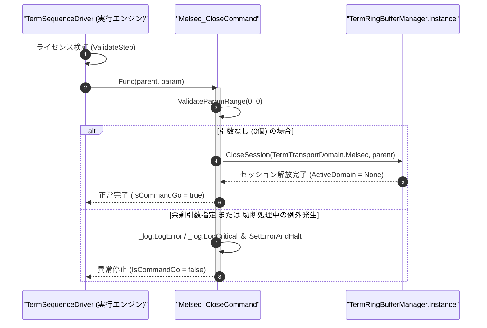

# コマンドリファレンス：Melsec_Close

## 概要

**Melsec_Close** は、現在オープンされている MELSEC 計算機リンク通信用の排他シリアルセッション（UART 回線）を `TermRingBufferManager.Instance.CloseSession` により安全に切断し、通信ハンドルを解放する通信制御系コマンドです。

> 💡 **補足**: シーケンス終了時や判定分岐後の終了処理では、必ず `Melsec_Close` を実行して COM ポートを解放してください。

---

## 💡 書式・パラメータ仕様

### コマンド構文

```csv
,SEQUENCE, [ステップキー], Melsec_Close
```

### パラメータ（引数）一覧

| 引数位置 | 引数名 | 必須/任意 | 説明・制約 |
| :--- | :--- | :---: | :--- |
| （引数なし） | - | - | 引数 0 個固定（`ValidateParamRange(0, 0)`）。現在接続中の MELSEC 通信用 COM ポートをクローズします。 |

---

## 🔄 特殊置換規約・分岐規約の適用

本コマンドの引数における特殊記法および解釈ルールです。
* **動的置換（`$`）**: 本コマンドは引数を取らないため、引数に対する `$PARAMキー$` 動的置換は適用されません。（適用可能な引数: 非適用）
* **ジャンプ先指定（`#`）**: 本コマンドはジャンプ制御を行わないため適用されません。（適用可能な引数: 非適用）
* **共通コマンド指定（`@`）**: 本コマンドは外部マクロを呼び出さないため、共通コマンド呼び出し記法は適用されません。（適用可能な引数: 非適用）
* **カンマのエスケープ**: 本コマンドは引数を取らないため適用されません。
* **エイリアス（別名）**: なし（標準コマンド名 `Melsec_Close` のみ。大文字・小文字は区別されません）

---

## 💡 動作例（正しい構文での記述例）

### スクリプト記述例

※COMMAND ブロック配下の子要素行（PARAM, SEQUENCE）は必ず行頭カンマから開始し、スペースインデントや行末コメント（`;`）は記述しないでください。

```csv
COMMAND, "SAMPLE_MELSEC_CLOSE", "ACK_STATUS"
,PARAM, "ACK_STATUS", Work, "書込応答結果", ""
,SEQUENCE, 010, Melsec_Mode, "9600,O,7,1", "NONE", "P1"
,SEQUENCE, 020, Melsec_Open
,SEQUENCE, 030, Melsec_P1s_S, "00FF", "WW", "0D0000011234"
,SEQUENCE, 040, Melsec_Res_P1s_R, "00", "ACK_STATUS"
; 応答が "ACK" か判定（不一致時は #NG_PROC# へ分岐）
,SEQUENCE, 050, Judge, "EQU", "$ACK_STATUS$", "ACK", "#NG_PROC#"
,SEQUENCE, 060, Melsec_Close
,SEQUENCE, 070, Exit, "$ACK_STATUS$", 0
; 条件不成立時のクローズ＆異常終了経路
,SEQUENCE, #NG_PROC#, Melsec_Close
,SEQUENCE, 090, Exit, "NG", -1
```

### 実行時の挙動・変数変化

* **実行前の状態**: Term 通信エンジンが初期化され、変数プール（`PARAM`）に `"ACK_STATUS"` が定義されている状態。
* **実行後の状態**: `Melsec_Res_P1s_R` でシーケンサからの肯定応答（`"ACK"`）を `"ACK_STATUS"` へ格納し、`Judge` 判定後に正常経路・異常経路のいずれでも `Melsec_Close` により排他シリアルセッションが安全に切断されます。

---

## 🔄 動作フロー（シーケンス図）



---

## 🚫 エラーハンドリング・安全設計（仕様制限）

1. **余剰引数の遮断および未接続時の安全な無視**:
   - 引数が 1 個以上指定された場合は `ValidateParamRange(0, 0)` によりエラー停止します。一方、未接続状態で引数なしの `Melsec_Close` を実行しても例外は発生せず、安全に次のステップへ進みます。
2. **切断例外時の保護と受信済みデータの保持**:
   - クローズ後も直前の受信コマンドで変数プールに格納されたデータは保持されます。万一ポート解放中に例外が発生した場合は、`catch` 節で `_log.LogCritical` に記録し `SetErrorAndHalt(-1, ex.Message)` で安全停止します。

---

## 🧪 ユニットテスト仕様

本コマンドクラス（`Melsec_CloseCommand.cs`）に実装されている `RunUnitTest()` メソッドが検証するユニットテストの仕様です。

### テスト実行前提条件

* **実行トリガー**: `RunUnitTest()` メソッドの呼び出し
* **有効化条件**: システム全体の最小ログレベル（`ErrorLogger.MinimumLevel`）が `LogLevel.Test` であること（それ以外の場合は無効化ガードにより早期リターン）
* **検証結果出力**: `_log.LogTest` によるログ出力。検証失敗時は `_log.LogError`、予期せぬ例外発生時は `_log.LogCritical` で記録し、`finally` ブロックで `UartTransportCore.Shared.IsSimulationMode` を開始前の状態へ復元します。

### テストケース一覧

| No | テストカテゴリ | テスト条件（入力値） | 期待される結果（出力値） | 検証の目的 / 観点 |
| :---: | :--- | :--- | :--- | :--- |
| **1** | 正常系 | `IsSimulationMode = true` 環境下で `OpenExclusiveSession(TermTransportDomain.Melsec, null, useSocket: false)` 確立後、引数なしで `Melsec_Close` を実行 | `!param.HasError` かつ `ActiveDomain == TermTransportDomain.None` となる | MELSEC 計算機リンク排他セッションの正常切断およびポート解放の検証 |
| **2** | 異常系 | 余剰引数 1 個（`"EXTRA_INVALID"`）を指定して `Func(null, invalidParam)` を実行 | `ValidateParamRange(0, 0)` により拒否され、`invalidParam.HasError == true` かつ `!invalidParam.IsCommandGo` となる | 引数なし制約の境界バリデーション検証 |
