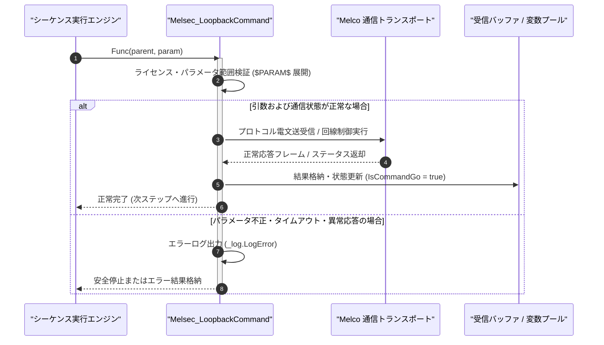

# コマンドリファレンス：Melsec_Loopback

## 概要

**Melsec_Loopback** は、三菱電機 MELSEC シーケンサ（計算機リンクユニット / 通信ポート）に対して折り返しテスト要求（`TT` コマンド）を実行し、通信回線および通信モジュールの送受信機能が正常に機能しているかを診断・検証する高水準通信コマンドです。

指定された任意のテスト文字列をシーケンサへ送信し、シーケンサから折り返し返信された文字列が一致するかを内部で自動検証します。一致結果は指定の変数またはセルへ格納されます。

> 💡 **補足**: 内部で使用される専用プロトコル形式（P1 / P2 / P3 / P4 / P5）および伝送待ち時間は、[Melsec_Mode](Melsec_Mode.Md) コマンドで設定された値（未指定時は P1 / 待ち時間 0ms）に自動追従します。

---

## 💡 書式・パラメータ仕様

### コマンド構文

```csv
,SEQUENCE, [ステップキー], Melsec_Loopback, [TestData], [ResultKey], "[StationNo: 00]"
```

### パラメータ（引数）一覧

| 引数位置 | 引数名 | 必須/任意 | 説明・制約 |
| :--- | :--- | :---: | :--- |
| 第 1 引数 | `TestData` | **必須** | 折り返しテスト（`TT` コマンド）で送信する `1`〜`254` 文字の英数字文字列（例: `"TEST1234"`）。 |
| 第 2 引数 | `ResultKey` | **必須** | シーケンサから折り返し返信された文字列を格納する変数キー名またはセル参照。 |
| 第 3 引数 | `StationNo` | 任意 | 送信先の局番 2 桁 16 進文字列（省略時既定値: `"00"`）。 |

---

## 🔄 特殊置換規約・分岐規約の適用

本コマンドの引数における特殊記法および解釈ルールです。
* **動的置換（`$`）**: 引数内で `$PARAMキー$` のように記述すると、実行時に変数プール（PARAM）の値へ動的置換されます。（適用可能な引数: 全引数対応）
* **ジャンプ先指定（`#`）**: 本コマンドはジャンプ制御を行わないため適用されません。（適用可能な引数: 非適用）
* **共通コマンド指定（`@`）**: 本コマンドは外部マクロを呼び出さないため、共通コマンド呼び出し記法は適用されません。（適用可能な引数: 非適用）
* **カンマのエスケープ**: 通信条件文字列（例: `"9600,E,7,1"`）や複数データのカンマ区切り値を単一引数として渡す場合は、必ず `"..."` と二重引用符で囲んで記述します。
* **エイリアス（別名）**: `Analysis_Melsec_Loopback`, `Sqn_Melsec_Loopback`

---

## 💡 動作例（正しい構文での記述例）

### スクリプト記述例

※COMMAND ブロック配下の子要素行（PARAM, SEQUENCE）は必ず行頭カンマから開始し、スペースインデントや行末コメント（`;`）は記述しないでください。

```csv
COMMAND, "MELSEC_LOOPBACK_DEMO", "ECHO_BACK"
,PARAM, "ECHO_BACK", Work, "折り返し結果", ""
,SEQUENCE, 010, Melsec_Mode, "9600,E,7,1", "NONE", "P1"
,SEQUENCE, 020, Melsec_Open
; テスト文字列 "TEST1234" で折り返し診断を実行し ECHO_BACK へ格納
,SEQUENCE, 030, Melsec_Loopback, "TEST1234", "ECHO_BACK", "00"
,SEQUENCE, 040, Melsec_Close
,SEQUENCE, 050, Exit
```

### 実行時の挙動・変数変化

* **実行前の状態**: MELSEC 計算機リンク回線がオープン済みで、`"ECHO_BACK"` が空文字列 `""` の状態。
* **実行後の状態**: ステップ `030` で折り返しテスト電文（`TT` コマンド）が送受信され、返却文字列 `"TEST1234"` の一致検証後に `"ECHO_BACK"` へ格納されます。

---

## 🔄 動作フロー（シーケンス図）



---

## 🚫 エラーハンドリング・安全設計（仕様制限）

入力データの異常や実行時エラーに対し、解析・実行エンジンが実行するセーフティ規約です。

1. **引数範囲・プロトコル書式バリデーション保護**:
   - 必須引数の欠落、デバイス表記・数値範囲の不正、または余剰引数が指定された場合は `_log.LogError` に詳細を記録し、`SetErrorAndHalt` により異常電文の送出を未然に遮断します。
2. **通信タイムアウト・異常応答・排他ドメイン保護**:
   - 相手機器の無応答タイムアウト、NAK／異常終了コード応答、または他通信ドメインとの排他競合が発生した場合は、例外クラッシュを起こさず安全にエラーハンドリングを行います。

---

## 🧪 ユニットテスト仕様

本コマンドクラス（`Melsec_LoopbackCommand.cs`）に実装されている `RunUnitTest()` メソッドが検証するユニットテストの仕様です。

### テスト実行前提条件

* **実行トリガー**: `RunUnitTest()` メソッドの呼び出し
* **有効化条件**: システム全体の最小ログレベル（`ErrorLogger.MinimumLevel`）が `LogLevel.Test` であること（それ以外の場合は無効化ガードにより早期リターン）
* **検証結果出力**: `_log.LogTest` によるログ出力。検証失敗時は `_log.LogError`、予期せぬ例外発生時は `_log.LogCritical` で記録し、`finally` ブロックで `Melsec_ModeCommand.DefaultProtocolType` および `UartTransportCore.Shared.IsSimulationMode` を開始前の状態へ復元します。

### テストケース一覧

| No | テストカテゴリ | テスト条件（入力値） | 期待される結果（出力値） | 検証の目的 / 観点 |
| :---: | :--- | :--- | :--- | :--- |
| **1** | 正常系 | `IsSimulationMode = true`・`DefaultProtocolType = "P1"` 環境下で引数 `"TEST1234"`, `"ECHO_RESULT"`, `"00"` および擬似応答（`STX + "00FFTEST1234" + ETX + SUM`）を与えて実行 | `!param.HasError` かつ `param.IsCommandGo == true`、格納先 `SBuf["ECHO_RESULT"]` が `"TEST1234"` と一致する | 折り返しテスト（`TT` コマンド）要求構築およびエコーバック文字列一致判定の検証 |
| **2** | 異常系 | `TestData` 空文字・`254` 文字超過、NAK／無応答（`"ERROR_RESPONSE"`）、またはエコーデータ不一致 | `_log.LogError` 出力および `SetErrorAndHalt` により不一致・通信異常を検出して安全に停止する | テスト文字数境界・無応答およびエコーバック不一致時のフェイルセーフ検証 |
