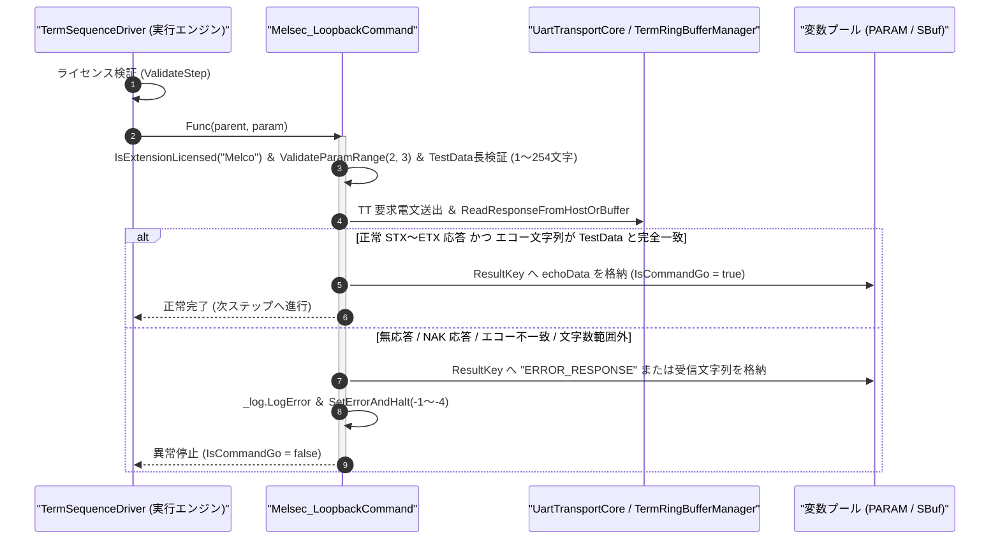

# コマンドリファレンス：Melsec_Loopback

## 概要

**Melsec_Loopback** は、三菱電機 MELSEC シーケンサ（計算機リンクユニット / 通信ポート）に対して折り返しテスト要求（`TT` コマンド）を実行し、通信回線および通信モジュールの送受信機能が正常に機能しているかを診断・検証する高水準通信制御系コマンドです。
指定されたテスト文字列を送信し、シーケンサから折り返し返信された文字列と完全一致するかをコマンド内部で自動照合した上で、エコー文字列を指定変数へ格納します。

> 💡 **補足**: 本コマンドの送信フレーム構築は **ASCII コード通信方式である形式 1 〜 形式 4（`P1` / `P2` / `P3` / `P4`）専用** であり、[Melsec_Mode](Melsec_Mode.Md) コマンドの設定値（未指定時は `P1` / 伝送待ち時間 `0`）に自動追従します。 **バイナリコード通信方式の形式 5（`P5`）には非対応** であるため、形式 5 を使用する場合は [`Melsec_P5s_S`](Melsec_P5s_S.Md) / [`Melsec_Res_P5s_R`](Melsec_Res_P5s_R.Md) を使用してください。

---

## 💡 書式・パラメータ仕様

### コマンド構文

```csv
,SEQUENCE, [ステップキー], Melsec_Loopback, [TestData], [ResultKey], "[StationNo: 00]"
```

### パラメータ（引数）一覧

| 引数位置 | 引数名 | 必須/任意 | 説明・制約 |
| :--- | :--- | :---: | :--- |
| 第 1 引数 | `TestData` | **必須** | 折り返しテスト（`TT` コマンド）で送信する `1`〜`254` 文字の英数字文字列（例: `"TEST1234"`。空文字または `255` 文字以上はエラー停止）。 |
| 第 2 引数 | `ResultKey` | **必須** | シーケンサから折り返し返信された文字列を格納するパラメータキー名（`"@"` や `"$"` を付けない素のキー名、例: `"ECHO_BACK"`）。 |
| 第 3 引数 | `StationNo` | 任意 | 送信先の局番 2 桁 16 進文字列（省略時既定値: `"00"`、自局 PC 番号 `"FF"` は自動付与）。 |

---

## 🔄 特殊置換規約・分岐規約の適用

本コマンドの引数における特殊記法および解釈ルールです。
* **動的置換（`$`）**: 引数内で `$PARAMキー$` のように記述すると、実行時に変数プール（PARAM）の値へ動的置換されます。（適用可能な引数: 全引数対応）
* **ジャンプ先指定（`#`）**: 本コマンドはジャンプ制御を行わないため適用されません。（適用可能な引数: 非適用）
* **共通コマンド指定（`@`）**: 本コマンドは外部マクロを呼び出さないため、共通コマンド呼び出し記法は適用されません。（適用可能な引数: 非適用）
* **カンマのエスケープ**: 引数自体にカンマを含める場合は、必ず `"..."` と二重引用符で囲んで記述します。
* **エイリアス（別名）**: `Analysis_Melsec_Loopback`, `Sqn_Melsec_Loopback`

---

## 💡 動作例（正しい構文での記述例）

### スクリプト記述例

※COMMAND ブロック配下の子要素行（PARAM, SEQUENCE）は必ず行頭カンマから開始し、スペースインデントや行末コメント（`;`）は記述しないでください。

```csv
COMMAND, "MELSEC_LOOPBACK_DEMO", "ECHO_BACK"
,PARAM, "ECHO_BACK", Work, "折り返し結果", ""
,SEQUENCE, 010, Melsec_Mode, "9600,E,7,1", "NONE", "P1"
,SEQUENCE, 020, Melsec_Open
; テスト文字列 "TEST1234" で折り返し診断を実行（内部で一致検証を実施し、一致時のみ次ステップへ進行）
,SEQUENCE, 030, Melsec_Loopback, "TEST1234", "ECHO_BACK", "00"
,SEQUENCE, 040, Melsec_Close
,SEQUENCE, 050, Exit, "$ECHO_BACK$", 0
```

### 実行時の挙動・変数変化

* **実行前の状態**: MELSEC 計算機リンク回線がオープン済みで、`"ECHO_BACK"` が空文字列 `""` の状態。
* **実行後の状態**: ステップ `030` で折り返しテスト電文（`TT` コマンド）が送受信され、返信文字列 `"TEST1234"` が `"ECHO_BACK"` へ格納されます。送信データと完全一致した場合は `param.IsCommandGo = true` でステップ `040` の `Melsec_Close` へ進み、不一致または無応答時はステップ `030` で `SetErrorAndHalt` により即座にエラー停止します。

---

## 🔄 動作フロー（シーケンス図）



---

## 🚫 エラーハンドリング・安全設計（仕様制限）

入力データの異常や実行時エラーに対し、解析・実行エンジンが実行するセーフティ規約です。

1. **引数範囲およびテスト文字列長の検証**:
   - 引数個数不正（`ValidateParamRange(2, 3)` 違反）、`TestData` が空文字（エラーコード `-1`）、または `254` 文字超過（エラーコード `-2`）の場合は、`_log.LogError` に記録し `SetErrorAndHalt` で送信前に遮断します。
2. **無応答・NAK・エコーバック不一致時の即時停止**:
   - タイムアウトや `NAK` 受信時は `ResultKey` に `"ERROR_RESPONSE"` を格納してエラーコード `-3` で停止し、折り返し文字列が `TestData` と一致しない場合はエラーコード `-4` で即座に停止します。

---

## 🧪 ユニットテスト仕様

本コマンドクラス（`Melsec_LoopbackCommand.cs`）に実装されている `RunUnitTest()` メソッドが検証するユニットテストの仕様です。

### テスト実行前提条件

* **実行トリガー**: `RunUnitTest()` メソッドの呼び出し
* **有効化条件**: システム全体の最小ログレベル（`ErrorLogger.MinimumLevel`）が `LogLevel.Test` であること（それ以外の場合は無効化ガードにより早期リターン）
* **検証結果出力**: `_log.LogTest` によるログ出力。検証失敗時は `_log.LogError`、予期せぬ例外発生時は `_log.LogCritical` で記録し、`finally` ブロックで `Melsec_ModeCommand.DefaultProtocolType` および `UartTransportCore.Shared.IsSimulationMode` を開始前の状態へ復元します。

### テストケース一覧

| No | テストカテゴリ | テスト条件（入力値） | 期待される結果（出力値） | 検証の目的 / 観点 |
| :---: | :--- | :--- | :--- | :--- |
| **1** | 正常系 | `IsSimulationMode = true`・`DefaultProtocolType = "P1"` 環境下で引数 `"TEST1234"`, `"ECHO_RESULT"`, `"00"` および擬似応答（`STX + "00FFTEST1234" + ETX + SUM`）を与えて実行 | `!param.HasError` かつ `param.IsCommandGo == true`、格納先 `SBuf["ECHO_RESULT"]` が `"TEST1234"` と一致する | 折り返しテスト（`TT` コマンド）要求構築およびエコーバック文字列一致判定の検証 |
| **2** | 異常系 | 第 1 引数 `TestData` に空文字 `""`、第 2 引数に `"ECHO_RESULT"` を指定して `Func(null, invalidParam)` を実行 | 空文字チェックにより `SetErrorAndHalt(-1, ...)` が呼ばれ、`invalidParam.HasError == true` かつ `!invalidParam.IsCommandGo` となる | 空テストデータ入力時のバリデーション拒否および安全停止の検証 |
