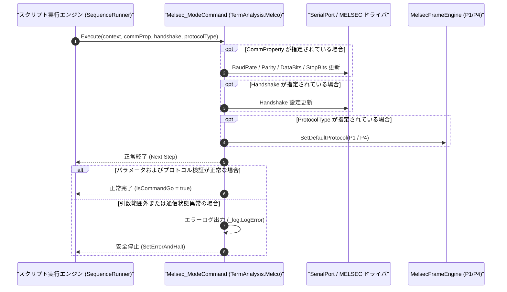

# コマンドリファレンス：Melsec_Mode

## 概要

**Melsec_Mode** は、三菱電機 MELSEC 計算機リンク通信における UART 通信条件（ボーレート・パリティ・データビット・ストップビット）、フロー制御（ハンドシェイク）、および専用プロトコル形式（`P1`〜`P5`：形式 1 〜 形式 5）を設定するコマンドです。

> 💡 **補足**: MELSEC 計算機リンクユニットのスイッチ・パラメータ設定（例: 9600bps / 57600bps、奇数パリティ、7bit/8bit、プロトコル形式 1 〜 形式 5）に合わせて通信条件および送受信データモード（ASCII / バイナリ透過）を一括設定します。他ドメインの `Com_Mode` を併用する必要はなく、MELSEC ドメイン単独で完結します。

---

## 💡 書式・パラメータ仕様

### コマンド構文

```csv
,SEQUENCE, [ステップキー], Melsec_Mode, "[CommProperty]", "[Handshake]", "[ProtocolType: P1〜P5]"
```

### パラメータ（引数）一覧

| 引数位置 | パラメータ名 | 必須/任意 | 型・制約 | 説明 |
| :---: | :--- | :---: | :--- | :--- |
| 第1引数 | `CommProperty` | 任意 | `"Baud,Parity,DataBits,StopBits"`（例: `"57600,O,8,1"`, `"9600,O,7,1"`） | UART 通信条件をカンマ区切り文字列で指定します。空文字 `""` または省略時は現在値を維持します。 |
| 第2引数 | `Handshake` | 任意 | `NONE` / `RTSCTS` / `XONXOFF` | フロー制御方式を指定します。空文字または省略時は現在値を維持します。 |
| 第3引数 | `ProtocolType` | 任意 | `P1` / `P2` / `P3` / `P4` / `P5`（既定値: `P1`） | 計算機リンク専用プロトコルの形式を指定します（`P1`: 形式1、`P2`: 形式2、`P3`: 形式3［`CR+LF` 終端］、`P4`: 形式4［サムチェック＋`CR+LF` 終端］、`P5`: 形式5［バイナリコード通信方式・`BIN` 透過受信自動適用］）。 |

---

## 🔄 特殊置換規約・分岐規約の適用

本コマンドの引数における特殊記法および解釈ルールです。
* **動的置換（`$`）**: 引数内で `$PARAMキー$` のように記述すると、実行時に変数プール（PARAM）の値へ動的置換されます。（適用可能な引数: 全引数対応）
* **ジャンプ先指定（`#`）**: 本コマンドはジャンプ制御を行わないため適用されません。（適用可能な引数: 非適用）
* **共通コマンド指定（`@`）**: 本コマンドは外部マクロを呼び出さないため、共通コマンド呼び出し記法は適用されません。（適用可能な引数: 非適用）
* **カンマのエスケープ**: 通信条件文字列（例: `"9600,E,7,1"`）や複数データのカンマ区切り値を単一引数として渡す場合は、必ず `"..."` と二重引用符で囲んで記述します。
* **エイリアス（別名）**: なし（標準コマンド名 `Melsec_Mode` のみ。大文字・小文字は区別されません）

---

## 💡 動作例（正しい構文での記述例）

### スクリプト記述例

※COMMAND ブロック配下の子要素行（PARAM, SEQUENCE）は必ず行頭カンマから開始し、スペースインデントや行末コメント（`;`）は記述しないでください。

```csv
COMMAND, "SAMPLE_MELSEC_MODE", ""
; 1. 計算機リンク標準設定（9600bps, 奇数パリティ, 7bit, Stop 1, フロー制御なし, プロトコル形式4）
,SEQUENCE, 010, Melsec_Mode, "9600,O,7,1", "NONE", "P4"
,SEQUENCE, 020, Melsec_Open
; 2. 通信中にプロトコル形式のみを P1（形式1）へ切り替え
,SEQUENCE, 030, Melsec_Mode, "", "", "P1"
,SEQUENCE, 040, Melsec_Close
,SEQUENCE, 050, Exit
```

### 実行時の挙動・変数変化

* **実行前の状態**: Term 通信エンジンが初期化され、必要な通信パラメータおよび変数プール（`PARAM`）が準備されている状態。
* **実行後の状態**: 1 回目の `Melsec_Mode` で `9600,O,7,1`、ハンドシェイク `NONE`、プロトコル形式 `P4` が設定されます。 2 回目の `Melsec_Mode` では UART 設定を維持したまま、デフォルトプロトコル形式のみが `P1` に切り替わります。

---

## 🔄 動作フロー（シーケンス図）



---

## 🚫 エラーハンドリング・安全設計（仕様制限）

1. **不正な通信パラメータおよびプロトコル形式の検証**:
   - `CommProperty` の書式不正や、引数個数範囲外（`ValidateParamRange(1, 3)` 違反）が指定された場合はエラーログを出力して誤設定を防止します。
2. **オープン中の動的反映**:
   - ポートオープン中に `Melsec_Mode` が実行された場合、OS シリアルドライバへリアルタイムに設定変更を適用します。

---

## 🧪 ユニットテスト仕様

本コマンドクラス（`Melsec_ModeCommand.cs`）に実装されている `RunUnitTest()` メソッドが検証するユニットテストの仕様です。

### テスト実行前提条件

* **実行トリガー**: `RunUnitTest()` メソッドの呼び出し
* **有効化条件**: システム全体の最小ログレベル（`ErrorLogger.MinimumLevel`）が `LogLevel.Test` であること（それ以外の場合は無効化ガードにより早期リターン）
* **検証結果出力**: `_log.LogTest` によるログ出力。検証失敗時は `_log.LogError`、予期せぬ例外発生時は `_log.LogCritical` で記録し、`finally` ブロックで `DefaultProtocolType = "P1"`、`TxDelimiter = "TXCR"`、`DataMode = "ASCII"`、`"9600,N,8,1"` へ初期状態を復元します。

### テストケース一覧

| No | テストカテゴリ | テスト条件（入力値） | 期待される結果（出力値） | 検証の目的 / 観点 |
| :---: | :--- | :--- | :--- | :--- |
| **1** | 正常系 | 引数 `"9600,E,7,1"`, `"None"`, `"P4"` の 3 引数を一括指定して実行 | `!param.HasError` かつ `BaudRate == 9600`、`DataBits == 7`、`DefaultProtocolType == "P4"` となる | UART 通信条件・フロー制御・プロトコル形式 `P4` の一括設定検証 |
| **2** | 正常系 | `ApplyToken` でプロトコル形式 `"P2"`, `"P3"`, `"P5"` を順次指定 | `"P2"` で `DataMode == ASCII`、`"P3"` で `TxDelimiter == TXCRLF`、`"P5"` で `DataMode == BIN` へ自動連動する | 形式 2／3／5 切替時のデリミタおよびバイナリ透過受信連動の検証 |
| **3** | 異常系 | 引数なしまたは 4 個以上の指定（`ValidateParamRange(1, 3)` 違反）、および設定反映中の例外発生 | 引数範囲外エラー出力による早期リターン、または `_log.LogCritical` 記録と `SetErrorAndHalt(-1, ex.Message)` による安全停止 | 引数個数境界ガードおよびモード変更例外時のクラッシュ防御検証 |
