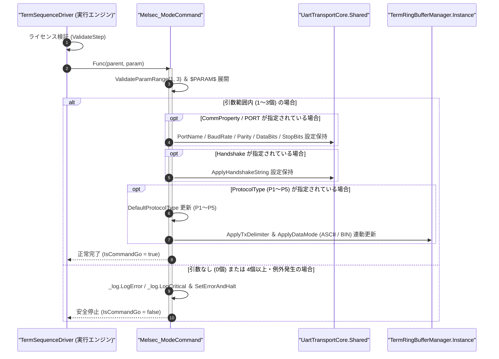

# コマンドリファレンス：Melsec_Mode

## 概要

**Melsec_Mode** は、三菱電機 MELSEC 計算機リンク通信における UART 通信条件（ボーレート・パリティ・データビット・ストップビット）、フロー制御（ハンドシェイク）、および専用プロトコル形式（`P1`〜`P5`：形式 1 〜 形式 5）を設定する通信設定系コマンドです。

> 💡 **補足**: MELSEC 計算機リンクユニットのスイッチ・パラメータ設定（例: 9600bps / 57600bps、奇数パリティ、7bit/8bit、プロトコル形式 1 〜 形式 5）に合わせて通信条件および送受信データモード（ASCII / バイナリ透過）を一括設定します。他ドメインの `Com_Mode` を併用する必要はなく、MELSEC ドメイン単独で完結します。

---

## 💡 書式・パラメータ仕様

### コマンド構文

```csv
,SEQUENCE, [ステップキー], Melsec_Mode, [CommPropertyOrSettingType], "[HandshakeOrValue]", "[ProtocolType: P1]"
```

※ **最低 1 引数の指定が必須** です（`ParameterSpec` 第 1 引数必須、かつ `ValidateParamRange(1, 3)` により引数 0 個または 4 個以上はエラー停止）。標準 1〜3 引数構文のほか、2 引数のキー・バリュー構文（例: `Melsec_Mode, "PROTOCOL", "P4"` や `Melsec_Mode, "PORT", "COM3"`）にも対応しています。

### パラメータ（引数）一覧

| 引数位置 | 引数名 | 必須/任意 | 説明・制約 |
| :--- | :--- | :---: | :--- |
| 第 1 引数 | `CommPropertyOrSettingType` | **必須** | UART 通信条件文字列（`"Baud,Parity,DataBits,StopBits"`、例: `"57600,O,8,1"`, `"9600,O,7,1"`）、プロトコル名（`"P1"`〜`"P5"`）、または設定キー名（`"PORT"`, `"PROPERTY"`, `"COMMPROPERTY"`, `"HANDSHAKE"`, `"PROTOCOL"`, `"PROTOCOLTYPE"`）。第 2・第 3 引数のみを変更したい場合は空文字 `""` を指定します。 |
| 第 2 引数 | `HandshakeOrValue` | 任意 | フロー制御方式（`"NONE"` / `"RTSCTS"` / `"XONXOFF"` 等、キー・バリュー構文時は設定値）。省略または空文字 `""` 指定時は現在値を維持します。 |
| 第 3 引数 | `ProtocolType` | 任意 | 計算機リンク専用プロトコルの形式（`"P1"`: 形式 1、`"P2"`: 形式 2、`"P3"`: 形式 3［`CR+LF` 終端］、`"P4"`: 形式 4［サムチェック＋`CR+LF` 終端］、`"P5"`: 形式 5［バイナリコード通信方式・`BIN` 透過受信自動適用］、省略時既定値: `"P1"`）。 |

---

## 🔄 特殊置換規約・分岐規約の適用

本コマンドの引数における特殊記法および解釈ルールです。
* **動的置換（`$`）**: 引数内で `$PARAMキー$` のように記述すると、実行時に変数プール（PARAM）の値へ動的置換されます。（適用可能な引数: 全引数対応）
* **ジャンプ先指定（`#`）**: 本コマンドはジャンプ制御を行わないため適用されません。（適用可能な引数: 非適用）
* **共通コマンド指定（`@`）**: 本コマンドは外部マクロを呼び出さないため、共通コマンド呼び出し記法は適用されません。（適用可能な引数: 非適用）
* **カンマのエスケープ**: 通信条件文字列（例: `"9600,O,7,1"`）を単一引数として渡す場合は、必ず `"..."` と二重引用符で囲んで記述します。
* **エイリアス（別名）**: なし（標準コマンド名 `Melsec_Mode` のみ。大文字・小文字は区別されません）

---

## 💡 動作例（正しい構文での記述例）

### スクリプト記述例

※COMMAND ブロック配下の子要素行（PARAM, SEQUENCE）は必ず行頭カンマから開始し、スペースインデントや行末コメント（`;`）は記述しないでください。

```csv
COMMAND, "SAMPLE_MELSEC_MODE", ""
; 1. 計算機リンク標準設定（9600bps, 奇数パリティ, 7bit, Stop 1, フロー制御なし, プロトコル形式4）
,SEQUENCE, 010, Melsec_Mode, "9600,O,7,1", "NONE", "P4"
,SEQUENCE, 020, Melsec_Open
; 2. 通信中にプロトコル形式のみを P1（形式1）へ切り替え
,SEQUENCE, 030, Melsec_Mode, "", "", "P1"
,SEQUENCE, 040, Melsec_Close
,SEQUENCE, 050, Exit
```

### 実行時の挙動・変数変化

* **実行前の状態**: Term 通信エンジンが初期化され、必要な通信パラメータが準備されている状態。
* **実行後の状態**: 1 回目の `Melsec_Mode`（`Melsec_Open` の前）で `UartTransportCore.Shared` に `9600,O,7,1`、ハンドシェイク `NONE`、プロトコル形式 `P4` が設定され、続く `Melsec_Open` で OS シリアルドライバへ適用されます。2 回目の `Melsec_Mode` では UART 設定値を維持したまま、既定プロトコル形式（`DefaultProtocolType`）およびデリミタ設定のみが `P1` に切り替わります。

---

## 🔄 動作フロー（シーケンス図）



---

## 🚫 エラーハンドリング・安全設計（仕様制限）

1. **必須引数個数および設定例外の保護**:
   - 引数が 0 個または 4 個以上指定された場合（`ValidateParamRange(1, 3)` 違反）は `_log.LogError` に記録して停止し、設定適用中に予期せぬ例外が発生した場合は `_log.LogCritical` と `SetErrorAndHalt(-1, ex.Message)` により安全に停止します。
2. **物理 UART 条件の反映タイミング（次回 `Melsec_Open` 時反映）**:
   - ボーレート・パリティ・データビット・ストップビット・フロー制御などの物理シリアル通信条件は `UartTransportCore.Shared` 上の設定プロパティを更新します。すでにポートをオープン中の状態で実行した場合、次回 [`Melsec_Open`](Melsec_Open.Md) を実行（再オープン）した時点で物理ポートへ反映されます（なお、`ProtocolType` による `DefaultProtocolType` および `TermRingBufferManager` のデリミタ・`ASCII`/`BIN` モード切替は即時反映されます）。

---

## 🧪 ユニットテスト仕様

本コマンドクラス（`Melsec_ModeCommand.cs`）に実装されている `RunUnitTest()` メソッドが検証するユニットテストの仕様です。

### テスト実行前提条件

* **実行トリガー**: `RunUnitTest()` メソッドの呼び出し
* **有効化条件**: システム全体の最小ログレベル（`ErrorLogger.MinimumLevel`）が `LogLevel.Test` であること（それ以外の場合は無効化ガードにより早期リターン）
* **検証結果出力**: `_log.LogTest` によるログ出力。検証失敗時は `_log.LogError`、予期せぬ例外発生時は `_log.LogCritical` で記録し、`finally` ブロックで `DefaultProtocolType = "P1"`、`TxDelimiter = "TXCR"`、`DataMode = "ASCII"`、`"9600,N,8,1"` へ初期状態を復元します。

### テストケース一覧

| No | テストカテゴリ | テスト条件（入力値） | 期待される結果（出力値） | 検証の目的 / 観点 |
| :---: | :--- | :--- | :--- | :--- |
| **1** | 正常系 | 引数 `"9600,E,7,1"`, `"None"`, `"P4"` の 3 引数を一括指定して実行 | `!param.HasError` かつ `BaudRate == 9600`、`DataBits == 7`、`DefaultProtocolType == "P4"` となる | UART 通信条件・フロー制御・プロトコル形式 `P4` の一括設定検証 |
| **2** | 正常系 | `ApplyToken(null, ..., 3)` でプロトコル形式 `"P2"`, `"P3"`, `"P5"` を順次指定 | `"P2"` で `DataMode == ASCII`、`"P3"` で `TxDelimiter == TXCRLF`、`"P5"` で `DataMode == BIN` へ自動連動する | 形式 2／3／5 切替時のデリミタおよびバイナリ透過受信連動の検証 |
| **3** | 異常系 | 引数 0 個（`new TermSequence { Name = "Melsec_Mode" }`）で `Func(null, invalidParam)` を実行 | `ValidateParamRange(1, 3)` により拒否され、`invalidParam.HasError == true` かつ `!invalidParam.IsCommandGo` となる | 必須第 1 引数欠落時のバリデーション拒否検証 |
