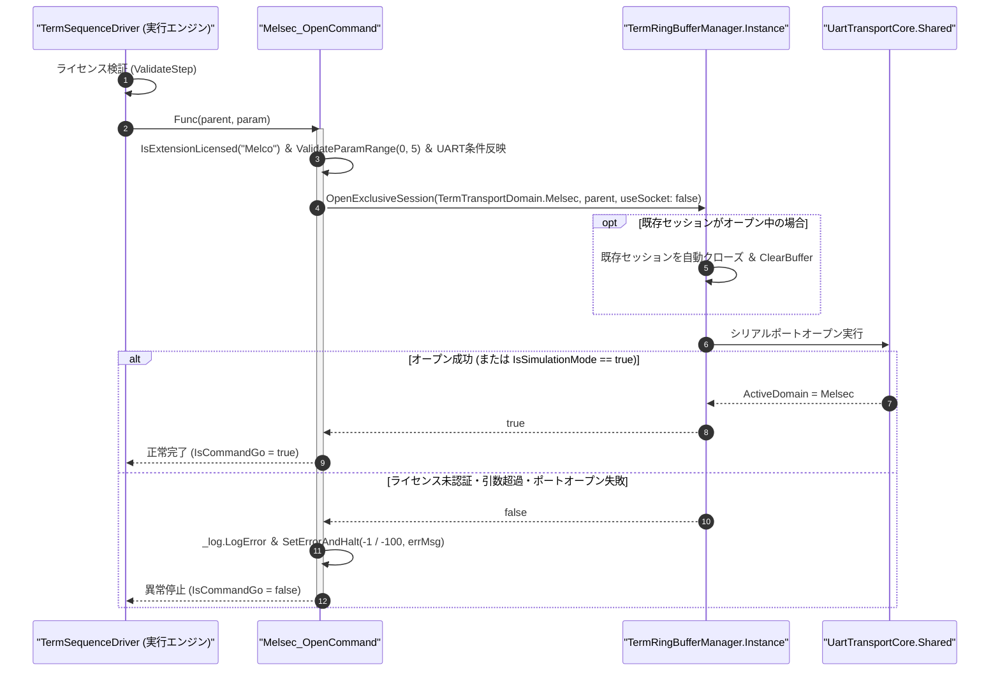

# コマンドリファレンス：Melsec_Open

## 概要

**Melsec_Open** は、三菱電機 MELSEC シーケンサ計算機リンク（専用プロトコル形式 1 〜 形式 5）用のシリアルポート（UART 回線）をオープンする通信制御系コマンドです。引数を省略した場合はプロパティ設定画面（UI 環境設定）および `Melsec_Mode` の設定値を自動採用し、引数を指定した場合は個別通信条件（`PortName`〜`StopBits`）でオーバーライド可能です。
実行時に Term 通信制御の排他選択モードを **MELSEC モード** （`TermTransportDomain.Melsec`）へ確定させます。

> 💡 **補足**: 物理 COM ポートに加え、仮想シリアル中継ツール **[c2c](https://github.com/Monaca-App/c2c)** が公開中の仮想 COM ポート（例: `COM10` ⇔ `COM11`）も透過的にオープン可能です。

---

## 💡 書式・パラメータ仕様

### コマンド構文

```csv
,SEQUENCE, [ステップキー], Melsec_Open, "[PortName]", "[BaudRate: 9600]", "[Parity: Even]", "[DataBits: 7]", "[StopBits: 1]"
```

※ 全引数を省略した場合は、`UartTransportCore.Shared`（UI プロパティ画面または `Melsec_Mode` で設定された通信条件）で計算機リンク用 COM ポートをオープンします。

### パラメータ（引数）一覧

| 引数位置 | 引数名 | 必須/任意 | 説明・制約 |
| :--- | :--- | :---: | :--- |
| 第 1 引数 | `PortName` | 任意 | オープンする COM ポート名（例: `"COM3"`、省略または空文字 `""` 指定時は現在設定されているポート名を使用）。 |
| 第 2 引数 | `BaudRate` | 任意 | 通信ボーレート［bps］（`300` 以上の整数、省略時既定値: `9600`。`Func` 直接実行時に `300` 未満や非数値が渡された場合は直前値を維持）。 |
| 第 3 引数 | `Parity` | 任意 | パリティ種別（`"N"`/`"NONE"` は None、`"O"`/`"ODD"` は Odd、それ以外［既定 `"Even"`］は Even として適用）。 |
| 第 4 引数 | `DataBits` | 任意 | データビット長（`5`〜`8` の整数、省略時既定値: `7`。計算機リンク ASCII 形式では `7` または `8`、バイナリ形式 5 では `8` を使用）。 |
| 第 5 引数 | `StopBits` | 任意 | ストップビット長（`"2"` 指定時は `StopBits.Two`、それ以外［既定 `"1"`］は `StopBits.One` として適用）。 |

---

## 🔄 特殊置換規約・分岐規約の適用

本コマンドの引数における特殊記法および解釈ルールです。
* **動的置換（`$`）**: 引数内で `$PARAMキー$` のように記述すると、実行時に変数プール（PARAM）の値へ動的置換されます。（適用可能な引数: 全引数対応）
* **ジャンプ先指定（`#`）**: 本コマンドはジャンプ制御を行わないため適用されません。（適用可能な引数: 非適用）
* **共通コマンド指定（`@`）**: 本コマンドは外部マクロを呼び出さないため、共通コマンド呼び出し記法は適用されません。（適用可能な引数: 非適用）
* **カンマのエスケープ**: 引数自体にカンマを含める場合は、必ず `"..."` と二重引用符で囲んで記述します。
* **エイリアス（別名）**: なし（標準コマンド名 `Melsec_Open` のみ。大文字・小文字は区別されません）

---

## 💡 動作例（正しい構文での記述例）

### スクリプト記述例

※COMMAND ブロック配下の子要素行（PARAM, SEQUENCE）は必ず行頭カンマから開始し、スペースインデントや行末コメント（`;`）は記述しないでください。

```csv
COMMAND, "SAMPLE_MELSEC_OPEN", "D100_VAL"
,PARAM, "D100_VAL", Work, "D100読出結果", ""
; 1. MELSEC計算機リンク形式4（9600bps, Odd, 7bit, Stop 1）を設定して回線オープン
,SEQUENCE, 010, Melsec_Mode, "9600,O,7,1", "NONE", "P4"
,SEQUENCE, 020, Melsec_Open
; 2. 局番00・PC番号FFのD0100から1点読出要求(WR)を送信し、応答を D100_VAL へ格納
,SEQUENCE, 030, Melsec_P4s_S, "00FF", "WR", "0D010001"
,SEQUENCE, 040, Melsec_Res_P4s_R, "00", "D100_VAL"
; 3. 読出値が 0x0064 (100) 以上か判定（未満時は #NG_PROC# へ分岐）
,SEQUENCE, 050, Judge, "GE", "$D100_VAL$", "0x0064", "#NG_PROC#"
,SEQUENCE, 060, Melsec_Close
,SEQUENCE, 070, Exit, "$D100_VAL$", 0
; 条件不成立時のクローズ＆異常終了経路
,SEQUENCE, #NG_PROC#, Melsec_Close
,SEQUENCE, 090, Exit, "NG", -1
```

### 実行時の挙動・変数変化

* **実行前の状態**: Term 通信エンジンが初期化され、変数プール（`PARAM`）に `"D100_VAL"` が定義されている状態。
* **実行後の状態**: `Melsec_Mode` により `9600,O,7,1` およびプロトコル形式 `P4` が設定され、`Melsec_Open` により `TermRingBufferManager.OpenExclusiveSession` を介して COM ポートが開かれます。読出結果（例: `"0x1234"`）が `"D100_VAL"` に格納され、`Judge` 判定後にポートをクローズします。

---

## 🔄 動作フロー（シーケンス図）



---

## 🚫 エラーハンドリング・安全設計（仕様制限）

1. **他通信ドメインおよび既存セッションの自動クローズ排他切替**:
   - すでに他ドメインまたは同一 MELSEC ドメインがオープン中の状態で実行した場合、`TermRingBufferManager.OpenExclusiveSession` により既存セッションを自動的に安全クローズし、受信バッファを初期化した上で MELSEC セッションへ排他切り替えします。
2. **ライセンス未認証・ポートオープン失敗・引数超過時の安全停止**:
   - `Melco` ライセンス未認証時（`-100`）、引数が 6 個以上指定された場合（`ValidateParamRange(0, 5)` 違反）、または対象 COM ポート不在・占有によりオープン失敗した場合は、`_log.LogError` に記録し `SetErrorAndHalt` によりシーケンスを安全に停止します。

---

## 🧪 ユニットテスト仕様

本コマンドクラス（`Melsec_OpenCommand.cs`）に実装されている `RunUnitTest()` メソッドが検証するユニットテストの仕様です。

### テスト実行前提条件

* **実行トリガー**: `RunUnitTest()` メソッドの呼び出し
* **有効化条件**: システム全体の最小ログレベル（`ErrorLogger.MinimumLevel`）が `LogLevel.Test` であること（それ以外の場合は無効化ガードにより早期リターン）
* **検証結果出力**: `_log.LogTest` によるログ出力。検証失敗時は `_log.LogError`、予期せぬ例外発生時は `_log.LogCritical` で記録し、`finally` ブロックで `TermRingBufferManager.Instance.CloseSession(TermTransportDomain.Melsec, null)` および `UartTransportCore.Shared.IsSimulationMode` の復元を実行します。

### テストケース一覧

| No | テストカテゴリ | テスト条件（入力値） | 期待される結果（出力値） | 検証の目的 / 観点 |
| :---: | :--- | :--- | :--- | :--- |
| **1** | 正常系 | `UartTransportCore.Shared.IsSimulationMode = true` 環境下で引数 `"COM2"`, `"9600"`, `"Even"`, `"7"`, `"1"` を指定して実行 | `!param.HasError` かつ `ActiveDomain == TermTransportDomain.Melsec`、`PortName == "COM2"`、`Parity == Parity.Even`、`DataBits == 7` となる | 個別通信条件指定および MELSEC 排他シリアルセッション確立の検証 |
| **2** | 異常系 | 余剰引数 6 個（`"1"`〜`"6"`）を指定して `Func(null, invalidParam)` を実行 | `ValidateParamRange(0, 5)` により拒否され、`invalidParam.HasError == true` かつ `!invalidParam.IsCommandGo` となる | 引数上限超過時のバリデーション拒否検証 |
