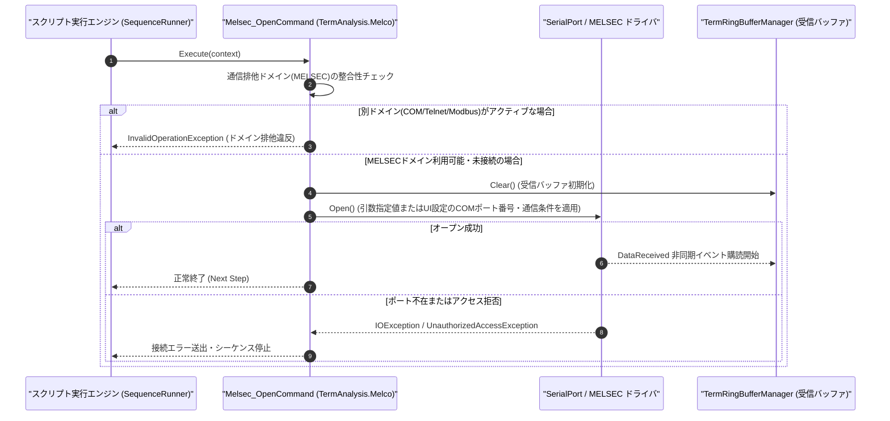

# コマンドリファレンス：Melsec_Open

## 概要

**Melsec_Open** は、三菱電機 MELSEC シーケンサ計算機リンク（専用プロトコル形式 1 〜 形式 5）用のシリアルポート（UART 回線）をオープンする通信制御系コマンドです。引数を省略した場合はプロパティ設定画面（UI 環境設定）および `Melsec_Mode` の設定値を自動採用し、引数を指定した場合は個別通信条件（`PortName`〜`StopBits`）でオーバーライド可能です。
実行時に Term 通信制御の排他選択モードを **MELSEC モード** （`TermAnalysis.Melco.dll`）へ確定させます。

> 💡 **補足**: 引数をすべて省略した場合は PC 環境設定（UI 設定値）の COM ポート番号・通信条件を自動採用し、第 1 引数〜第 5 引数を指定した場合はスクリプト側から個別通信条件（`PortName`〜`StopBits`）を指定してオープンできます。物理 COM ポートに加え、仮想シリアル中継ツール **[c2c](https://github.com/Monaca-App/c2c)** が公開中の仮想 COM ポート（例: `COM10` ⇔ `COM11`）も透過的にオープン可能です。

---

## 💡 書式・パラメータ仕様

### コマンド構文

```csv
,SEQUENCE, [ステップキー], Melsec_Open, "[PortName]", "[BaudRate: 9600]", "[Parity: Even]", "[DataBits: 7]", "[StopBits: 1]"
```

※ 全引数を省略した場合は、UI プロパティ画面または `Melsec_Mode` で設定された通信条件で計算機リンク用 COM ポートをオープンします。

### パラメータ（引数）一覧

| 引数位置 | 引数名 | 必須/任意 | 説明・制約 |
| :--- | :--- | :---: | :--- |
| 第 1 引数 | `PortName` | 任意 | オープンする COM ポート名（例: `"COM3"`、省略時既定値: `""`＝UI 設定ポートを使用）。 |
| 第 2 引数 | `BaudRate` | 任意 | 通信ボーレート［bps］（省略時既定値: `9600`）。 |
| 第 3 引数 | `Parity` | 任意 | パリティ種別（`"Even"` / `"Odd"` / `"None"`、省略時既定値: `"Even"`）。 |
| 第 4 引数 | `DataBits` | 任意 | データビット長（`7` または `8`、省略時既定値: `7`）。 |
| 第 5 引数 | `StopBits` | 任意 | ストップビット長（`"1"` または `"2"`、省略時既定値: `"1"`）。 |

---

## 🔄 特殊置換規約・分岐規約の適用

本コマンドの引数における特殊記法および解釈ルールです。
* **動的置換（`$`）**: 引数内で `$PARAMキー$` のように記述すると、実行時に変数プール（PARAM）の値へ動的置換されます。（適用可能な引数: 全引数対応）
* **ジャンプ先指定（`#`）**: 本コマンドはジャンプ制御を行わないため適用されません。（適用可能な引数: 非適用）
* **共通コマンド指定（`@`）**: 本コマンドは外部マクロを呼び出さないため、共通コマンド呼び出し記法は適用されません。（適用可能な引数: 非適用）
* **カンマのエスケープ**: 通信条件文字列（例: `"9600,E,7,1"`）や複数データのカンマ区切り値を単一引数として渡す場合は、必ず `"..."` と二重引用符で囲んで記述します。
* **エイリアス（別名）**: なし（標準コマンド名 `Melsec_Open` のみ。大文字・小文字は区別されません）

---

## 💡 動作例（正しい構文での記述例）

### スクリプト記述例

※COMMAND ブロック配下の子要素行（PARAM, SEQUENCE）は必ず行頭カンマから開始し、スペースインデントや行末コメント（`;`）は記述しないでください。

```csv
COMMAND, "SAMPLE_MELSEC_OPEN", ""
; 1. MELSEC計算機リンク形式4（9600bps, Odd, 7bit, Stop 1）を設定して回線オープン
,SEQUENCE, 010, Melsec_Mode, "9600,O,7,1", "NONE", "P4"
,SEQUENCE, 020, Melsec_Open
; 2. 局番00のD0100から1点読出要求(WR)を送信し、応答を受信
,SEQUENCE, 030, Melsec_P4s_S, "00", "WR", "0D010001"
,SEQUENCE, 040, Melsec_Res_P4s_R, "00", "@D100_VAL"
,SEQUENCE, 050, Melsec_Close
,SEQUENCE, 060, Exit
```

### 実行時の挙動・変数変化

* **実行前の状態**: Term 通信エンジンが初期化され、必要な通信パラメータおよび変数プール（`PARAM`）が準備されている状態。
* **実行後の状態**: `Melsec_Mode` により計算機リンク標準の `9600,O,7,1` およびプロトコル形式 `P4` が設定されます。 `Melsec_Open` により COM ポートが開かれ、`TermRingBufferManager` への非同期フレーム受信監視が開始されます。

---

## 🔄 動作フロー（シーケンス図）



---

## 🚫 エラーハンドリング・安全設計（仕様制限）

1. **二重オープンの安全な扱い（Idempotent 制御）**:
   - すでに MELSEC 回線がオープンされている状態で再実行された場合、エラーとせず安全に継続します。
2. **他通信ドメインとの排他保護**:
   - 同一シーケンス内で `Com_Open` や `Modbus_Open` 等と併用された場合は、排他制御エラーとして即座に検出・遮断します。

---

## 🧪 ユニットテスト仕様

本コマンドクラス（`Melsec_OpenCommand.cs`）に実装されている `RunUnitTest()` メソッドが検証するユニットテストの仕様です。

### テスト実行前提条件

* **実行トリガー**: `RunUnitTest()` メソッドの呼び出し
* **有効化条件**: システム全体の最小ログレベル（`ErrorLogger.MinimumLevel`）が `LogLevel.Test` であること（それ以外の場合は無効化ガードにより早期リターン）
* **検証結果出力**: `_log.LogTest` によるログ出力。検証失敗時は `_log.LogError`、予期せぬ例外発生時は `_log.LogCritical` で記録し、`finally` ブロックで `TermRingBufferManager.Instance.CloseSession(TermTransportDomain.Melsec, null)` および `UartTransportCore.Shared.IsSimulationMode` の復元を実行します。

### テストケース一覧

| No | テストカテゴリ | テスト条件（入力値） | 期待される結果（出力値） | 検証の目的 / 観点 |
| :---: | :--- | :--- | :--- | :--- |
| **1** | 正常系 | `UartTransportCore.Shared.IsSimulationMode = true` 環境下で引数 `"COM2"`, `"9600"`, `"Even"`, `"7"`, `"1"` を指定して実行 | `!param.HasError` かつ `ActiveDomain == TermTransportDomain.Melsec`、`PortName == "COM2"`、`Parity == Parity.Even`、`DataBits == 7` となる | 個別通信条件指定および MELSEC 排他シリアルセッション確立の検証 |
| **2** | 異常系 | 引数 6 個以上の過剰指定（`ValidateParamRange(0, 5)` 違反）または排他セッションオープン失敗（`!opened`） | `_log.LogError` 出力および `SetErrorAndHalt(-1, errMsg)`（または引数検証失敗による早期リターン）により安全に停止する | 引数境界チェックおよび COM ポート接続失敗時のフェイルセーフ検証 |
