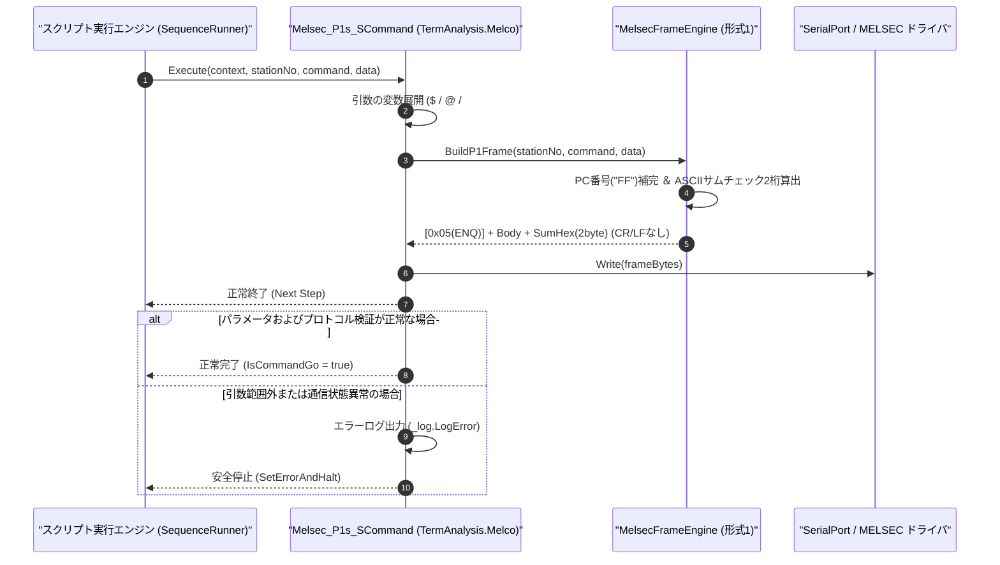

# コマンドリファレンス：Melsec_P1s_S

## 概要

**Melsec_P1s_S** は、三菱電機 MELSEC 計算機リンク **専用プロトコル形式 1（サムチェック付き、CR/LF なし）** の電文フレームを自動構築し、先頭制御コード（`ENQ [0x05]`）および末尾の 2 桁 ASCII サムチェックコードを自動計算・付与してシリアルポートへ送信するコマンドです。

> 💡 **補足**: シーケンサに対するデバイス読み出し要求（`BR` / `WR`）やデバイス書き込み要求（`BW` / `WW`）を形式 1 で送信する際に使用します。

---

## 💡 書式・パラメータ仕様

### コマンド構文

```csv
,SEQUENCE, [ステップキー], Melsec_P1s_S, "<StationNo>", "<Command>", "<Data>"
```

### パラメータ（引数）一覧

| 引数位置 | パラメータ名 | 必須/任意 | 型・制約 | 説明 |
| :---: | :--- | :---: | :--- | :--- |
| 第1引数 | `StationNo` | **必須** | 2桁または4桁16進文字列（例: `"00"`, `"00FF"`） | 送信先の局番（2桁指定時は自局 PC 番号 `"FF"` が自動補完されます）を指定します。 |
| 第2引数 | `Command` | **必須** | 2文字コマンド文字列（例: `"BR"`, `"WR"`, `"BW"`, `"WW"`） | 計算機リンクコマンド名を指定します。 |
| 第3引数 | `Data` | **必須** | 文字列（伝送待ち時間＋先頭デバイス＋点数＋書込値） | コマンドに続くデータ部（例: 伝送待ち時間 `"0"` + デバイス `"D0100"` + 点数 `"01"` = `"0D010001"`）を指定します。 |

---

## 🔄 特殊置換規約・分岐規約の適用

本コマンドの引数における特殊記法および解釈ルールです。
* **動的置換（`$`）**: 引数内で `$PARAMキー$` のように記述すると、実行時に変数プール（PARAM）の値へ動的置換されます。（適用可能な引数: 全引数対応）
* **ジャンプ先指定（`#`）**: 本コマンドはジャンプ制御を行わないため適用されません。（適用可能な引数: 非適用）
* **共通コマンド指定（`@`）**: 本コマンドは外部マクロを呼び出さないため、共通コマンド呼び出し記法は適用されません。（適用可能な引数: 非適用）
* **カンマのエスケープ**: 通信条件文字列（例: `"9600,E,7,1"`）や複数データのカンマ区切り値を単一引数として渡す場合は、必ず `"..."` と二重引用符で囲んで記述します。
* **エイリアス（別名）**: `P1s_S`, `Analysis_P1s_S`, `Sqn_Com_P1s_S`, `Analysis_SQN_COM_P1S_S`

---

## 💡 動作例（正しい構文での記述例）

### スクリプト記述例

※COMMAND ブロック配下の子要素行（PARAM, SEQUENCE）は必ず行頭カンマから開始し、スペースインデントや行末コメント（`;`）は記述しないでください。

```csv
COMMAND, "SAMPLE_MELSEC_P1S_S", ""
,PARAM, "WRITE_VAL", Text, "WRITE_VAL", "03E8"
,SEQUENCE, 010, Melsec_Mode, "9600,O,7,1", "NONE", "P1"
,SEQUENCE, 020, Melsec_Open
; 1. 局番00、D0100から1ワード読出要求(WR)を形式1で送信し、応答を受信
,SEQUENCE, 030, Melsec_P1s_S, "00", "WR", "0D010001"
,SEQUENCE, 040, Melsec_Res_P1s_R, "00", "@READ_DATA"
; 2. 局番00、D0200へ1ワード($WRITE_VAL = 03E8h = 1000)書込要求(WW)を形式1で送信
,SEQUENCE, 050, Melsec_P1s_S, "00", "WW", "0D020001$WRITE_VAL$"
,SEQUENCE, 060, Melsec_Res_P1s_R, "00", "@WRITE_ACK"
,SEQUENCE, 070, Melsec_Close
,SEQUENCE, 080, Exit
```

### 実行時の挙動・変数変化

* **実行前の状態**: Term 通信エンジンが初期化され、必要な通信パラメータおよび変数プール（`PARAM`）が準備されている状態。
* **実行後の状態**: 1 回目の `Melsec_P1s_S` では、`[ENQ(0x05)] + "00FFWR0D010001" + [Sum2桁]` が構築されて送信されます (`CR+LF` は付与されません)。 2 回目の `Melsec_P1s_S` では、`$WRITE_VAL` が `"03E8"` に展開された上で `[ENQ(0x05)] + "00FFWW0D02000103E8" + [Sum2桁]` が送信されます。

---

## 🔄 動作フロー（シーケンス図）



---

## 🚫 エラーハンドリング・安全設計（仕様制限）

1. **回線未オープン時の送信防止**:
   - `Melsec_Open` が実行されていない状態で呼び出された場合、`InvalidOperationException` を送出して停止します。
2. **不正な局番・コマンド長の検証**:
   - 局番が空文字または 16 進表記でない場合や、コマンド名が 2 文字でない場合は、`ArgumentException` を送出して不正フレーム送出を防止します。

---

## 🧪 ユニットテスト仕様

本コマンドクラス（`Melsec_P1s_SCommand.cs`）に実装されている `RunUnitTest()` メソッドが検証するユニットテストの仕様です。

### テスト実行前提条件

* **実行トリガー**: `RunUnitTest()` メソッドの呼び出し
* **有効化条件**: システム全体の最小ログレベル（`ErrorLogger.MinimumLevel`）が `LogLevel.Test` であること（それ以外の場合は無効化ガードにより早期リターン）
* **検証結果出力**: `_log.LogTest` によるログ出力。検証失敗時は `_log.LogError`、予期せぬ例外発生時は `_log.LogCritical` で記録し、`finally` ブロックで `UartTransportCore.Shared.IsSimulationMode` を開始前の状態へ復元します。

### テストケース一覧

| No | テストカテゴリ | テスト条件（入力値） | 期待される結果（出力値） | 検証の目的 / 観点 |
| :---: | :--- | :--- | :--- | :--- |
| **1** | 正常系 | `IsSimulationMode = true` 環境下で 3 引数 `"00"`, `"FFWR0"`, `"D000001"` を指定して実行 | `!param.HasError` かつ `param.SndData` が `'\u0005' + "00FFWR0D000001" + SQNSUM("00FFWR0D000001")` と完全一致する | 形式 1（`ENQ`＋本体＋2 桁サムチェック）電文構築および送信の検証 |
| **2** | 異常系 | 必須引数欠落・引数 9 個以上の過剰指定（`ValidateParamRange(1, 8)` 違反）、または送信例外発生 | 引数検証エラーによる早期リターン、または `_log.LogCritical` 記録と `SetErrorAndHalt(-1, ex.Message)` による安全停止 | 引数境界チェックおよび送信異常時のクラッシュ防御検証 |
