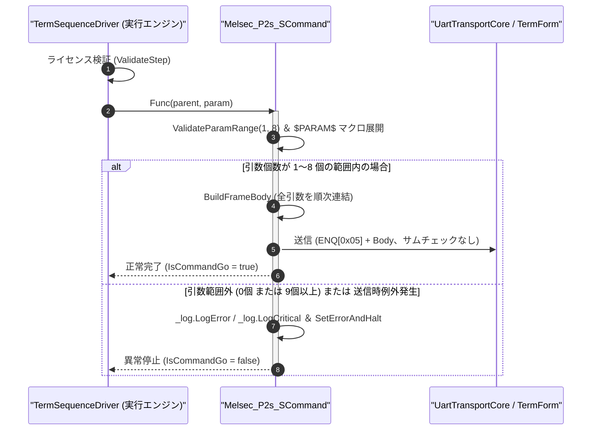

# コマンドリファレンス：Melsec_P2s_S

## 概要

**Melsec_P2s_S** は、三菱電機 MELSEC 計算機リンク **形式 2（サムチェックなし対話手順、末尾制御コードなし）** の要求電文フレームを構築し、先頭制御コード（`ENQ [0x05]`）を付与してシリアルポートへ送信するコマンドです。

形式 1 と異なり、サムチェックコード（2 桁 ASCII）の付加を省略する設定の計算機リンクユニットに対して使用します。

> 💡 **補足**: 形式 2 設定の MELSEC 計算機リンクユニットに対してデバイス読み出し（`BR` / `WR`）やデバイス書き込み（`BW` / `WW`）を要求する際に使用します。

---

## 💡 書式・パラメータ仕様

### コマンド構文

```csv
,SEQUENCE, [ステップキー], Melsec_P2s_S, [StationNoOrFrameData], "[Command]", "[Data]"
```

※ `ParameterSpec` は `EnableVariableLength(true)` で定義され、実行時（`Func`）は `ValidateParamRange(1, 8)` により 1〜8 個の引数を受け付けて各トークンを順番にトリム連結します。

### パラメータ（引数）一覧

| 引数位置 | 引数名 | 必須/任意 | 説明・制約 |
| :--- | :--- | :---: | :--- |
| 第 1 引数 | `StationNoOrFrameData` | **必須** | 複数引数指定時は送信先の **局番（2 桁）＋ PC 番号（2 桁）の計 4 文字（例: `"00FF"`）** または先頭局番部を指定します（※ PC 番号 `"FF"` の自動補完は行われません）。1 引数構文時は電文本体全体を直接指定可能です。 |
| 第 2 引数 | `Command` | 任意 | 計算機リンクコマンド文字列（例: `"BR"`, `"WR"`, `"BW"`, `"WW"`、または PC 番号を含む `"FFWR0"` 等。省略時既定値: `""`）。 |
| 第 3 引数 | `Data` | 任意 | コマンドに続くデータ部（伝送待ち時間＋先頭デバイス＋点数＋書込値、例: `"0D010001"`。省略時既定値: `""`）。第 4〜第 8 引数を分割指定した場合もすべて順番にトリム連結されます。 |

---

## 🔄 特殊置換規約・分岐規約の適用

本コマンドの引数における特殊記法および解釈ルールです。
* **動的置換（`$`）**: 引数内で `$PARAMキー$` のように記述すると、実行時に変数プール（PARAM）の値へ動的置換されます。（適用可能な引数: 全引数対応）
* **ジャンプ先指定（`#`）**: 本コマンドはジャンプ制御を行わないため適用されません。（適用可能な引数: 非適用）
* **共通コマンド指定（`@`）**: 本コマンドは外部マクロを呼び出さないため、共通コマンド呼び出し記法は適用されません。（適用可能な引数: 非適用）
* **カンマのエスケープ**: 引数自体にカンマを含める場合は、必ず `"..."` と二重引用符で囲んで記述します。
* **エイリアス（別名）**: `P2s_S`, `Analysis_P2s_S`, `Sqn_Com_P2s_S`, `Analysis_SQN_COM_P2S_S`

---

## 💡 動作例（正しい構文での記述例）

### スクリプト記述例

※COMMAND ブロック配下の子要素行（PARAM, SEQUENCE）は必ず行頭カンマから開始し、スペースインデントや行末コメント（`;`）は記述しないでください。

```csv
COMMAND, "SAMPLE_MELSEC_P2S_S", "READ_VAL"
,PARAM, "READ_VAL", Work, "読出データ結果", ""
,SEQUENCE, 010, Melsec_Mode, "9600,E,7,1", "NONE", "P2"
,SEQUENCE, 020, Melsec_Open
; 局番00・PC番号FF、D0100から1ワード読出要求(WR)を形式2で送信
,SEQUENCE, 030, Melsec_P2s_S, "00FF", "WR", "00D010001"
,SEQUENCE, 040, Melsec_Res_P2s_R, "00", "READ_VAL"
; 読出値が 0x0064 (100) 以上か判定（未満時は #NG_PROC# へ分岐）
,SEQUENCE, 050, Judge, "GE", "$READ_VAL$", "0x0064", "#NG_PROC#"
,SEQUENCE, 060, Melsec_Close
,SEQUENCE, 070, Exit, "$READ_VAL$", 0
; 閾値未満時のクローズ＆異常終了経路
,SEQUENCE, #NG_PROC#, Melsec_Close
,SEQUENCE, 090, Exit, "NG", -1
```

### 実行時の挙動・変数変化

* **実行前の状態**: Term 通信エンジンが初期化され、変数プール（`PARAM`）に `"READ_VAL"` が定義されている状態。
* **実行後の状態**: `Melsec_P2s_S` により `[ENQ(0x05)] + "00FFWR00D010001"`（サムチェックなし・`CR+LF` なし）が送信され、応答データが `"READ_VAL"` に格納されます。後続の `Judge` で `0x0064` 以上が確認されると回線を閉じて正常終了し、未満時は `#NG_PROC#` へ分岐してクローズ後に異常終了します。

---

## 🔄 動作フロー（シーケンス図）



---

## 🚫 エラーハンドリング・安全設計（仕様制限）

1. **引数個数境界の検証および例外保護**:
   - 引数が 0 個または 9 個以上指定された場合（`ValidateParamRange(1, 8)` 違反）は、`_log.LogError` に記録し `SetErrorAndHalt` により異常電文の送出を遮断します。送信中に予期せぬ例外が発生した場合は `_log.LogCritical` に記録し `SetErrorAndHalt(-1, ex.Message)` で安全に停止します。
2. **局番＋PC 番号の明示指定規約**:
   - `BuildFrameBody` は渡された各引数トークンをそのままトリム連結します。PC 番号 `"FF"` の自動補完は行われないため、電文本体の先頭が局番 2 桁＋PC 番号 2 桁（例: `"00FF"`）となるよう明示指定してください。

---

## 🧪 ユニットテスト仕様

本コマンドクラス（`Melsec_P2s_SCommand.cs`）に実装されている `RunUnitTest()` メソッドが検証するユニットテストの仕様です。

### テスト実行前提条件

* **実行トリガー**: `RunUnitTest()` メソッドの呼び出し
* **有効化条件**: システム全体の最小ログレベル（`ErrorLogger.MinimumLevel`）が `LogLevel.Test` であること（それ以外の場合は無効化ガードにより早期リターン）
* **検証結果出力**: `_log.LogTest` によるログ出力。検証失敗時は `_log.LogError`、予期せぬ例外発生時は `_log.LogCritical` で記録し、`finally` ブロックで `UartTransportCore.Shared.IsSimulationMode` を開始前の状態へ復元します。

### テストケース一覧

| No | テストカテゴリ | テスト条件（入力値） | 期待される結果（出力値） | 検証の目的 / 観点 |
| :---: | :--- | :--- | :--- | :--- |
| **1** | 正常系 | `IsSimulationMode = true` 環境下で 3 引数 `"00"`, `"FFWR0"`, `"D000001"` を指定して実行 | `!param.HasError` かつ `param.SndData` が `"\u000500FFWR0D000001"`（サムチェックなし）と一致する | 形式 2（`ENQ`＋本体・サムチェックなし）電文構築および送信の検証 |
| **2** | 異常系 | 引数 0 個の空 `TermSequence` を指定して `Func(null, invalidParam)` を実行 | `ValidateParamRange(1, 8)` により拒否され、`invalidParam.HasError == true` かつ `!invalidParam.IsCommandGo` となる | 必須引数欠落（0 個）時のバリデーション拒否および安全停止検証 |
