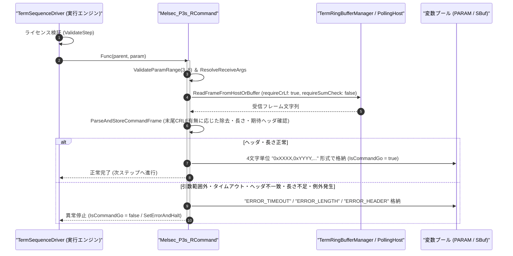

# コマンドリファレンス：Melsec_P3s_R

## 概要

**Melsec_P3s_R** は、三菱電機 MELSEC 計算機リンク **形式 3（`CR+LF` 終端、サムチェックなし）** の要求電文（`ENQ [0x05]` 開始フレーム）を受信検証し、末尾に `CR+LF`（`0x0D 0x0A`）が存在する場合は除去した上で期待ヘッダおよび点数フィールド桁数（`sizeNumDigits`）を確認し、抽出データを **`"0xXXXX,0xYYYY,..."`** 形式（4 文字単位の 16 進カンマ区切り、4 文字未満は生文字列）で指定パラメータへ格納するコマンドです。

> 💡 **補足**: 形式 4 と異なりサムチェック照合は行われません。ホストポーリング受信時は末尾 `CR+LF`（2 文字分）を含むフレーム長まで待機し、解析時は末尾 `\r\n` の有無を判定（`hasCrLf`）して付帯していれば除去する柔軟な構造となっています。

---

## 💡 書式・パラメータ仕様

### コマンド構文

```csv
,SEQUENCE, [ステップキー], Melsec_P3s_R, [StationNoOrHeader], [CommandOrSizeNum], [DataLengthOrTarget], "[TargetOrFormat]", "[Format]"
```

※ `ParameterSpec` は `EnableVariableLength(true)` で定義され、実行時（`Func`）は `ValidateParamRange(3, 8)` により 3〜8 個の引数を受け付けます（第 6〜第 8 引数は互換用予備引数として無視されます）。

### パラメータ（引数）一覧

| 引数位置 | 引数名 | 必須/任意 | 説明・制約 |
| :--- | :--- | :---: | :--- |
| 第 1 引数 | `StationNoOrHeader` | **必須** | 4〜5 引数構文時は先頭局番部（例: `"00"`、第 2 引数と連結されて期待ヘッダを構成）、3〜4 引数構文時は `ENQ` 直後に期待する完全ヘッダ文字列（例: `"00FFWW00D0100"`）を指定します。 |
| 第 2 引数 | `CommandOrSizeNum` | **必須** | 4〜5 引数構文時は残りの期待ヘッダ文字列（例: `"FF"` や `"FFWW00D0100"`）、3〜4 引数構文（本引数が `1`〜`8` の整数かつ第 3 引数が非整数の場合）は **点数フィールドの 16 進文字桁数（`sizeNumDigits`）** を指定します。 |
| 第 3 引数 | `DataLengthOrTarget` | **必須** | 標準 4〜5 引数構文（整数指定時）は **ヘッダ直後に続く点数フィールドの 16 進文字桁数（`sizeNumDigits`、例: `"2"`）** を指定します（データ部文字数は `点数(16進) × 4` 文字で自動算出）。3〜4 引数構文時は格納先パラメータキー名、4 引数以上で非整数（例: `"HEX"`）指定時は `sizeNumDigits = 2` 固定で変換書式として扱われます。 |
| 第 4 引数 | `TargetOrFormat` | 任意 | 4 引数以上構文時は抽出データの格納先パラメータキー名（`"@"` や `"$"` を付けない素のキー名、例: `"RECV_BUF"`）。通常キー指定時は 4 文字ごとの `"0xXXXX,0xYYYY,..."` 形式で格納され、数値キー指定時は連番キーへ格納されます（3〜4 引数構文時は `sscanf` 書式文字列）。 |
| 第 5 引数 | `Format` | 任意 | 標準 5 引数構文かつ格納先が数値キー（連番格納）の場合に適用する `TermStringUtility.Sscanf` 書式変換文字列（省略時既定値: `""`）。第 6〜第 8 引数は互換用予備として無視されます。 |

---

## 🔄 特殊置換規約・分岐規約の適用

本コマンドの引数における特殊記法および解釈ルールです。
* **動的置換（`$`）**: 引数内で `$PARAMキー$` のように記述すると、実行時に変数プール（PARAM）の値へ動的置換されます。（適用可能な引数: 全引数対応）
* **ジャンプ先指定（`#`）**: 本コマンドはジャンプ制御を行わないため適用されません。（適用可能な引数: 非適用）
* **共通コマンド指定（`@`）**: 本コマンドは外部マクロを呼び出さないため、共通コマンド呼び出し記法は適用されません。（適用可能な引数: 非適用）
* **カンマのエスケープ**: 引数自体にカンマを含める場合は、必ず `"..."` と二重引用符で囲んで記述します。
* **エイリアス（別名）**: `P3s_R`, `Analysis_P3s_R`, `Sqn_Com_P3s_R`, `Analysis_SQN_COM_P3S_R`

---

## 💡 動作例（正しい構文での記述例）

### スクリプト記述例

※COMMAND ブロック配下の子要素行（PARAM, SEQUENCE）は必ず行頭カンマから開始し、スペースインデントや行末コメント（`;`）は記述しないでください。

```csv
COMMAND, "SAMPLE_MELSEC_P3S_R", "RECV_BUF"
,PARAM, "RECV_BUF", Work, "受信ワードデータ", ""
,SEQUENCE, 010, Melsec_Mode, "9600,E,7,1", "NONE", "P3"
,SEQUENCE, 020, Melsec_Open
; 形式3で要求電文(期待ヘッダ "00FFWW00D0100"、点数フィールド2桁、CRLF終端)を受信し RECV_BUF へ格納
,SEQUENCE, 030, Melsec_P3s_R, "00FFWW00D0100", "2", "RECV_BUF"
; 受信した1ワード値が 0x0064 (100) 以上か判定（未満時は #NG_PROC# へ分岐）
,SEQUENCE, 040, Judge, "GE", "$RECV_BUF$", "0x0064", "#NG_PROC#"
,SEQUENCE, 050, Melsec_Close
,SEQUENCE, 060, Exit, "$RECV_BUF$", 0
; 閾値未満時のクローズ＆異常終了経路
,SEQUENCE, #NG_PROC#, Melsec_Close
,SEQUENCE, 080, Exit, "NG", -1
```

### 実行時の挙動・変数変化

* **実行前の状態**: Term 通信エンジンが初期化され、変数プール（`PARAM`）に `"RECV_BUF"` が定義されている状態。
* **実行後の状態**: 形式 3 フレーム（`CR+LF` 終端・サムチェックなし）から末尾 `\r\n` が除去され、期待ヘッダ `"00FFWW00D0100"` と点数フィールド（2 桁）が確認された上で、後続のデータ部が 4 文字ごとの `"0xXXXX,..."` 形式で `"RECV_BUF"` に格納されます。後続の `Judge` で `0x0064` 以上が確認されると回線をクローズして正常終了し、未満時は `#NG_PROC#` へ分岐してクローズ後に異常終了します。

---

## 🔄 動作フロー（シーケンス図）



---

## 🚫 エラーハンドリング・安全設計（仕様制限）

1. **引数個数検証および末尾 `CR+LF`・ヘッダ・長さの処理**:
   - 引数が 3 個未満または 9 個以上の場合（`ValidateParamRange(3, 8)` 違反）は `_log.LogError` に記録して停止します。受信文字列の解析時は `hasCrLf = rawInput != null && rawInput.EndsWith("\r\n")` を渡すため、末尾に `CR+LF` が付帯していれば除去して解析し、付帯していない場合もエラーとはせずそのまま長さ（`"ERROR_LENGTH"`）および期待ヘッダ前方一致（`"ERROR_HEADER"`）を検証します。不一致時は該当エラー文字列を格納先に記録し `param.IsCommandGo = false` で停止します。
2. **受信タイムアウトおよび実行時例外の保護**:
   - 受信フレームが空文字列（タイムアウト）の場合は格納先に `"ERROR_TIMEOUT"` を記録して `param.IsCommandGo = false` で停止し、予期せぬ例外発生時は `_log.LogCritical` に記録の上 `SetErrorAndHalt(-1, ex.Message)` で安全に停止します。

---

## 🧪 ユニットテスト仕様

本コマンドクラス（`Melsec_P3s_RCommand.cs`）に実装されている `RunUnitTest()` メソッドが検証するユニットテストの仕様です。

### テスト実行前提条件

* **実行トリガー**: `RunUnitTest()` メソッドの呼び出し
* **有効化条件**: システム全体の最小ログレベル（`ErrorLogger.MinimumLevel`）が `LogLevel.Test` であること（それ以外の場合は無効化ガードにより早期リターン）
* **検証結果出力**: `_log.LogTest` によるログ出力。検証失敗時は `_log.LogError`、予期せぬ例外発生時は `_log.LogCritical` で記録し、`finally` ブロックで `testSbuf?.Clear()`、`TermRingBufferManager.Instance.ClearBuffer()`、および `UartTransportCore.Shared.IsLoopbackMode` の復元を実行します。

### テストケース一覧

| No | テストカテゴリ | テスト条件（入力値） | 期待される結果（出力値） | 検証の目的 / 観点 |
| :---: | :--- | :--- | :--- | :--- |
| **1** | 正常系 | `IsLoopbackMode = true` 環境下で引数 `"00"`, `"FF"`, `"HEX"`, `"RECV_DATA"` および `CR+LF` 終端の擬似要求電文 `"\u000500FF025678\r\n"` を与えて実行 | `!param.HasError` かつ `param.IsCommandGo == true`、`CR+LF` 除去・サムチェック照合なしでデータ部が抽出され `SBuf["RECV_DATA"]` が `"0x5678"` と一致する | 形式 3 要求電文（`CR+LF` 終端・サムチェックなし）の解析および 16 進データ抽出格納の検証 |
| **2** | 異常系 | 引数不足（引数 0 個の `TermSequence`）を指定した `Func(null, invalidParam)` および `Func(null, null)` を実行 | `ValidateParamRange(3, 8)` により `!invalidParam.IsCommandGo` で安全に拒否され、`null` 入力でも例外クラッシュしない | 必須引数欠落および `null` パラメータに対する安全防御検証 |
