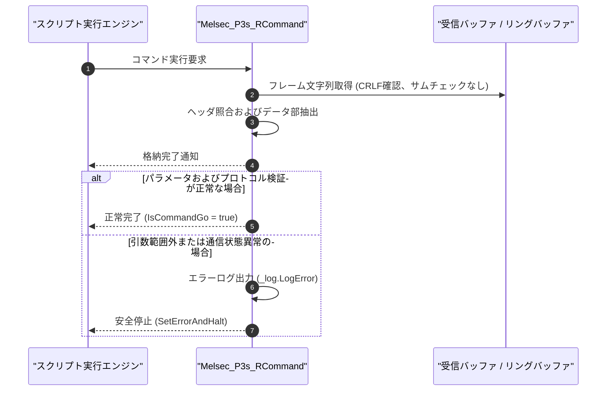

# コマンドリファレンス：Melsec_P3s_R

## 概要

**Melsec_P3s_R** は、三菱電機 MELSEC 計算機リンク **形式 3（CR/LF終端、サムチェックなし）** の要求電文を受信検証し、CR/LF 終端を確認の上で抽出データを指定のレジスタまたはセルへ格納するコマンドです。

形式 4 と異なり、サムチェック照合は行われません。

---

## 💡 書式・パラメータ仕様

### コマンド構文

```csv
,SEQUENCE, [ステップキー], Melsec_P3s_R, "<StationNoOrHeader>", "<CommandOrSizeNum>", "<DataLengthOrTarget>", "[TargetOrFormat]"
```

### パラメータ（引数）一覧

| 引数位置 | 引数名 | 必須/任意 | 説明・制約 |
| :--- | :--- | :---: | :--- |
| 第 1 引数 | `StationNoOrHeader` | **必須** | 期待する局番またはヘッダ文字列（例: `"00"` または `"00FF"`）。 |
| 第 2 引数 | `CommandOrSizeNum` | **必須** | 期待するコマンド文字列またはデータ長桁数を指定します。 |
| 第 3 引数 | `DataLengthOrTarget` | **必須** | データ長または抽出データの格納先レジスタ／変数名を指定します。 |
| 第 4 引数 | `TargetOrFormat` | 任意 | 4 引数構文時の格納先変数名、または変換フォーマット文字列（省略時既定値: `""`）。 |

---

## 🔄 特殊置換規約・分岐規約の適用

本コマンドの引数における特殊記法および解釈ルールです。
* **動的置換（`$`）**: 引数内で `$PARAMキー$` のように記述すると、実行時に変数プール（PARAM）の値へ動的置換されます。（適用可能な引数: 全引数対応）
* **ジャンプ先指定（`#`）**: 本コマンドはジャンプ制御を行わないため適用されません。（適用可能な引数: 非適用）
* **共通コマンド指定（`@`）**: 本コマンドは外部マクロを呼び出さないため、共通コマンド呼び出し記法は適用されません。（適用可能な引数: 非適用）
* **カンマのエスケープ**: 通信条件文字列（例: `"9600,E,7,1"`）や複数データのカンマ区切り値を単一引数として渡す場合は、必ず `"..."` と二重引用符で囲んで記述します。
* **エイリアス（別名）**: `P3s_R`, `Analysis_P3s_R`, `Sqn_Com_P3s_R`, `Analysis_SQN_COM_P3S_R`

---

## 💡 動作例（正しい構文での記述例）

### スクリプト記述例

※COMMAND ブロック配下の子要素行（PARAM, SEQUENCE）は必ず行頭カンマから開始し、スペースインデントや行末コメント（`;`）は記述しないでください。

```csv
COMMAND, "SAMPLE_MELSEC_P3S_R", ""
; 形式3で要求電文を受信し、RECV_BUFへ格納
,SEQUENCE, 010, Melsec_P3s_R, "00FF", "2", "RECV_BUF"
```

### 実行時の挙動・変数変化

* **実行前の状態**: Term 通信エンジンが初期化され、必要な通信パラメータおよび変数プール（`PARAM`）が準備されている状態。
* **実行後の状態**: ステップ実行により `Melsec_P3s_R` の通信制御・プロトコル処理が正常に遂行され、結果または回線状態が更新されます。

---

## 🔄 動作フロー（シーケンス図）



---

## 🚫 エラーハンドリング・安全設計（仕様制限）

入力データの異常や実行時エラーに対し、解析・実行エンジンが実行するセーフティ規約です。

1. **引数範囲・プロトコル書式バリデーション保護**:
   - 必須引数の欠落、デバイス表記・数値範囲の不正、または余剰引数が指定された場合は `_log.LogError` に詳細を記録し、`SetErrorAndHalt` により異常電文の送出を未然に遮断します。
2. **通信タイムアウト・異常応答・排他ドメイン保護**:
   - 相手機器の無応答タイムアウト、NAK／異常終了コード応答、または他通信ドメインとの排他競合が発生した場合は、例外クラッシュを起こさず安全にエラーハンドリングを行います。

---

## 🧪 ユニットテスト仕様

本コマンドクラス（`Melsec_P3s_RCommand.cs`）に実装されている `RunUnitTest()` メソッドが検証するユニットテストの仕様です。

### テスト実行前提条件

* **実行トリガー**: `RunUnitTest()` メソッドの呼び出し
* **有効化条件**: システム全体の最小ログレベル（`ErrorLogger.MinimumLevel`）が `LogLevel.Test` であること（それ以外の場合は無効化ガードにより早期リターン）
* **検証結果出力**: `_log.LogTest` によるログ出力。検証失敗時は `_log.LogError`、予期せぬ例外発生時は `_log.LogCritical` で記録し、`finally` ブロックで `testSbuf?.Clear()`、`TermRingBufferManager.Instance.ClearBuffer()`、および `UartTransportCore.Shared.IsLoopbackMode` の復元を実行します。

### テストケース一覧

| No | テストカテゴリ | テスト条件（入力値） | 期待される結果（出力値） | 検証の目的 / 観点 |
| :---: | :--- | :--- | :--- | :--- |
| **1** | 正常系 | `IsLoopbackMode = true` 環境下で引数 `"00FF"`, `"2"`, `"02"`, `"RECV_DATA"` および `CR+LF` 終端の擬似要求電文 `"\u000500FF025678\r\n"` を与えて実行 | `!param.HasError` かつ `param.IsCommandGo == true`、`CR+LF` 除去・サムチェック照合なしでデータ部が抽出され `SBuf["RECV_DATA"]` へ格納される | 形式 3 要求電文（`CR+LF` 終端・サムチェックなし）の解析およびデータ抽出検証 |
| **2** | 異常系 | 引数不足（引数 0 個の `TermSequence`）および `Func(null, null)` を指定して実行 | `ValidateParamRange(3, 8)` により `!invalidParam.IsCommandGo` で安全に拒否され、`null` 入力でもクラッシュしない | 必須引数欠落および `null` パラメータに対する安全防御検証 |
