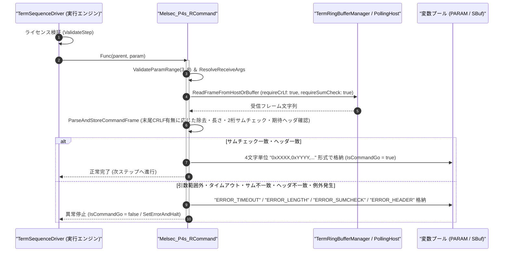

# コマンドリファレンス：Melsec_P4s_R

## 概要

**Melsec_P4s_R** は、三菱電機 MELSEC 計算機リンク **専用プロトコル形式 4（サムチェック付き、末尾 `CR+LF [0x0D, 0x0A]` あり）** において、外部マスターまたはシーケンサから送信される要求電文（`ENQ [0x05]` 開始フレーム）を受信・解析し、末尾に `CR+LF` が付帯している場合は除去した上で期待ヘッダ・点数フィールド桁数（`sizeNumDigits`）および 2 桁 ASCII サムチェックの検証を行い、抽出データを **`"0xXXXX,0xYYYY,..."`** 形式（4 文字単位の 16 進カンマ区切り、4 文字未満は生文字列）で指定パラメータへ格納するコマンドです。

> 💡 **補足**: プロトコル形式 4 は形式 1 のフレーム末尾に `CR+LF`（`0x0D 0x0A`）が付加された形式です。ホストポーリング受信時は末尾 `CR+LF`（2 文字分）を含む文字数まで待機し、解析時は末尾 `\r\n` の有無を判定（`hasCrLf`）して付帯していれば除去した上でサムチェック照合を実行します。

---

## 💡 書式・パラメータ仕様

### コマンド構文

```csv
,SEQUENCE, [ステップキー], Melsec_P4s_R, [StationNoOrHeader], [CommandOrSizeNum], [DataLengthOrTarget], "[TargetOrFormat]", "[Format]"
```

※ `ParameterSpec` は `EnableVariableLength(true)` で定義され、実行時（`Func`）は `ValidateParamRange(3, 8)` により 3〜8 個の引数を受け付けます（第 6〜第 8 引数は互換用予備引数として無視されます）。

### パラメータ（引数）一覧

| 引数位置 | 引数名 | 必須/任意 | 説明・制約 |
| :--- | :--- | :---: | :--- |
| 第 1 引数 | `StationNoOrHeader` | **必須** | 4〜5 引数構文時は先頭局番部（例: `"00"`、第 2 引数と連結されて期待ヘッダを構成）、3〜4 引数構文時は `ENQ` 直後に期待する完全ヘッダ文字列（例: `"00FFWW00D0100"`）を指定します。 |
| 第 2 引数 | `CommandOrSizeNum` | **必須** | 4〜5 引数構文時は残りの期待ヘッダ文字列（例: `"FFWW00D0100"`）、3〜4 引数構文（本引数が `1`〜`8` の整数かつ第 3 引数が非整数の場合）は **点数フィールドの 16 進文字桁数（`sizeNumDigits`）** を指定します。 |
| 第 3 引数 | `DataLengthOrTarget` | **必須** | 標準 4〜5 引数構文（整数指定時）は **ヘッダ直後に続く点数フィールドの 16 進文字桁数（`sizeNumDigits`、例: `"2"`）** を指定します（データ部文字数は `点数(16進) × 4` 文字で自動算出）。3〜4 引数構文時は格納先パラメータキー名、4 引数以上で非整数（例: `"HEX"`）指定時は `sizeNumDigits = 2` 固定で変換書式として扱われます。 |
| 第 4 引数 | `TargetOrFormat` | 任意 | 4 引数以上構文時は抽出データの格納先パラメータキー名（`"@"` や `"$"` を付けない素のキー名、例: `"REQ_DATA"`）。通常キー指定時は 4 文字ごとの `"0xXXXX,0xYYYY,..."` 形式で格納され、数値キー指定時は連番キーへ格納されます（3〜4 引数構文時は `sscanf` 書式文字列）。 |
| 第 5 引数 | `Format` | 任意 | 標準 5 引数構文かつ格納先が数値キー（連番格納）の場合に適用する `TermStringUtility.Sscanf` 書式変換文字列（省略時既定値: `""`）。第 6〜第 8 引数は互換用予備として無視されます。 |

---

## 🔄 特殊置換規約・分岐規約の適用

本コマンドの引数における特殊記法および解釈ルールです。
* **動的置換（`$`）**: 引数内で `$PARAMキー$` のように記述すると、実行時に変数プール（PARAM）の値へ動的置換されます。（適用可能な引数: 全引数対応）
* **ジャンプ先指定（`#`）**: 本コマンドはジャンプ制御を行わないため適用されません。（適用可能な引数: 非適用）
* **共通コマンド指定（`@`）**: 本コマンドは外部マクロを呼び出さないため、共通コマンド呼び出し記法は適用されません。（適用可能な引数: 非適用）
* **カンマのエスケープ**: 引数自体にカンマを含める場合は、必ず `"..."` と二重引用符で囲んで記述します。
* **エイリアス（別名）**: `P4s_R`, `Analysis_P4s_R`, `Sqn_Com_P4s_R`, `Analysis_SQN_COM_P4S_R`

---

## 💡 動作例（正しい構文での記述例）

### スクリプト記述例

※COMMAND ブロック配下の子要素行（PARAM, SEQUENCE）は必ず行頭カンマから開始し、スペースインデントや行末コメント（`;`）は記述しないでください。

```csv
COMMAND, "SAMPLE_MELSEC_P4S_R", "REQ_DATA"
,PARAM, "REQ_DATA", Work, "受信ワードデータ", ""
,SEQUENCE, 010, Melsec_Mode, "9600,O,7,1", "NONE", "P4"
,SEQUENCE, 020, Melsec_Open
; 期待ヘッダ "00FFWW00D0100"、点数フィールド2桁の形式4フレーム(CRLF終端)を受信し REQ_DATA へ格納
,SEQUENCE, 030, Melsec_P4s_R, "00", "FFWW00D0100", "2", "REQ_DATA"
; 受信したワード値が期待値 "0xCAFE" と一致するか判定（不一致時は #NG_PROC# へ分岐）
,SEQUENCE, 040, Judge, "EQU", "$REQ_DATA$", "0xCAFE", "#NG_PROC#"
,SEQUENCE, 050, Melsec_Close
,SEQUENCE, 060, Exit, "$REQ_DATA$", 0
; 期待値不一致時のクローズ＆異常終了経路
,SEQUENCE, #NG_PROC#, Melsec_Close
,SEQUENCE, 080, Exit, "NG", -1
```

### 実行時の挙動・変数変化

* **実行前の状態**: Term 通信エンジンが初期化され、変数プール（`PARAM`）に `"REQ_DATA"` が定義されている状態。
* **実行後の状態**: 受信バッファから `ENQ (0x05)` + `"00FFWW00D0100"` + `"01"`（2 桁点数フィールド）+ `"CAFE"` + `Sum(2桁)` + `CR(0x0D) + LF(0x0A)` のフレームを検証します。末尾 `\r\n` 除去後、2 桁サムチェックおよび期待ヘッダ `"00FFWW00D0100"` が一致すると、データ部が 4 文字単位で整形され `"0xCAFE"` が `"REQ_DATA"` に格納されます。後続の `Judge` で一致が確認されると回線をクローズして正常終了し、不一致時は `#NG_PROC#` へ分岐してクローズ後に異常終了します。

---

## 🔄 動作フロー（シーケンス図）



---

## 🚫 エラーハンドリング・安全設計（仕様制限）

1. **引数個数検証および末尾 `CR+LF`・サムチェック・ヘッダ照合**:
   - 引数が 3 個未満または 9 個以上の場合（`ValidateParamRange(3, 8)` 違反）は `_log.LogError` に記録して停止します。受信文字列の解析時は `hasCrLf = rawInput != null && rawInput.EndsWith("\r\n")` を渡すため、末尾に `CR+LF` があれば除去し、無い場合もエラーとせずそのまま長さ（`"ERROR_LENGTH"`）、2 桁 ASCII サムチェック（`"ERROR_SUMCHECK"`）、および期待ヘッダ（`"ERROR_HEADER"`）を検証します。不一致時は該当エラー文字列を格納先に記録し `param.IsCommandGo = false` で停止します。
2. **受信タイムアウトおよび実行時例外の保護**:
   - 受信フレームが空文字列（タイムアウト）の場合は格納先に `"ERROR_TIMEOUT"` を記録して `param.IsCommandGo = false` で停止し、予期せぬ例外発生時は `_log.LogCritical` に記録の上 `SetErrorAndHalt(-1, ex.Message)` で安全に停止します。

---

## 🧪 ユニットテスト仕様

本コマンドクラス（`Melsec_P4s_RCommand.cs`）に実装されている `RunUnitTest()` メソッドが検証するユニットテストの仕様です。

### テスト実行前提条件

* **実行トリガー**: `RunUnitTest()` メソッドの呼び出し
* **有効化条件**: システム全体の最小ログレベル（`ErrorLogger.MinimumLevel`）が `LogLevel.Test` であること（それ以外の場合は無効化ガードにより早期リターン）
* **検証結果出力**: `_log.LogTest` によるログ出力。検証失敗時は `_log.LogError`、予期せぬ例外発生時は `_log.LogCritical` で記録し、`finally` ブロックで `testSbuf?.Clear()`、`TermRingBufferManager.Instance.ClearBuffer()`、および `UartTransportCore.Shared.IsLoopbackMode` の復元を実行します。

### テストケース一覧

| No | テストカテゴリ | テスト条件（入力値） | 期待される結果（出力値） | 検証の目的 / 観点 |
| :---: | :--- | :--- | :--- | :--- |
| **1** | 正常系 | `IsLoopbackMode = true` 環境下で引数 `"00"`, `"FFWW0D0000"`, `"2"`, `"MEL_P4_RCV"` および擬似要求電文 `'\u0005' + "00FFWW0D000001CAFE" + SQNSUM(...) + "\r\n"` を与えて実行 | `!param.HasError` かつ `param.IsCommandGo == true`、格納先 `SBuf["MEL_P4_RCV"]` が `"0xCAFE"` と一致する | 形式 4 要求電文（`CR+LF` 終端＋サムチェック）の照合およびワード抽出格納の検証 |
| **2** | 異常系 | サムチェック不一致フレーム（`'\u0005' + body + "00\r\n"`）を指定した `Func(null, badParam)` および `Func(null, null)` を実行 | サムチェック異常により `"ERROR_SUMCHECK"` が格納されて `badParam.HasError \|\| !badParam.IsCommandGo` となり、`null` 入力でも例外クラッシュしない | サムチェック不一致検出および `null` パラメータに対する安全防御検証 |
