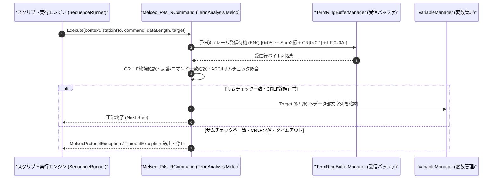

# コマンドリファレンス：Melsec_P4s_R

## 概要

**Melsec_P4s_R** は、三菱電機 MELSEC 計算機リンク **専用プロトコル形式 4（サムチェック付き、末尾 `CR+LF [0x0D, 0x0A]` あり）** において、外部マスターまたはシーケンサから送信される要求電文（`ENQ [0x05]` 開始〜`CR+LF` 終端フレーム）を受信・解析し、局番・コマンド・データ長・2 桁サムチェックおよび末尾 `CR+LF` デリミタの検証を行った上で、データ部を指定ターゲット変数へ格納するコマンドです。

> 💡 **補足**: プロトコル形式 4 は形式 1 のフレーム末尾に `CR+LF`（`0x0D 0x0A`）が付加された形式であり、シリアルモニタ上での行単位視認性に優れています。

---

## 💡 書式・パラメータ仕様

### コマンド構文

```csv
,SEQUENCE, [ステップキー], Melsec_P4s_R, "<StationNo>", "<Command>", "<DataLength>", "<Target>"
```

### パラメータ（引数）一覧

| 引数位置 | パラメータ名 | 必須/任意 | 型・制約 | 説明 |
| :---: | :--- | :---: | :--- | :--- |
| 第1引数 | `StationNo` | **必須** | 2桁または4桁16進文字列（例: `"00"`, `"00FF"`） | 受信を期待する局番（Station No.）を指定します。 |
| 第2引数 | `Command` | **必須** | 2文字コマンド文字列（例: `"BR"`, `"WR"`, `"BW"`, `"WW"`） | 受信を期待する計算機リンクコマンド名を指定します。 |
| 第3引数 | `DataLength` | **必須** | 整数（文字数） | コマンドおよび伝送待ち時間に続くデータ部のバイト（文字）長を指定します。 |
| 第4引数 | `Target` | **必須** | 変数名（`$` / `@`） | 受信フレームから抽出したデータ部文字列を格納するターゲット変数を指定します。 |

---

## 🔄 特殊置換規約・分岐規約の適用

本コマンドの引数における特殊記法および解釈ルールです。
* **動的置換（`$`）**: 引数内で `$PARAMキー$` のように記述すると、実行時に変数プール（PARAM）の値へ動的置換されます。（適用可能な引数: 全引数対応）
* **ジャンプ先指定（`#`）**: 本コマンドはジャンプ制御を行わないため適用されません。（適用可能な引数: 非適用）
* **共通コマンド指定（`@`）**: 本コマンドは外部マクロを呼び出さないため、共通コマンド呼び出し記法は適用されません。（適用可能な引数: 非適用）
* **カンマのエスケープ**: 通信条件文字列（例: `"9600,E,7,1"`）や複数データのカンマ区切り値を単一引数として渡す場合は、必ず `"..."` と二重引用符で囲んで記述します。
* **エイリアス（別名）**: `P4s_R`, `Analysis_P4s_R`, `Sqn_Com_P4s_R`, `Analysis_SQN_COM_P4S_R`

---

## 💡 動作例（正しい構文での記述例）

### スクリプト記述例

※COMMAND ブロック配下の子要素行（PARAM, SEQUENCE）は必ず行頭カンマから開始し、スペースインデントや行末コメント（`;`）は記述しないでください。

```csv
COMMAND, "SAMPLE_MELSEC_P4S_R", ""
,PARAM, "REQ_DATA", Text, "REQ_DATA", ""
,SEQUENCE, 010, Melsec_Mode, "9600,O,7,1", "NONE", "P4"
,SEQUENCE, 020, Melsec_Open
; 局番00、ワード一括読出コマンド(WR)、データ部8文字の形式4フレーム(CRLF終端)を受信
,SEQUENCE, 030, Melsec_P4s_R, "00", "WR", "8", "$REQ_DATA$"
,SEQUENCE, 040, Melsec_Close
,SEQUENCE, 050, Exit
```

### 実行時の挙動・変数変化

* **実行前の状態**: Term 通信エンジンが初期化され、必要な通信パラメータおよび変数プール（`PARAM`）が準備されている状態。
* **実行後の状態**: 受信リングバッファから `ENQ (0x05)` + `"00FFWR0D010001"` + `Sum(2桁)` + `CR(0x0D) + LF(0x0A)` のフレーム到着を待機します。 末尾 `CR+LF` の存在確認および 2 桁サムチェック照合に成功すると、データ部 `"0D010001"` が `$REQ_DATA` に格納されます。

---

## 🔄 動作フロー（シーケンス図）



---

## 🚫 エラーハンドリング・安全設計（仕様制限）

1. **サムチェックおよび `CR+LF` デリミタの二重検証**:
   - 形式 4 ではサムチェック 2 桁の直後に必ず `CR+LF`（`0x0D 0x0A`）が必要です。サム不一致またはデリミタ欠落時はエラーを送出し、破損データの取り込みを防止します。
2. **受信タイムアウト保護**:
   - 規定時間内に `CR+LF` 終端フレームが到着しない場合は `TimeoutException` を送出します。

---

## 🧪 ユニットテスト仕様

本コマンドクラス（`Melsec_P4s_RCommand.cs`）に実装されている `RunUnitTest()` メソッドが検証するユニットテストの仕様です。

### テスト実行前提条件

* **実行トリガー**: `RunUnitTest()` メソッドの呼び出し
* **有効化条件**: システム全体の最小ログレベル（`ErrorLogger.MinimumLevel`）が `LogLevel.Test` であること（それ以外の場合は無効化ガードにより早期リターン）
* **検証結果出力**: `_log.LogTest` によるログ出力。検証失敗時は `_log.LogError`、予期せぬ例外発生時は `_log.LogCritical` で記録し、`finally` ブロックで `testSbuf?.Clear()`、`TermRingBufferManager.Instance.ClearBuffer()`、および `UartTransportCore.Shared.IsLoopbackMode` の復元を実行します。

### テストケース一覧

| No | テストカテゴリ | テスト条件（入力値） | 期待される結果（出力値） | 検証の目的 / 観点 |
| :---: | :--- | :--- | :--- | :--- |
| **1** | 正常系 | `IsLoopbackMode = true` 環境下で引数 `"00"`, `"FFWW0D0000"`, `"2"`, `"MEL_P4_RCV"` および擬似要求電文 `'\u0005' + "00FFWW0D000001CAFE" + SQNSUM(...) + "\r\n"` を与えて実行 | `!param.HasError` かつ `param.IsCommandGo == true`、格納先 `SBuf["MEL_P4_RCV"]` が `"0xCAFE"` と一致する | 形式 4 要求電文（`CR+LF` 終端＋サムチェック）の照合およびワード抽出格納の検証 |
| **2** | 異常系 | サムチェック不一致フレーム（`'\u0005' + body + "00\r\n"`）および `Func(null, null)` を指定して実行 | サムチェック異常により `"ERROR_SUMCHECK"` が格納されて `!badParam.IsCommandGo` となり、`null` 入力でもクラッシュしない | サムチェック不一致検出および `null` パラメータに対する安全防御検証 |
