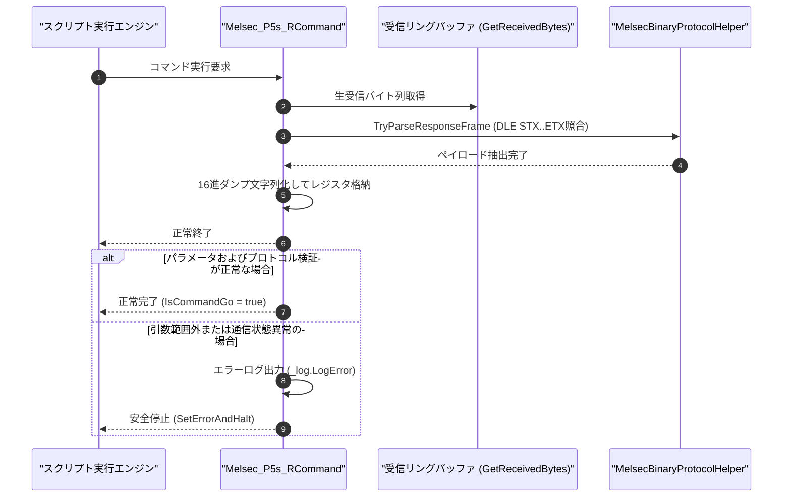

# コマンドリファレンス：Melsec_P5s_R

## 概要

**Melsec_P5s_R** は、三菱電機 MELSEC 計算機リンク **形式 5（バイナリコード通信方式）** の要求電文を受信検証し、DLE フレーミングおよびチェックサムを照合した上で、抽出したバイナリペイロードを 16 進ダンプ文字列としてターゲットへ格納するコマンドです。

---

## 💡 書式・パラメータ仕様

### コマンド構文

```csv
,SEQUENCE, [ステップキー], Melsec_P5s_R, "<StationNoOrTarget>", "[TargetKey]"
```

### パラメータ（引数）一覧

| 引数位置 | パラメータ名 | 必須/任意 | 型・制約 | 説明 |
| :---: | :--- | :---: | :--- | :--- |
| 第1引数 | `StationNoOrTarget` | **必須** | 文字列（例: `"00"`, `"RECV_KEY"`） | 期待する局番（16進）、または格納先レジスタ名を指定します。 |
| 第2引数 | `TargetKey` | 任意 | 文字列（例: `"RECV_KEY"`） | 格納先レジスタ名を指定します（第1引数で局番を指定した場合）。 |

---

## 🔄 特殊置換規約・分岐規約の適用

本コマンドの引数における特殊記法および解釈ルールです。
* **動的置換（`$`）**: 引数内で `$PARAMキー$` のように記述すると、実行時に変数プール（PARAM）の値へ動的置換されます。（適用可能な引数: 全引数対応）
* **ジャンプ先指定（`#`）**: 本コマンドはジャンプ制御を行わないため適用されません。（適用可能な引数: 非適用）
* **共通コマンド指定（`@`）**: 本コマンドは外部マクロを呼び出さないため、共通コマンド呼び出し記法は適用されません。（適用可能な引数: 非適用）
* **カンマのエスケープ**: 通信条件文字列（例: `"9600,E,7,1"`）や複数データのカンマ区切り値を単一引数として渡す場合は、必ず `"..."` と二重引用符で囲んで記述します。
* **エイリアス（別名）**: `P5s_R`, `Analysis_P5s_R`, `Sqn_Com_P5s_R`, `Analysis_SQN_COM_P5S_R`

---

## 💡 動作例（正しい構文での記述例）

### スクリプト記述例

※COMMAND ブロック配下の子要素行（PARAM, SEQUENCE）は必ず行頭カンマから開始し、スペースインデントや行末コメント（`;`）は記述しないでください。

```csv
COMMAND, "SAMPLE_MELSEC_P5S_R", ""
; 形式5で局番00からのバイナリ要求を受信し、RECV_HEXへ格納
,SEQUENCE, 010, Melsec_P5s_R, "00", "RECV_HEX"
```

### 実行時の挙動・変数変化

* **実行前の状態**: Term 通信エンジンが初期化され、必要な通信パラメータおよび変数プール（`PARAM`）が準備されている状態。
* **実行後の状態**: ステップ実行により `Melsec_P5s_R` の通信制御・プロトコル処理が正常に遂行され、結果または回線状態が更新されます。

---

## 🔄 動作フロー（シーケンス図）



---

## 🚫 エラーハンドリング・安全設計（仕様制限）

入力データの異常や実行時エラーに対し、解析・実行エンジンが実行するセーフティ規約です。

1. **引数範囲・プロトコル書式バリデーション保護**:
   - 必須引数の欠落、デバイス表記・数値範囲の不正、または余剰引数が指定された場合は `_log.LogError` に詳細を記録し、`SetErrorAndHalt` により異常電文の送出を未然に遮断します。
2. **通信タイムアウト・異常応答・排他ドメイン保護**:
   - 相手機器の無応答タイムアウト、NAK／異常終了コード応答、または他通信ドメインとの排他競合が発生した場合は、例外クラッシュを起こさず安全にエラーハンドリングを行います。

---

## 🧪 ユニットテスト仕様

本コマンドクラス（`Melsec_P5s_RCommand.cs`）に実装されている `RunUnitTest()` メソッドが検証するユニットテストの仕様です。

### テスト実行前提条件

* **実行トリガー**: `RunUnitTest()` メソッドの呼び出し
* **有効化条件**: システム全体の最小ログレベル（`ErrorLogger.MinimumLevel`）が `LogLevel.Test` であること（それ以外の場合は無効化ガードにより早期リターン）
* **検証結果出力**: `_log.LogTest` によるログ出力。検証失敗時は `_log.LogError`、予期せぬ例外発生時は `_log.LogCritical` で記録し、`finally` ブロックで `UartTransportCore.Shared.IsSimulationMode` を開始前の状態へ復元します。

### テストケース一覧

| No | テストカテゴリ | テスト条件（入力値） | 期待される結果（出力値） | 検証の目的 / 観点 |
| :---: | :--- | :--- | :--- | :--- |
| **1** | 正常系 | `IsSimulationMode = true` 環境下で引数 `"RECV_BINARY"` および擬似バイナリフレーム（本文 `00 FF 00 00 12 34` を `BuildRequestFrame` で DLE フレーミング）を与えて実行 | `!param.HasError` かつ `param.IsCommandGo == true`、格納先 `SBuf["RECV_BINARY"]` が `"1234"` と一致する | 形式 5 バイナリフレームの DLE アンエスケープ・サム照合およびペイロード抽出検証 |
| **2** | 異常系 | 必須引数欠落・引数範囲外（`ValidateParamRange(1, 4)` 違反）、空受信バッファ（`"ERROR_TIMEOUT"`）、またはサム不一致フレーム | エラー識別子を格納先へ記録し `IsCommandGo = false`（例外時は `SetErrorAndHalt(-1)`）で安全に停止する | 引数境界検証および無応答・破損バイナリフレーム受信時のフェイルセーフ検証 |
