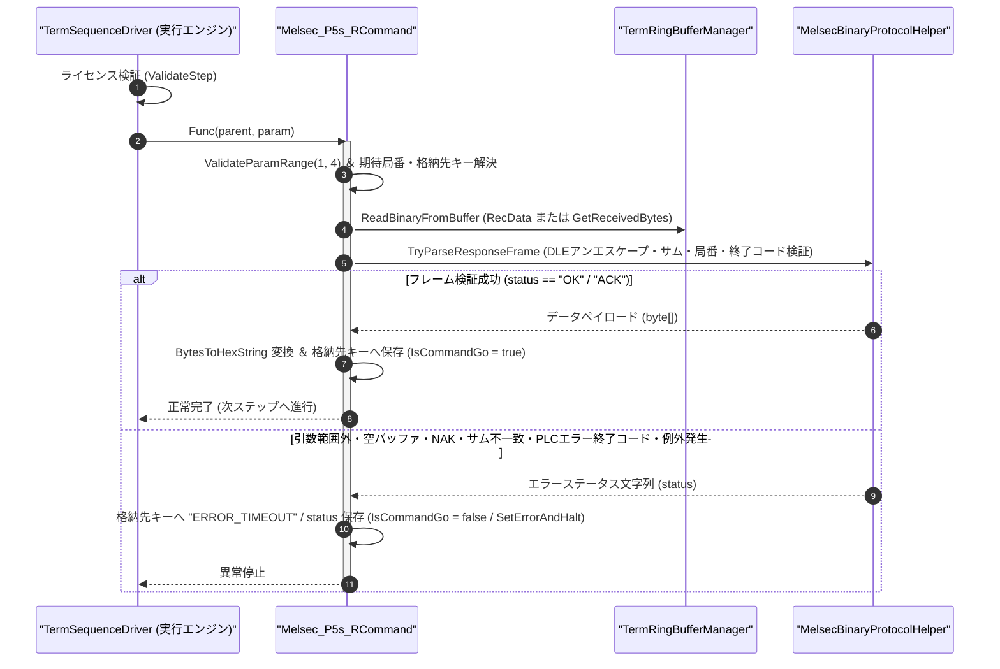

# コマンドリファレンス：Melsec_P5s_R

## 概要

**Melsec_P5s_R** は、三菱電機 MELSEC 計算機リンク **形式 5（バイナリコード通信方式）** のフレーム（`DLE STX [0x10 0x02]`〜`DLE ETX [0x10 0x03]`＋2 バイトチェックサム、または `DLE ACK` / `DLE NAK`）を受信検証し、DLE アンエスケープ・チェックサム照合・局番確認および終了コード（2 バイト：`0x0000` 正常）確認を行った上で、先頭 4 バイト（局番 1B＋PC 番号 1B＋終了コード 2B）を除いたバイナリペイロードを区切りなしの大文字 16 進文字列（例: `"1234"`）として指定パラメータへ格納するコマンドです。

---

## 💡 書式・パラメータ仕様

### コマンド構文

```csv
,SEQUENCE, [ステップキー], Melsec_P5s_R, [StationNoOrTarget], "[TargetKey]"
```

※ `ParameterSpec` は `EnableVariableLength(true)` で定義され、実行時（`Func`）は `ValidateParamRange(1, 4)` により 1〜4 個の引数を受け付けます（第 3・第 4 引数が指定された場合は互換用予備引数として無視されます）。

### パラメータ（引数）一覧

| 引数位置 | 引数名 | 必須/任意 | 説明・制約 |
| :--- | :--- | :---: | :--- |
| 第 1 引数 | `StationNoOrTarget` | **必須** | 第 2 引数（格納先キー）を指定した場合は期待する局番（2 桁 16 進文字列、例: `"00"`）、1 引数のみ指定した場合は格納先パラメータキー名（`"@"` や `"$"` を付けない素のキー名、例: `"RECV_HEX"`）として扱われます。 |
| 第 2 引数 | `TargetKey` | 任意 | 第 1 引数で期待局番を指定した場合の格納先パラメータキー名（`"@"` や `"$"` を付けない素のキー名、省略時既定値: `""`）。なお第 3・第 4 引数は互換用予備引数として許容され、実行時には破棄されます。 |

---

## 🔄 特殊置換規約・分岐規約の適用

本コマンドの引数における特殊記法および解釈ルールです。
* **動的置換（`$`）**: 引数内で `$PARAMキー$` のように記述すると、実行時に変数プール（PARAM）の値へ動的置換されます。（適用可能な引数: 全引数対応）
* **ジャンプ先指定（`#`）**: 本コマンドはジャンプ制御を行わないため適用されません。（適用可能な引数: 非適用）
* **共通コマンド指定（`@`）**: 本コマンドは外部マクロを呼び出さないため、共通コマンド呼び出し記法は適用されません。（適用可能な引数: 非適用）
* **カンマのエスケープ**: 引数自体にカンマを含める場合は、必ず `"..."` と二重引用符で囲んで記述します。
* **エイリアス（別名）**: `P5s_R`, `Analysis_P5s_R`, `Sqn_Com_P5s_R`, `Analysis_SQN_COM_P5S_R`

---

## 💡 動作例（正しい構文での記述例）

### スクリプト記述例

※COMMAND ブロック配下の子要素行（PARAM, SEQUENCE）は必ず行頭カンマから開始し、スペースインデントや行末コメント（`;`）は記述しないでください。

```csv
COMMAND, "SAMPLE_MELSEC_P5S_R", "RECV_HEX"
,PARAM, "RECV_HEX", Work, "バイナリ受信結果", ""
,SEQUENCE, 010, Melsec_Mode, "115200,E,8,1", "NONE", "P5"
,SEQUENCE, 020, Melsec_Open
; 形式5で局番00のバイナリフレームを受信し、データペイロードを RECV_HEX へ格納
,SEQUENCE, 030, Melsec_P5s_R, "00", "RECV_HEX"
; 抽出された16進ペイロードが期待値 "1234" と一致するか判定（不一致時は #NG_PROC# へ分岐）
,SEQUENCE, 040, Judge, "EQU", "$RECV_HEX$", "1234", "#NG_PROC#"
,SEQUENCE, 050, Melsec_Close
,SEQUENCE, 060, Exit, "$RECV_HEX$", 0
; 期待値不一致時のクローズ＆異常終了経路
,SEQUENCE, #NG_PROC#, Melsec_Close
,SEQUENCE, 080, Exit, "NG", -1
```

### 実行時の挙動・変数変化

* **実行前の状態**: Term 通信エンジンが初期化され、変数プール（`PARAM`）に `"RECV_HEX"` が定義されている状態。
* **実行後の状態**: 受信バイナリ列に対して `MelsecBinaryProtocolHelper.TryParseResponseFrame` が実行され、DLE アンエスケープ・2 バイトサム照合・局番 `0x00` 照合・終了コード `0x0000` 確認後、データペイロードが大文字 16 進文字列（例: `"1234"`、`DLE ACK` 時は空文字列 `""`）として `"RECV_HEX"` に格納されます。後続の `Judge` で期待値一致が確認されると回線をクローズして正常終了し、不一致時は `#NG_PROC#` へ分岐してクローズ後に異常終了します。

---

## 🔄 動作フロー（シーケンス図）



---

## 🚫 エラーハンドリング・安全設計（仕様制限）

1. **引数個数境界およびバイナリフレーム構造・終了コード検証**:
   - 引数が 0 個または 5 個以上指定された場合（`ValidateParamRange(1, 4)` 違反）は `_log.LogError` に記録して停止します。受信バイト列が空の場合は `"ERROR_TIMEOUT"`、`DLE NAK` 時は `"NAK"`、フレーミング・長さ・サムチェック・局番・PLC 終了コード異常時は `"ERROR_FRAME"` / `"ERROR_LENGTH"` / `"ERROR_SUMCHECK"` / `"ERROR_STATION"` / `"ERROR_PLC_xxxx"` を格納先へ記録し、`param.IsCommandGo = false` で停止します。
2. **実行時例外発生時のフェイルセーフ**:
   - `param.RecData` に不正な 16 進文字列が設定されていた場合などの実行時例外は `catch` 節で捕捉し、`_log.LogCritical` への記録と `SetErrorAndHalt(-1, ex.Message)` により安全に停止します。

---

## 🧪 ユニットテスト仕様

本コマンドクラス（`Melsec_P5s_RCommand.cs`）に実装されている `RunUnitTest()` メソッドが検証するユニットテストの仕様です。

### テスト実行前提条件

* **実行トリガー**: `RunUnitTest()` メソッドの呼び出し
* **有効化条件**: システム全体の最小ログレベル（`ErrorLogger.MinimumLevel`）が `LogLevel.Test` であること（それ以外の場合は無効化ガードにより早期リターン）
* **検証結果出力**: `_log.LogTest` によるログ出力。検証失敗時は `_log.LogError`、予期せぬ例外発生時は `_log.LogCritical` で記録し、`finally` ブロックで `UartTransportCore.Shared.IsSimulationMode` を開始前の状態へ復元します。

### テストケース一覧

| No | テストカテゴリ | テスト条件（入力値） | 期待される結果（出力値） | 検証の目的 / 観点 |
| :---: | :--- | :--- | :--- | :--- |
| **1** | 正常系 | `IsSimulationMode = true` 環境下で引数 `"RECV_BINARY"` および擬似バイナリフレーム（本文 `00 FF 00 00 12 34` を `BuildRequestFrame` で DLE フレーミング）を与えて実行 | `!param.HasError` かつ `param.IsCommandGo == true`、格納先 `SBuf["RECV_BINARY"]` が `"1234"` と一致する | 形式 5 バイナリフレームの DLE アンエスケープ・サム照合およびペイロード抽出検証 |
| **2** | 異常系 | 引数 0 個の空 `TermSequence` を指定して `Func(null, invalidParam)` を実行 | `ValidateParamRange(1, 4)` により拒否され、`invalidParam.HasError == true` かつ `!invalidParam.IsCommandGo` となる | 必須引数欠落（0 個）時のバリデーション拒否および安全停止検証 |
