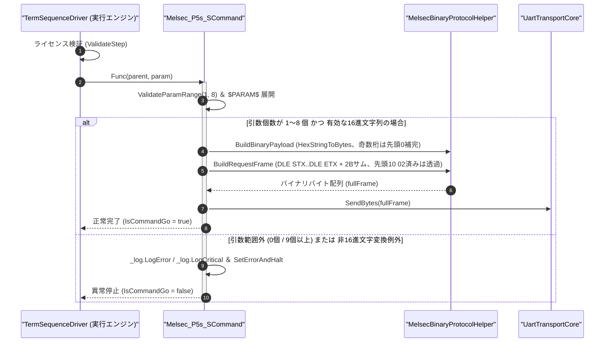

# コマンドリファレンス：Melsec_P5s_S

## 概要

**Melsec_P5s_S** は、三菱電機 MELSEC 計算機リンク **形式 5（バイナリコード通信方式）** の要求電文フレームを自動構築し、先頭制御コード（`DLE [0x10] + STX [0x02]`）、DLE エスケープ処理、終了制御コード（`DLE [0x10] + ETX [0x03]`）、および 2 バイト加算チェックサムを付与してシリアルポートへ送信するバイナリ通信専用コマンドです。

ASCII テキスト形式（形式 1〜4）と比べて電文長が約半分となり、大量データの高速転送や高速サンプリングに適しています。

---

## 💡 書式・パラメータ仕様

### コマンド構文

```csv
,SEQUENCE, [ステップキー], Melsec_P5s_S, [StationNoOrFrameData], "[Command]", "[Data]"
```

※ `ParameterSpec` は `EnableVariableLength(true)` で定義され、実行時（`Func`）は `ValidateParamRange(1, 8)` により 1〜8 個の 16 進文字列トークンを受け付けてバイト配列へ変換・連結します。

### パラメータ（引数）一覧

| 引数位置 | 引数名 | 必須/任意 | 説明・制約 |
| :--- | :--- | :---: | :--- |
| 第 1 引数 | `StationNoOrFrameData` | **必須** | 複数引数指定時は送信先局番または先頭ヘッダ部（例: `"00"` や `"00FF"`）、1 引数指定時は電文本体全体または `DLE STX` 構築済みバイナリ電文の 16 進文字列（例: `"00FF04010000A80000640001"`、空白・カンマ・ハイフン・コロン・`"0x"` 区切り可）を指定します。 |
| 第 2 引数 | `Command` | 任意 | PC 番号や計算機リンクバイナリコマンドの 16 進文字列（例: `"FF"` や `"0401"`、省略時既定値: `""`）。 |
| 第 3 引数 | `Data` | 任意 | コマンドに続く要求データ部の 16 進文字列（省略時既定値: `""`）。第 4〜第 8 引数を分割指定した場合も各トークンがバイト列へ変換され順番に連結されます。 |

---

## 🔄 特殊置換規約・分岐規約の適用

本コマンドの引数における特殊記法および解釈ルールです。
* **動的置換（`$`）**: 引数内で `$PARAMキー$` のように記述すると、実行時に変数プール（PARAM）の値へ動的置換されます。（適用可能な引数: 全引数対応）
* **ジャンプ先指定（`#`）**: 本コマンドはジャンプ制御を行わないため適用されません。（適用可能な引数: 非適用）
* **共通コマンド指定（`@`）**: 本コマンドは外部マクロを呼び出さないため、共通コマンド呼び出し記法は適用されません。（適用可能な引数: 非適用）
* **カンマのエスケープ**: 引数自体にカンマを含める場合は、必ず `"..."` と二重引用符で囲んで記述します。
* **エイリアス（別名）**: `P5s_S`, `Analysis_P5s_S`, `Sqn_Com_P5s_S`, `Analysis_SQN_COM_P5S_S`

---

## 💡 動作例（正しい構文での記述例）

### スクリプト記述例

※COMMAND ブロック配下の子要素行（PARAM, SEQUENCE）は必ず行頭カンマから開始し、スペースインデントや行末コメント（`;`）は記述しないでください。

```csv
COMMAND, "SAMPLE_MELSEC_P5S_S", "PLC_D100"
,PARAM, "PLC_D100", Work, "D100読出結果", ""
,SEQUENCE, 010, Melsec_Mode, "115200,E,8,1", "NONE", "P5"
,SEQUENCE, 020, Melsec_Open
; 局番00、PC番号FF、一括読出コマンド(0401h)、D100から1点読出を形式5で送信
,SEQUENCE, 030, Melsec_P5s_S, "00FF04010000A80000640001"
,SEQUENCE, 040, Melsec_Res_P5s_R, "00", "PLC_D100", "DEC"
; 10進変換されたD100の読出値が 100 以上か判定（未満時は #NG_PROC# へ分岐）
,SEQUENCE, 050, Judge, "GE", "$PLC_D100$", "100", "#NG_PROC#"
,SEQUENCE, 060, Melsec_Close
,SEQUENCE, 070, Exit, "$PLC_D100$", 0
; 閾値未満時のクローズ＆異常終了経路
,SEQUENCE, #NG_PROC#, Melsec_Close
,SEQUENCE, 090, Exit, "NG", -1
```

### 実行時の挙動・変数変化

* **実行前の状態**: Term 通信エンジンが初期化され、変数プール（`PARAM`）に `"PLC_D100"` が定義されている状態。
* **実行後の状態**: `Melsec_P5s_S` により `DLE STX (10 02)` ＋本文（`0x10` 含有時は自動 DLE 二重化エスケープ）＋ `DLE ETX (10 03)` ＋ 2 バイト加算チェックサム（リトルエンディアン）のバイナリフレームが送出され、続く `Melsec_Res_P5s_R` で `"PLC_D100"` に 10 進数値文字列（例: `"100"`）が格納されます。後続の `Judge` で閾値以上が確認されると回線を閉じて正常終了し、未満時は `#NG_PROC#` へ分岐してクローズ後に異常終了します。

---

## 🔄 動作フロー（シーケンス図）



---

## 🚫 エラーハンドリング・安全設計（仕様制限）

1. **引数個数検証および奇数桁 HEX 自動ゼロ補完・不正文字保護**:
   - 引数が 0 個または 9 個以上指定された場合（`ValidateParamRange(1, 8)` 違反）は `_log.LogError` に記録して停止します。指定された HEX 文字列から空白・カンマ・ハイフン・コロン・`"0x"` を除去した結果が **奇数桁となった場合は、停止せず先頭に `"0"` を自動パディング** してバイト配列へ変換します。一方、16 進数以外の不正文字が含まれている場合は例外を捕捉し `_log.LogCritical` 記録および `SetErrorAndHalt(-1, ex.Message)` により安全に停止します。
2. **構築済みフレームの二重フレーミング防止**:
   - ペイロードの先頭がすでに `DLE STX`（`0x10 0x02`、4 バイト以上）で始まっている場合は完全構築済みフレームと判定し、再フレーミングを行わずそのまま送出します。

---

## 🧪 ユニットテスト仕様

本コマンドクラス（`Melsec_P5s_SCommand.cs`）に実装されている `RunUnitTest()` メソッドが検証するユニットテストの仕様です。

### テスト実行前提条件

* **実行トリガー**: `RunUnitTest()` メソッドの呼び出し
* **有効化条件**: システム全体の最小ログレベル（`ErrorLogger.MinimumLevel`）が `LogLevel.Test` であること（それ以外の場合は無効化ガードにより早期リターン）
* **検証結果出力**: `_log.LogTest` によるログ出力。検証失敗時は `_log.LogError`、予期せぬ例外発生時は `_log.LogCritical` で記録し、`finally` ブロックで `UartTransportCore.Shared.IsSimulationMode` を開始前の状態へ復元します。

### テストケース一覧

| No | テストカテゴリ | テスト条件（入力値） | 期待される結果（出力値） | 検証の目的 / 観点 |
| :---: | :--- | :--- | :--- | :--- |
| **1** | 正常系 | `IsSimulationMode = true` 環境下で 3 引数 `"00"`, `"FF"`, `"0401"` を指定して実行 | `!param.HasError` かつ `param.SndData` が `"100200FF04011003"` で始まるバイナリフレーム（`DLE STX`＋本文＋`DLE ETX`＋2 バイトチェックサム）となる | 形式 5 バイナリコード通信フレームの DLE フレーミングおよびサム計算の検証 |
| **2** | 異常系 | 引数 0 個の空 `TermSequence` を指定して `Func(null, invalidParam)` を実行 | `ValidateParamRange(1, 8)` により拒否され、`invalidParam.HasError == true` かつ `!invalidParam.IsCommandGo` となる | 必須引数欠落（0 個）時のバリデーション拒否および安全停止検証 |
