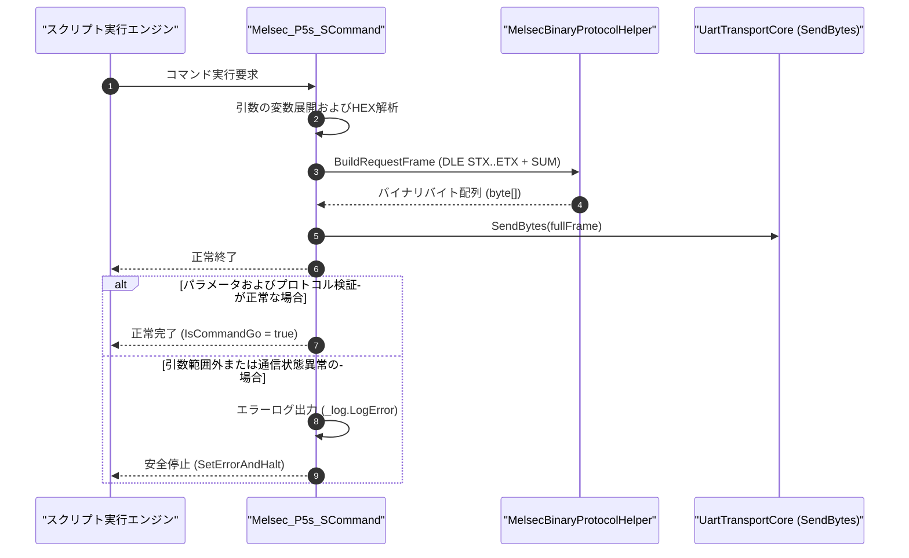

# コマンドリファレンス：Melsec_P5s_S

## 概要

**Melsec_P5s_S** は、三菱電機 MELSEC 計算機リンク **形式 5（バイナリコード通信方式）** の要求電文フレームを自動構築し、先頭制御コード（`DLE [0x10] + STX [0x02]`）、DLE エスケープ処理、終了制御コード（`DLE [0x10] + ETX [0x03]`）、および 2 バイト加算チェックサムを付与してシリアルポートへ送信するバイナリ通信専用コマンドです。

ASCII テキスト形式（形式 1〜4）と比べて電文長が約半分となり、大量データの高速転送や高速サンプリングに最適です。

---

## 💡 書式・パラメータ仕様

### コマンド構文

```csv
,SEQUENCE, [ステップキー], Melsec_P5s_S, "<StationNoOrFrameData>", "[Command]", "[Data]"
```

### パラメータ（引数）一覧

| 引数位置 | パラメータ名 | 必須/任意 | 型・制約 | 説明 |
| :---: | :--- | :---: | :--- | :--- |
| 第1引数 | `StationNoOrFrameData` | **必須** | 16進ダンプ文字列（例: `"00"`, `"00FF04010000A80000640002"`, `"10 02..."`） | 送信先局番、または送信する完全バイナリ電文（16進表現）を指定します。 |
| 第2引数 | `Command` | 任意 | 16進文字列（例: `"0401"`） | 計算機リンクコマンド（2バイト）を指定します。 |
| 第3引数 | `Data` | 任意 | 16進文字列（サブコマンド＋デバイス指定＋点数等） | コマンドに続く要求データ部を指定します。 |

---

## 🔄 特殊置換規約・分岐規約の適用

本コマンドの引数における特殊記法および解釈ルールです。
* **動的置換（`$`）**: 引数内で `$PARAMキー$` のように記述すると、実行時に変数プール（PARAM）の値へ動的置換されます。（適用可能な引数: 全引数対応）
* **ジャンプ先指定（`#`）**: 本コマンドはジャンプ制御を行わないため適用されません。（適用可能な引数: 非適用）
* **共通コマンド指定（`@`）**: 本コマンドは外部マクロを呼び出さないため、共通コマンド呼び出し記法は適用されません。（適用可能な引数: 非適用）
* **カンマのエスケープ**: 通信条件文字列（例: `"9600,E,7,1"`）や複数データのカンマ区切り値を単一引数として渡す場合は、必ず `"..."` と二重引用符で囲んで記述します。
* **エイリアス（別名）**: `P5s_S`, `Analysis_P5s_S`, `Sqn_Com_P5s_S`, `Analysis_SQN_COM_P5S_S`

---

## 💡 動作例（正しい構文での記述例）

### スクリプト記述例

※COMMAND ブロック配下の子要素行（PARAM, SEQUENCE）は必ず行頭カンマから開始し、スペースインデントや行末コメント（`;`）は記述しないでください。

```csv
COMMAND, "SAMPLE_MELSEC_P5S_S", ""
,SEQUENCE, 010, Melsec_Mode, "115200,E,8,1", "NONE", "P5"
,SEQUENCE, 020, Melsec_Open
; 局番00、Qシリーズ一括読出コマンド(0401h)、D100から2点読出を形式5で送信
; 本文: 00(局番) + FF(PC) + 0401(コマンド) + 0000(サブ) + A8(Dレジスタ) + 000064(アドレス) + 0002(点数)
,SEQUENCE, 030, Melsec_P5s_S, "00FF04010000A80000640002"
,SEQUENCE, 040, Melsec_Res_P5s_R, "00", "PLC_D100", "DEC"
,SEQUENCE, 050, Melsec_Close
,SEQUENCE, 060, Exit
```

### 実行時の挙動・変数変化

* **実行前の状態**: Term 通信エンジンが初期化され、必要な通信パラメータおよび変数プール（`PARAM`）が準備されている状態。
* **実行後の状態**: ステップ実行により `Melsec_P5s_S` の通信制御・プロトコル処理が正常に遂行され、結果または回線状態が更新されます。

---

## 🔄 動作フロー（シーケンス図）



---

## 🚫 エラーハンドリング・安全設計（仕様制限）

1. **不正なHEX文字列の検証**: 奇数文字長や16進以外の文字が含まれている場合は安全にエラー停止します。
2. **バイナリシミュレーション**: 実機未接続時もダンプログを安全にトレース出力します。

---

## 🧪 ユニットテスト仕様

本コマンドクラス（`Melsec_P5s_SCommand.cs`）に実装されている `RunUnitTest()` メソッドが検証するユニットテストの仕様です。

### テスト実行前提条件

* **実行トリガー**: `RunUnitTest()` メソッドの呼び出し
* **有効化条件**: システム全体の最小ログレベル（`ErrorLogger.MinimumLevel`）が `LogLevel.Test` であること（それ以外の場合は無効化ガードにより早期リターン）
* **検証結果出力**: `_log.LogTest` によるログ出力。検証失敗時は `_log.LogError`、予期せぬ例外発生時は `_log.LogCritical` で記録し、`finally` ブロックで `UartTransportCore.Shared.IsSimulationMode` を開始前の状態へ復元します。

### テストケース一覧

| No | テストカテゴリ | テスト条件（入力値） | 期待される結果（出力値） | 検証の目的 / 観点 |
| :---: | :--- | :--- | :--- | :--- |
| **1** | 正常系 | `IsSimulationMode = true` 環境下で 3 引数 `"00"`, `"FF"`, `"0401"` を指定して実行 | `!param.HasError` かつ `param.SndData` が `"100200FF04011003"` で始まるバイナリフレーム（`DLE STX`＋本文＋`DLE ETX`＋2 バイトチェックサム）となる | 形式 5 バイナリコード通信フレームの DLE フレーミングおよびサム計算の検証 |
| **2** | 異常系 | 必須引数欠落・引数範囲外（`ValidateParamRange(1, 8)` 違反）、または不正な 16 進文字列によるパース例外 | 引数検証エラーによる早期リターン、または `_log.LogCritical` 記録と `SetErrorAndHalt(-1, ex.Message)` による安全停止 | 引数境界チェックおよび不正 HEX 入力時のクラッシュ防御検証 |
