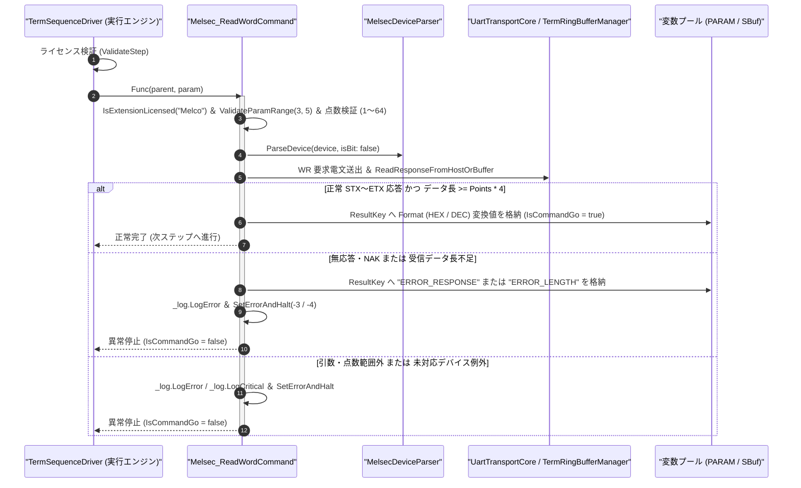

# コマンドリファレンス：Melsec_ReadWord

## 概要

**Melsec_ReadWord** は、三菱電機 MELSEC シーケンサ（計算機リンクユニット / 通信ポート）に対してワード単位の一括読出要求（`WR` コマンド）を実行し、取得したデータを指定の変数またはセルへ格納する高水準通信制御系コマンドです。
複雑な計算機リンクのデバイスコード指定（`0D0100` 等）や ASCII プロトコルフレーム（形式 1 〜 4）、サムチェック計算を意識することなく、`"D100"` や `"W0010"` といった直感的なデバイス表記で通信を行うことができます。

> 💡 **補足**: 本コマンドの送信フレーム構築は **ASCII コード通信方式である形式 1 〜 形式 4（`P1` / `P2` / `P3` / `P4`）専用** であり、[Melsec_Mode](Melsec_Mode.Md) コマンドの設定値（未指定時は `P1` / 伝送待ち時間 `0`）に自動追従します。 **バイナリコード通信方式の形式 5（`P5`）には非対応** であるため、形式 5 を使用する場合は [`Melsec_P5s_S`](Melsec_P5s_S.Md) / [`Melsec_P5s_R`](Melsec_P5s_R.Md) / [`Melsec_Res_P5s_R`](Melsec_Res_P5s_R.Md) を使用してください。

### 🔄 対象ワードデバイス仕様

| デバイス種別 | 表記例 | デバイスコード変換 | アドレス進数 |
| :--- | :--- | :--- | :--- |
| データレジスタ | `D100` | `0D0100` | 10 進 |
| リンクレジスタ | `W0010` | `0W0010` | 16 進 |
| ファイルレジスタ | `R50` | `0R0050` | 10 進 |
| タイマ現在値 | `TN0` | `TN0000` | 10 進 |
| カウンタ現在値 | `CN0` | `CN0000` | 10 進 |

---

## 💡 書式・パラメータ仕様

### コマンド構文

```csv
,SEQUENCE, [ステップキー], Melsec_ReadWord, [Device], [Points], [ResultKey], "[Format: HEX]", "[StationNo: 00]"
```

### パラメータ（引数）一覧

| 引数位置 | 引数名 | 必須/任意 | 説明・制約 |
| :--- | :--- | :---: | :--- |
| 第 1 引数 | `Device` | **必須** | 読み出しを開始する先頭ワードデバイス名（例: `"D100"`, `"W10"`, `"R50"`, `"TN0"`, `"CN0"`）。 |
| 第 2 引数 | `Points` | **必須** | 連続して読み出すワード点数（`1`〜`64` の整数。`0` 以下または `65` 以上の整数はエラーコード `-2` で停止します）。 |
| 第 3 引数 | `ResultKey` | **必須** | 読み出したデータ値を格納するパラメータキー名（`"@"` や `"$"` を付けない素のキー名、例: `"READ_HEX_VAL"`）。 |
| 第 4 引数 | `Format` | 任意 | 格納する数値表現形式（`"DEC"` 指定時は符号付き 16 ビット 10 進数のカンマ区切り、それ以外［既定 `"HEX"`］は `"0xXXXX,0xYYYY"` 形式）。 |
| 第 5 引数 | `StationNo` | 任意 | 送信先の局番 2 桁 16 進文字列（省略時既定値: `"00"`、自局 PC 番号 `"FF"` は自動補完）。 |

---

## 🔄 特殊置換規約・分岐規約の適用

本コマンドの引数における特殊記法および解釈ルールです。
* **動的置換（`$`）**: 引数内で `$PARAMキー$` のように記述すると、実行時に変数プール（PARAM）の値へ動的置換されます。（適用可能な引数: 全引数対応）
* **ジャンプ先指定（`#`）**: 本コマンドはジャンプ制御を行わないため適用されません。（適用可能な引数: 非適用）
* **共通コマンド指定（`@`）**: 本コマンドは外部マクロを呼び出さないため、共通コマンド呼び出し記法は適用されません。（適用可能な引数: 非適用）
* **カンマのエスケープ**: 引数自体にカンマを含める場合は、必ず `"..."` と二重引用符で囲んで記述します。
* **エイリアス（別名）**: `Analysis_Melsec_ReadWord`, `Sqn_Melsec_ReadWord`

---

## 💡 動作例（正しい構文での記述例）

### スクリプト記述例

※COMMAND ブロック配下の子要素行（PARAM, SEQUENCE）は必ず行頭カンマから開始し、スペースインデントや行末コメント（`;`）は記述しないでください。

```csv
COMMAND, "MELSEC_READ_WORD_DEMO", "READ_HEX_VAL"
,PARAM, "READ_HEX_VAL", Work, "16進読出結果", ""
,PARAM, "READ_DEC_VAL", Work, "10進読出結果", ""
,SEQUENCE, 010, Melsec_Mode, "9600,E,7,1", "NONE", "P1"
,SEQUENCE, 020, Melsec_Open
; D100 から 1 ワード読出（16進形式、局番 00）
,SEQUENCE, 030, Melsec_ReadWord, "D100", 1, "READ_HEX_VAL", "HEX", "00"
; D200 から 3 ワード読出（10進形式、局番 00）
,SEQUENCE, 040, Melsec_ReadWord, "D200", 3, "READ_DEC_VAL", "DEC", "00"
; D100 の読出値が 0x0064 (100) 以上か判定（未満時は #NG_PROC# へ分岐）
,SEQUENCE, 050, Judge, "GE", "$READ_HEX_VAL$", "0x0064", "#NG_PROC#"
,SEQUENCE, 060, Melsec_Close
,SEQUENCE, 070, Exit, "$READ_HEX_VAL$", 0
; 条件不成立時のクローズ＆異常終了経路
,SEQUENCE, #NG_PROC#, Melsec_Close
,SEQUENCE, 090, Exit, "NG", -1
```

### 実行時の挙動・変数変化

* **実行前の状態**: MELSEC 計算機リンク回線がオープン済みで、`"READ_HEX_VAL"` と `"READ_DEC_VAL"` が空文字列 `""` の状態。
* **実行後の状態**: ステップ `030` で `D100` の 16 進文字列（例: `"0x01F4"`）が `"READ_HEX_VAL"` に格納され、ステップ `040` で `D200`〜`D202` の 10 進カンマ区切り値が `"READ_DEC_VAL"` に格納されます。後続の `Judge` で `0x0064` 以上が確認されると回線を閉じて正常終了し、未満時は `#NG_PROC#` へ分岐してクローズ後にエラー終了します。

---

## 🔄 動作フロー（シーケンス図）



---

## 🚫 エラーハンドリング・安全設計（仕様制限）

入力データの異常や実行時エラーに対し、解析・実行エンジンが実行するセーフティ規約です。

1. **引数・点数範囲およびデバイス構文の保護**:
   - 引数個数不正（`ValidateParamRange(3, 5)` 違反）、デバイス空指定（`-1`）、および点数範囲外（`1`〜`64` 以外の整数指定、`-2`）の場合は `_log.LogError` と `SetErrorAndHalt` で送信前に遮断します。未対応デバイス種別等のパース例外時は `catch` 節で `_log.LogCritical` に記録し `SetErrorAndHalt(-1, ex.Message)` で停止します。
2. **無応答・NAK・データ長不足の検出**:
   - タイムアウトや `NAK` 応答時は `ResultKey` に `"ERROR_RESPONSE"` を格納してエラーコード `-3` で停止し、抽出データ長が `Points * 4` 文字未満の場合は `"ERROR_LENGTH"` を格納してエラーコード `-4` で安全停止します。

---

## 🧪 ユニットテスト仕様

本コマンドクラス（`Melsec_ReadWordCommand.cs`）に実装されている `RunUnitTest()` メソッドが検証するユニットテストの仕様です。

### テスト実行前提条件

* **実行トリガー**: `RunUnitTest()` メソッドの呼び出し
* **有効化条件**: システム全体の最小ログレベル（`ErrorLogger.MinimumLevel`）が `LogLevel.Test` であること（それ以外の場合は無効化ガードにより早期リターン）
* **検証結果出力**: `_log.LogTest` によるログ出力。検証失敗時は `_log.LogError`、予期せぬ例外発生時は `_log.LogCritical` で記録し、`finally` ブロックで `Melsec_ModeCommand.DefaultProtocolType` および `UartTransportCore.Shared.IsSimulationMode` を開始前の状態へ復元します。

### テストケース一覧

| No | テストカテゴリ | テスト条件（入力値） | 期待される結果（出力値） | 検証の目的 / 観点 |
| :---: | :--- | :--- | :--- | :--- |
| **1** | 正常系 | `IsSimulationMode = true`・`DefaultProtocolType = "P4"` 環境下で引数 `"D100"`, `"2"`, `"RES_D"`, `"HEX"`, `"00"` および擬似応答（`STX + "00FF12345678" + ETX + SUM + CRLF`）を与えて実行 | `!param.HasError` かつ `param.IsCommandGo == true`、格納先 `SBuf["RES_D"]` が `"0x1234,0x5678"` と一致する | `WR` 一括読出フレーム構築・形式 4 応答解析・HEX カンマ区切り格納の検証 |
| **2** | 異常系 | 点数範囲外 `"0"` を指定（引数 `"D100"`, `"0"`, `"RES_D_ERR"`）して `Func(null, invalidParam)` を実行 | 点数境界チェックにより `SetErrorAndHalt(-2, ...)` が呼ばれ、`invalidParam.HasError == true` かつ `!invalidParam.IsCommandGo` となる | 点数下限未満（`0` 点）指定時のバリデーション拒否および安全停止検証 |
