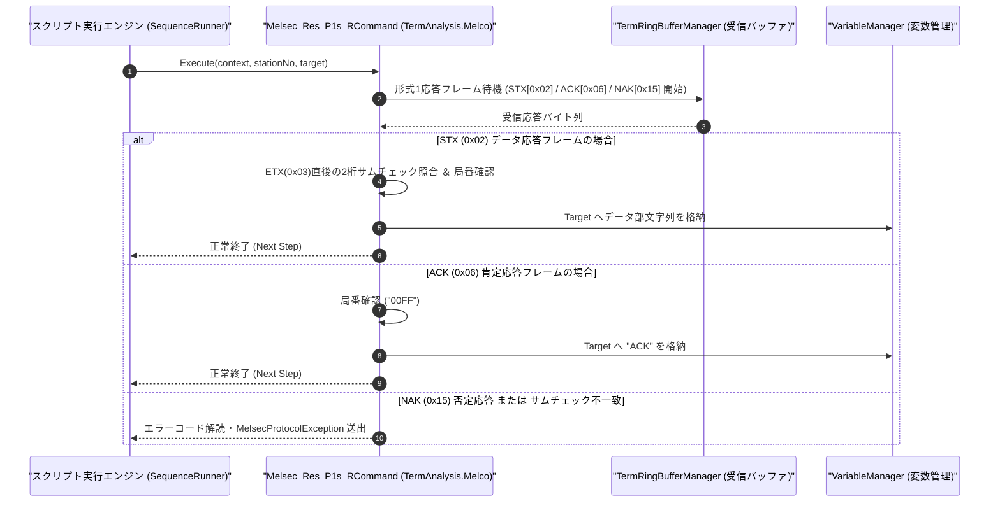

# コマンドリファレンス：Melsec_Res_P1s_R

## 概要

**Melsec_Res_P1s_R** は、`Melsec_P1s_S` で送信した要求電文に対する MELSEC シーケンサからの **専用プロトコル形式 1 応答電文** （データ応答フレーム `STX [0x02] ... ETX [0x03] + Sum2桁`、肯定応答 `ACK [0x06] ...`、または否定応答 `NAK [0x15] ...`）を受信・解析し、サムチェック照合後に読み出しデータ（または ACK/NAK ステータス）を指定ターゲット変数へ格納するコマンドです。

> 💡 **補足**: 読み出し要求（`BR` / `WR`）に対する `STX...ETX` データ応答と、書き込み要求（`BW` / `WW`）に対する `ACK` 応答の双方を自動判別して処理します。

---

## 💡 書式・パラメータ仕様

### コマンド構文

```csv
,SEQUENCE, [ステップキー], Melsec_Res_P1s_R, [StationNoOrHead], "[TargetOrPoints]", "[LegacyDest]", "[LegacyFormat]"
```

### パラメータ（引数）一覧

| 引数位置 | 引数名 | 必須/任意 | 説明・制約 |
| :--- | :--- | :---: | :--- |
| 第 1 引数 | `StationNoOrHead` | **必須** | 期待するシーケンサ局番または応答ヘッダ文字列（例: `"00"` または `"00FF"`）。 |
| 第 2 引数 | `TargetOrPoints` | 任意 | 2 引数標準構文時は抽出データ格納先の変数キー名、旧構文時は読出点数（省略時既定値: `""`）。 |
| 第 3 引数 | `LegacyDest` | 任意 | 旧 3〜4 引数互換構文における格納先レジスタ／変数キー名（省略時既定値: `""`）。 |
| 第 4 引数 | `LegacyFormat` | 任意 | 取得データの基数変換フォーマット（`"HEX"` / `"DEC"` 等、省略時既定値: `""`）。 |

---

## 🔄 特殊置換規約・分岐規約の適用

本コマンドの引数における特殊記法および解釈ルールです。
* **動的置換（`$`）**: 引数内で `$PARAMキー$` のように記述すると、実行時に変数プール（PARAM）の値へ動的置換されます。（適用可能な引数: 全引数対応）
* **ジャンプ先指定（`#`）**: 本コマンドはジャンプ制御を行わないため適用されません。（適用可能な引数: 非適用）
* **共通コマンド指定（`@`）**: 本コマンドは外部マクロを呼び出さないため、共通コマンド呼び出し記法は適用されません。（適用可能な引数: 非適用）
* **カンマのエスケープ**: 通信条件文字列（例: `"9600,E,7,1"`）や複数データのカンマ区切り値を単一引数として渡す場合は、必ず `"..."` と二重引用符で囲んで記述します。
* **エイリアス（別名）**: `Res_P1s_R`, `Analysis_Res_P1s_R`, `Sqn_Res_P1s_R`, `Analysis_SQN_RES_P1S_R`

---

## 💡 動作例（正しい構文での記述例）

### スクリプト記述例

※COMMAND ブロック配下の子要素行（PARAM, SEQUENCE）は必ず行頭カンマから開始し、スペースインデントや行末コメント（`;`）は記述しないでください。

```csv
COMMAND, "SAMPLE_MELSEC_RES_P1S_R", ""
,PARAM, "D100_HEX", Text, "D100_HEX", ""
,SEQUENCE, 010, Melsec_Mode, "9600,O,7,1", "NONE", "P1"
,SEQUENCE, 020, Melsec_Open
; 1. D0100から2ワード読出要求(WR)を形式1で送信
,SEQUENCE, 030, Melsec_P1s_S, "00", "WR", "0D010002"
; 2. 形式1のSTX...ETX応答電文を受信し、2ワード分のHEX文字列(8文字)を $D100_HEX へ格納
,SEQUENCE, 040, Melsec_Res_P1s_R, "00", "$D100_HEX$"
; 3. シーケンサへ完了確認のACKを返す必要があるモードの場合は後続処理へ継続
,SEQUENCE, 050, Melsec_Close
,SEQUENCE, 060, Exit
```

### 実行時の挙動・変数変化

* **実行前の状態**: Term 通信エンジンが初期化され、必要な通信パラメータおよび変数プール（`PARAM`）が準備されている状態。
* **実行後の状態**: シーケンサから `[STX(0x02)] + "00FF" + "03E807D0" + [ETX(0x03)] + [Sum2桁]` が返却されます。 `Melsec_Res_P1s_R` は局番 `"00FF"` の一致および `STX` の次バイト〜`ETX` までのサムチェック 2 桁を検証し、データ部 `"03E807D0"` を `$D100_HEX` に格納します。

---

## 🔄 動作フロー（シーケンス図）



---

## 🚫 エラーハンドリング・安全設計（仕様制限）

1. **NAK（`0x15`）エラーコードの解読と通知**:
   - シーケンサから `NAK (0x15) + 局番 + PC番号 + エラーコード(2桁)` が返された場合、エラーコードを含めて例外を送出し、異常状態で次ステップへ進むことを防止します。
2. **サムチェック不一致の検出**:
   - `STX` 応答フレームのサムチェックが不一致の場合は、受信データを破棄して通信エラーを送出します。

---

## 🧪 ユニットテスト仕様

本コマンドクラス（`Melsec_Res_P1s_RCommand.cs`）に実装されている `RunUnitTest()` メソッドが検証するユニットテストの仕様です。

### テスト実行前提条件

* **実行トリガー**: `RunUnitTest()` メソッドの呼び出し
* **有効化条件**: システム全体の最小ログレベル（`ErrorLogger.MinimumLevel`）が `LogLevel.Test` であること（それ以外の場合は無効化ガードにより早期リターン）
* **検証結果出力**: `_log.LogTest` によるログ出力。検証失敗時は `_log.LogError`、予期せぬ例外発生時は `_log.LogCritical` で記録し、`finally` ブロックで `testSbuf?.Clear()`、`TermRingBufferManager.Instance.ClearBuffer()`、および `UartTransportCore.Shared.IsLoopbackMode` の復元を実行します。

### テストケース一覧

| No | テストカテゴリ | テスト条件（入力値） | 期待される結果（出力値） | 検証の目的 / 観点 |
| :---: | :--- | :--- | :--- | :--- |
| **1** | 正常系 | `IsLoopbackMode = true` 環境下で引数 `"00"`, `"RES_DATA"` および擬似応答 `'\u0002' + "00FF01000200" + '\u0003' + SQNSUM(...)` を与えて実行 | `!param.HasError` かつ `param.IsCommandGo == true`、格納先 `SBuf["RES_DATA"]` が `"0x0100,0x0200"` と一致する | 形式 1 `STX`〜`ETX` 応答のサムチェック照合およびデータ抽出格納の検証 |
| **2** | 異常系 | `NAK` 否定応答フレーム `"\u001500FF55"` および `Func(null, null)` を指定して実行 | `NAK` 検出により `"NAK"` を格納して `!nakParam.IsCommandGo` で停止し、`null` 入力でもクラッシュしない | `NAK` エラー応答検出および `null` パラメータに対する安全防御検証 |
