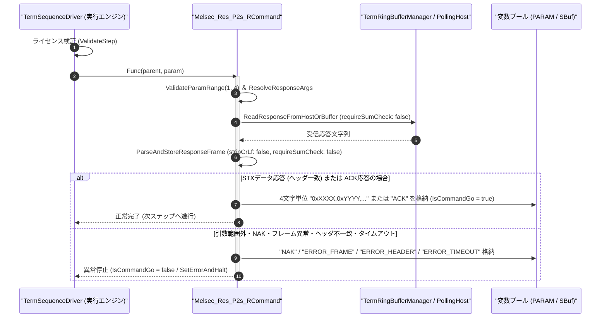

# コマンドリファレンス：Melsec_Res_P2s_R

## 概要

**Melsec_Res_P2s_R** は、三菱電機 MELSEC 計算機リンク **形式 2（サムチェックなし対話手順、CR/LF なし）** の応答電文を受信検証し、`STX`〜`ETX` で囲まれたデータ部（または `ACK` / `NAK`）を抽出して指定のパラメータまたはレジスタへ格納するコマンドです。

形式 1 と異なり、`ETX` 直後のサムチェック（2 桁 ASCII）の照合は行われません。

---

## 💡 書式・パラメータ仕様

### コマンド構文

```csv
,SEQUENCE, [ステップキー], Melsec_Res_P2s_R, [StationNoOrHead], "[TargetOrPoints]", "[LegacyDest]", "[LegacyFormat]"
```

※ `ParameterSpec` は `EnableVariableLength(true)` で定義されていますが、実行時（`Func`）は `ValidateParamRange(1, 4)` により **1〜4 個** の引数を受け付けます（5 個以上指定した場合はエラー停止します）。

### パラメータ（引数）一覧

| 引数位置 | 引数名 | 必須/任意 | 説明・制約 |
| :--- | :--- | :---: | :--- |
| 第 1 引数 | `StationNoOrHead` | **必須** | 2 引数以上の構文時は期待するシーケンサ局番または応答ヘッダ文字列（例: `"00"` または `"00FF"`。2 引数標準構文で 2 文字局番 `"00"` を指定した場合は自動的に `"00FF"` として照合されます）。1 引数構文時は格納先パラメータキー名として扱われます。 |
| 第 2 引数 | `TargetOrPoints` | 任意 | 2 引数標準構文時は抽出データの格納先パラメータキー名（`"@"` や `"$"` を付けない素のキー名、例: `"PLC_D100"`。データ部は 4 文字ごとの `"0xXXXX,0xYYYY,..."` 形式で格納）、旧 3〜4 引数構文時は 16 進読出点数（省略時既定値: `""`）。 |
| 第 3 引数 | `LegacyDest` | 任意 | 旧 3〜4 引数互換構文における格納先レジスタ／パラメータキー名（省略時既定値: `""`）。 |
| 第 4 引数 | `LegacyFormat` | 任意 | 旧 4 引数互換構文（格納先が数値キーで連番格納する場合）における `TermStringUtility.Sscanf` 変換フォーマット（省略時既定値: `""`）。 |

---

## 🔄 特殊置換規約・分岐規約の適用

本コマンドの引数における特殊記法および解釈ルールです。
* **動的置換（`$`）**: 引数内で `$PARAMキー$` のように記述すると、実行時に変数プール（PARAM）の値へ動的置換されます。（適用可能な引数: 全引数対応）
* **ジャンプ先指定（`#`）**: 本コマンドはジャンプ制御を行わないため適用されません。（適用可能な引数: 非適用）
* **共通コマンド指定（`@`）**: 本コマンドは外部マクロを呼び出さないため、共通コマンド呼び出し記法は適用されません。（適用可能な引数: 非適用）
* **カンマのエスケープ**: 引数自体にカンマを含める場合は、必ず `"..."` と二重引用符で囲んで記述します。
* **エイリアス（別名）**: `Res_P2s_R`, `Analysis_Res_P2s_R`, `Sqn_Res_P2s_R`, `Analysis_SQN_RES_P2S_R`

---

## 💡 動作例（正しい構文での記述例）

### スクリプト記述例

※COMMAND ブロック配下の子要素行（PARAM, SEQUENCE）は必ず行頭カンマから開始し、スペースインデントや行末コメント（`;`）は記述しないでください。

```csv
COMMAND, "SAMPLE_MELSEC_RES_P2S_R", "PLC_D100"
,PARAM, "PLC_D100", Work, "D100読出結果", ""
,SEQUENCE, 010, Melsec_Mode, "9600,E,7,1", "NONE", "P2"
,SEQUENCE, 020, Melsec_Open
; 形式2で局番00・PC番号FFのD100読出要求(1点)を送信し、STX..ETX応答を PLC_D100 へ格納
,SEQUENCE, 030, Melsec_P2s_S, "00FF", "WR", "00D010001"
,SEQUENCE, 040, Melsec_Res_P2s_R, "00", "PLC_D100"
; 読出値が 0x0064 (100) 以上か判定（未満時は #NG_PROC# へ分岐）
,SEQUENCE, 050, Judge, "GE", "$PLC_D100$", "0x0064", "#NG_PROC#"
,SEQUENCE, 060, Melsec_Close
,SEQUENCE, 070, Exit, "$PLC_D100$", 0
; 閾値未満時のクローズ＆異常終了経路
,SEQUENCE, #NG_PROC#, Melsec_Close
,SEQUENCE, 090, Exit, "NG", -1
```

### 実行時の挙動・変数変化

* **実行前の状態**: Term 通信エンジンが初期化され、変数プール（`PARAM`）に `"PLC_D100"` が定義されている状態。
* **実行後の状態**: 形式 2 応答フレーム（`STX`〜`ETX`・サムチェックなし）から期待ヘッダ `"00FF"` が照合され、データ部が 4 文字単位の `"0xXXXX,..."` 形式で `"PLC_D100"` に格納されます。後続の `Judge` で `0x0064` 以上が確認されると回線を閉じて正常終了し、未満時は `#NG_PROC#` へ分岐してクローズ後に異常終了します。

---

## 🔄 動作フロー（シーケンス図）



---

## 🚫 エラーハンドリング・安全設計（仕様制限）

1. **引数個数境界および NAK・フレーム構造・ヘッダの検証**:
   - 引数が 0 個または 5 個以上指定された場合（`ValidateParamRange(1, 4)` 違反）は `_log.LogError` に記録し `SetErrorAndHalt` で停止します。受信応答が `NAK`（`0x15` / `0x0F`）の場合は `"NAK"`、`STX`/`ETX` 位置異常時は `"ERROR_FRAME"`、期待ヘッダ前方不一致時は `"ERROR_HEADER"` を格納先に記録し `param.IsCommandGo = false` で停止します。
2. **受信タイムアウトおよび実行時例外の保護**:
   - 受信フレームが空文字列（タイムアウト）の場合は格納先に `"ERROR_TIMEOUT"` を記録して `param.IsCommandGo = false` で停止し、予期せぬ例外発生時は `_log.LogCritical` に記録の上 `SetErrorAndHalt(-1, ex.Message)` で安全に停止します。

---

## 🧪 ユニットテスト仕様

本コマンドクラス（`Melsec_Res_P2s_RCommand.cs`）に実装されている `RunUnitTest()` メソッドが検証するユニットテストの仕様です。

### テスト実行前提条件

* **実行トリガー**: `RunUnitTest()` メソッドの呼び出し
* **有効化条件**: システム全体の最小ログレベル（`ErrorLogger.MinimumLevel`）が `LogLevel.Test` であること（それ以外の場合は無効化ガードにより早期リターン）
* **検証結果出力**: `_log.LogTest` によるログ出力。検証失敗時は `_log.LogError`、予期せぬ例外発生時は `_log.LogCritical` で記録し、`finally` ブロックで `testSbuf?.Clear()`、`TermRingBufferManager.Instance.ClearBuffer()`、および `UartTransportCore.Shared.IsLoopbackMode` の復元を実行します。

### テストケース一覧

| No | テストカテゴリ | テスト条件（入力値） | 期待される結果（出力値） | 検証の目的 / 観点 |
| :---: | :--- | :--- | :--- | :--- |
| **1** | 正常系 | `IsLoopbackMode = true` 環境下で引数 `"00"`, `"RESULT_KEY"` およびサムチェックなし擬似応答 `"\u000200FF1234ABCD\u0003"` を与えて実行 | `!param.HasError` かつ `param.IsCommandGo == true`、格納先 `SBuf["RESULT_KEY"]` が `"0x1234,0xABCD"` と一致する | 形式 2 `STX`〜`ETX` 応答電文（サムチェックなし）の解析および 16 進格納検証 |
| **2** | 異常系 | 引数不足（引数 0 個の `TermSequence`）を指定した `Func(null, invalidParam)` および `Func(null, null)` を実行 | `ValidateParamRange(1, 4)` により `!invalidParam.IsCommandGo` で安全に拒否され、`null` 入力でも例外クラッシュしない | 必須引数欠落および `null` パラメータに対する安全防御検証 |
