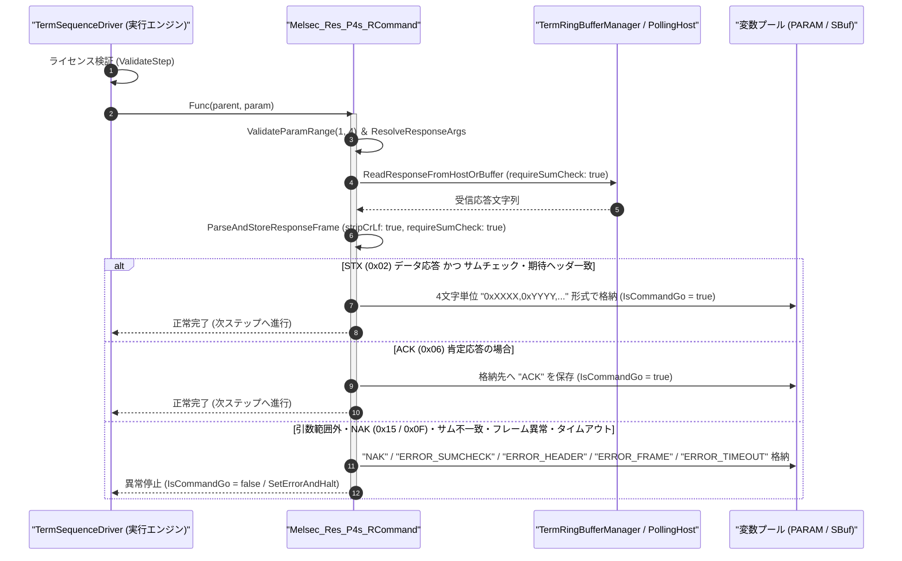

# コマンドリファレンス：Melsec_Res_P4s_R

## 概要

**Melsec_Res_P4s_R** は、`Melsec_P4s_S` で送信した要求電文に対する MELSEC シーケンサからの **専用プロトコル形式 4 応答電文** （`STX [0x02] ... ETX [0x03] + Sum2桁 + CR + LF`、`ACK [0x06] ...`、または `NAK [0x15 / 0x0F] ...`）を受信・解析し、末尾に `CR+LF`（`0x0D 0x0A`）が付帯している場合は除去した上で 2 桁 ASCII サムチェックおよび期待ヘッダを照合し、読み出しデータ（または `ACK` / `NAK` ステータス）を指定ターゲット変数へ格納するコマンドです。

> 💡 **補足**: 解析内部（`stripCrLf: true`）ではフレーム末尾に `\r\n` が存在すれば除去してからサムチェック検証を行い、仮に末尾 `\r\n` が省略されたフレームであってもエラーにせずサムチェックおよびヘッダ照合を実行します。

---

## 💡 書式・パラメータ仕様

### コマンド構文

```csv
,SEQUENCE, [ステップキー], Melsec_Res_P4s_R, [StationNoOrHead], "[TargetOrPoints]", "[LegacyDest]", "[LegacyFormat]"
```

※ `ParameterSpec` は `EnableVariableLength(true)` で定義されていますが、実行時（`Func`）は `ValidateParamRange(1, 4)` により **1〜4 個** の引数を受け付けます（5 個以上指定した場合はエラー停止します）。

### パラメータ（引数）一覧

| 引数位置 | 引数名 | 必須/任意 | 説明・制約 |
| :--- | :--- | :---: | :--- |
| 第 1 引数 | `StationNoOrHead` | **必須** | 2 引数以上の構文時は期待するシーケンサ局番または応答ヘッダ文字列（例: `"00"` または `"00FF"`。2 引数標準構文で 2 文字局番 `"00"` を指定した場合は自動的に `"00FF"` として照合されます）。1 引数構文時は格納先パラメータキー名として扱われます。 |
| 第 2 引数 | `TargetOrPoints` | 任意 | 2 引数標準構文時は抽出データ格納先のパラメータキー名（`"@"` や `"$"` を付けない素のキー名、例: `"D200_VAL"`。データ部は 4 文字ごとの `"0xXXXX,0xYYYY,..."` 形式で格納）、旧 3〜4 引数構文時は 16 進読出点数（省略時既定値: `""`）。 |
| 第 3 引数 | `LegacyDest` | 任意 | 旧 3〜4 引数互換構文における格納先レジスタ／パラメータキー名（省略時既定値: `""`）。 |
| 第 4 引数 | `LegacyFormat` | 任意 | 旧 4 引数互換構文（格納先が数値キーで連番格納する場合）における `TermStringUtility.Sscanf` 変換フォーマット（省略時既定値: `""`）。 |

---

## 🔄 特殊置換規約・分岐規約の適用

本コマンドの引数における特殊記法および解釈ルールです。
* **動的置換（`$`）**: 引数内で `$PARAMキー$` のように記述すると、実行時に変数プール（PARAM）の値へ動的置換されます。（適用可能な引数: 全引数対応）
* **ジャンプ先指定（`#`）**: 本コマンドはジャンプ制御を行わないため適用されません。（適用可能な引数: 非適用）
* **共通コマンド指定（`@`）**: 本コマンドは外部マクロを呼び出さないため、共通コマンド呼び出し記法は適用されません。（適用可能な引数: 非適用）
* **カンマのエスケープ**: 引数自体にカンマを含める場合は、必ず `"..."` と二重引用符で囲んで記述します。
* **エイリアス（別名）**: `Res_P4s_R`, `Analysis_Res_P4s_R`, `Sqn_Res_P4s_R`, `Analysis_SQN_RES_P4S_R`

---

## 💡 動作例（正しい構文での記述例）

### スクリプト記述例

※COMMAND ブロック配下の子要素行（PARAM, SEQUENCE）は必ず行頭カンマから開始し、スペースインデントや行末コメント（`;`）は記述しないでください。

```csv
COMMAND, "SAMPLE_MELSEC_RES_P4S_R", "D200_VAL"
,PARAM, "D200_VAL", Work, "D200読出値", ""
,SEQUENCE, 010, Melsec_Mode, "9600,O,7,1", "NONE", "P4"
,SEQUENCE, 020, Melsec_Open
; 1. 局番00・PC番号FF、D0200から1ワード読出要求(WR)を形式4で送信
,SEQUENCE, 030, Melsec_P4s_S, "00FF", "WR", "00D020001"
; 2. 形式4の応答電文(STX...ETX+Sum+CRLF)を受信し、データ部を D200_VAL へ格納
,SEQUENCE, 040, Melsec_Res_P4s_R, "00", "D200_VAL"
; 3. 条件判定：D200_VAL == 0x0064 (100) であれば通知後に正常終了、不一致時は #NG_PROC# へジャンプ
,SEQUENCE, 050, Judge, "EQU", "$D200_VAL$", "0x0064", "#NG_PROC#"
,SEQUENCE, 060, Msg_Box, "D0200の値が期待値($D200_VAL$)と一致しました"
,SEQUENCE, 070, Melsec_Close
,SEQUENCE, 080, Exit, "$D200_VAL$", 0
; 期待値不一致時のクローズ＆異常終了経路
,SEQUENCE, #NG_PROC#, Melsec_Close
,SEQUENCE, 100, Exit, "NG", -1
```

### 実行時の挙動・変数変化

* **実行前の状態**: Term 通信エンジンが初期化され、変数プール（`PARAM`）に `"D200_VAL"` が定義されている状態。
* **実行後の状態**: シーケンサから `[STX(0x02)] + "00FF0064" + [ETX(0x03)] + [Sum2桁] + [CR][LF]` が返却されます。`Melsec_Res_P4s_R` は末尾 `\r\n` を除去した上でサムチェック 2 桁および局番ヘッダ `"00FF"` を検証し、4 文字単位で整形した `"0x0064"` を `"D200_VAL"` に格納します（無応答や `NAK`・サム不一致時はステップ `040` で `IsCommandGo = false` となり即時 Fail-Fast 停止します）。正常格納後は `Judge` で `"0x0064"` と比較され、一致時は `Msg_Box` 表示後にクローズして正常終了し、不一致時は `#NG_PROC#` へ分岐してクローズ後に異常終了します。

---

## 🔄 動作フロー（シーケンス図）



---

## 🚫 エラーハンドリング・安全設計（仕様制限）

1. **引数個数境界および NAK 否定応答の検出**:
   - 引数が 0 個または 5 個以上指定された場合（`ValidateParamRange(1, 4)` 違反）は `_log.LogError` に記録し `SetErrorAndHalt` で停止します。シーケンサから `NAK`（`0x15` / `0x0F`）が返された場合は、格納先キーへ `"NAK"` を記録し `param.IsCommandGo = false` として停止します。
2. **末尾 `CR+LF` 除去とサムチェック・フレーム構造の検証**:
   - 末尾に `\r\n` が付帯している場合は除去した上で（付帯していない場合もそのまま）`STX` 直後〜`ETX` までの 2 桁 ASCII サムチェックおよび期待ヘッダを照合し、サム不一致時は `"ERROR_SUMCHECK"`、期待ヘッダ不一致時は `"ERROR_HEADER"`、制御文字位置・長さ異常時は `"ERROR_FRAME"`、無応答時は `"ERROR_TIMEOUT"` を格納先へ記録して `param.IsCommandGo = false` で停止します。

---

## 🧪 ユニットテスト仕様

本コマンドクラス（`Melsec_Res_P4s_RCommand.cs`）に実装されている `RunUnitTest()` メソッドが検証するユニットテストの仕様です。

### テスト実行前提条件

* **実行トリガー**: `RunUnitTest()` メソッドの呼び出し
* **有効化条件**: システム全体の最小ログレベル（`ErrorLogger.MinimumLevel`）が `LogLevel.Test` であること（それ以外の場合は無効化ガードにより早期リターン）
* **検証結果出力**: `_log.LogTest` によるログ出力。検証失敗時は `_log.LogError`、予期せぬ例外発生時は `_log.LogCritical` で記録し、`finally` ブロックで `testSbuf?.Clear()`、`TermRingBufferManager.Instance.ClearBuffer()`、および `UartTransportCore.Shared.IsLoopbackMode` の復元を実行します。

### テストケース一覧

| No | テストカテゴリ | テスト条件（入力値） | 期待される結果（出力値） | 検証の目的 / 観点 |
| :---: | :--- | :--- | :--- | :--- |
| **1** | 正常系 | `IsLoopbackMode = true` 環境下で引数 `"00"`, `"RES_P4_DATA"` および擬似応答 `'\u0002' + "00FF00AA00BB" + '\u0003' + SQNSUM(...) + "\r\n"` を与えて実行 | `!param.HasError` かつ `param.IsCommandGo == true`、格納先 `SBuf["RES_P4_DATA"]` が `"0x00AA,0x00BB"` と一致する | 形式 4 `STX`〜`ETX`＋サムチェック＋`CR+LF` 応答電文の解析および格納検証 |
| **2** | 異常系 | サムチェック不一致応答フレーム（`'\u0002' + sumTarget + "00\r\n"`）を指定した `Func(null, badParam)` および `Func(null, null)` を実行 | サムチェック異常により `"ERROR_SUMCHECK"` が格納されて `badParam.HasError \|\| !badParam.IsCommandGo` となり、`null` 入力でも例外クラッシュしない | サムチェック不一致検出および `null` パラメータに対する安全防御検証 |
