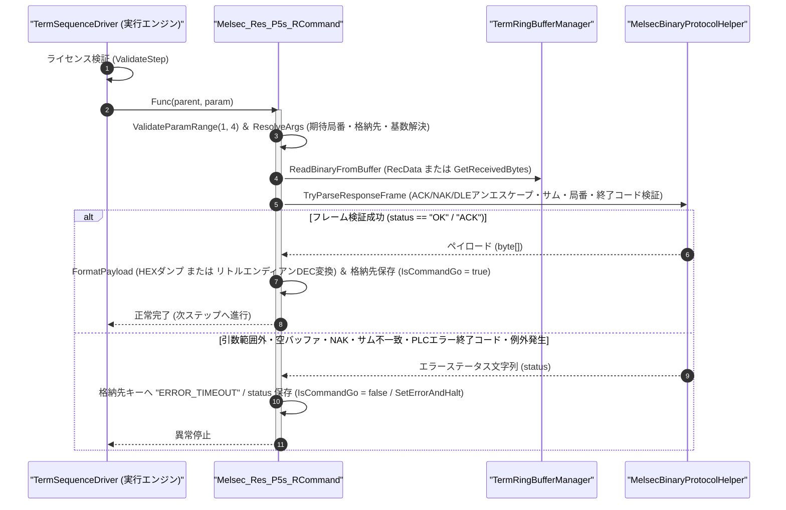

# コマンドリファレンス：Melsec_Res_P5s_R

## 概要

**Melsec_Res_P5s_R** は、三菱電機 MELSEC 計算機リンク **形式 5（バイナリコード通信方式）** の応答電文を受信検証し、DLE フレーミング・チェックサムおよび終了コード（正常 `0x0000`）を確認した上で、応答データを 16 進文字列（`HEX`）または 10 進整数（`DEC`）に変換して指定パラメータへ展開するコマンドです。

書込コマンドに対する正常応答（`DLE ACK [0x10 0x06]`）やエラー応答（`DLE NAK [0x10 0x15]`）の自動判定にも対応しています。

---

## 💡 書式・パラメータ仕様

### コマンド構文

```csv
,SEQUENCE, [ステップキー], Melsec_Res_P5s_R, [StationNoOrTarget], "[TargetOrRadix]", "[RadixFormat]"
```

※ `ParameterSpec` は `EnableVariableLength(true)` で定義され、実行時（`Func`）は `ValidateParamRange(1, 4)` により 1〜4 個の引数を受け付けます（第 4 引数が指定された場合は互換用予備引数として無視されます）。

### パラメータ（引数）一覧

| 引数位置 | 引数名 | 必須/任意 | 説明・制約 |
| :--- | :--- | :---: | :--- |
| 第 1 引数 | `StationNoOrTarget` | **必須** | 期待する局番（2 桁 16 進、例: `"00"`）、または格納先パラメータキー名（`"@"` や `"$"` を付けない素のキー名、例: `"PLC_D100"`）を指定します（1 引数時、または 2 引数で第 2 引数が `"DEC"` / `"HEX"` の場合は本引数が格納先キー名になります）。 |
| 第 2 引数 | `TargetOrRadix` | 任意 | 第 1 引数が期待局番の場合は格納先パラメータキー名（素のキー名）、第 1 引数が格納先キー名の場合は基数変換フォーマット（`"DEC"` または `"HEX"`、省略時既定値: `""` → `"HEX"`）を指定します。 |
| 第 3 引数 | `RadixFormat` | 任意 | 3 引数以上指定時における取得データの基数変換フォーマット（省略時既定値: `"HEX"`）。`"DEC"` 指定時は 2 バイト（リトルエンディアン符号付き 16 ビット整数、端数 1 バイト時は符号なしバイト値）単位のカンマ区切り 10 進数値に、それ以外は区切りなし大文字 16 進ダンプ文字列に変換します（第 4 引数は互換用予備として破棄）。 |

---

## 🔄 特殊置換規約・分岐規約の適用

本コマンドの引数における特殊記法および解釈ルールです。
* **動的置換（`$`）**: 引数内で `$PARAMキー$` のように記述すると、実行時に変数プール（PARAM）の値へ動的置換されます。（適用可能な引数: 全引数対応）
* **ジャンプ先指定（`#`）**: 本コマンドはジャンプ制御を行わないため適用されません。（適用可能な引数: 非適用）
* **共通コマンド指定（`@`）**: 本コマンドは外部マクロを呼び出さないため、共通コマンド呼び出し記法は適用されません。（適用可能な引数: 非適用）
* **カンマのエスケープ**: 引数自体にカンマを含める場合は、必ず `"..."` と二重引用符で囲んで記述します。
* **エイリアス（別名）**: `Res_P5s_R`, `Analysis_Res_P5s_R`, `Sqn_Res_P5s_R`, `Analysis_SQN_RES_P5S_R`

---

## 💡 動作例（正しい構文での記述例）

### スクリプト記述例

※COMMAND ブロック配下の子要素行（PARAM, SEQUENCE）は必ず行頭カンマから開始し、スペースインデントや行末コメント（`;`）は記述しないでください。

```csv
COMMAND, "SAMPLE_MELSEC_RES_P5S_R", "PLC_D100"
,PARAM, "PLC_D100", Work, "D100読出結果", ""
,SEQUENCE, 010, Melsec_Mode, "115200,E,8,1", "NONE", "P5"
,SEQUENCE, 020, Melsec_Open
; 形式5でD100からの2ワード読出要求を送信し、応答を10進数値（カンマ区切り）で PLC_D100 へ格納
,SEQUENCE, 030, Melsec_P5s_S, "00FF04010000A80000640002"
,SEQUENCE, 040, Melsec_Res_P5s_R, "00", "PLC_D100", "DEC"
; 2ワード読出結果が期待値 "100,200" と一致するか判定（不一致時は #NG_PROC# へ分岐）
,SEQUENCE, 050, Judge, "EQU", "$PLC_D100$", "100,200", "#NG_PROC#"
,SEQUENCE, 060, Melsec_Close
,SEQUENCE, 070, Exit, "$PLC_D100$", 0
; 期待値不一致時のクローズ＆異常終了経路
,SEQUENCE, #NG_PROC#, Melsec_Close
,SEQUENCE, 090, Exit, "NG", -1
```

### 実行時の挙動・変数変化

* **実行前の状態**: Term 通信エンジンが初期化され、変数プール（`PARAM`）に `"PLC_D100"` が定義されている状態。
* **実行後の状態**: 形式 5 バイナリ応答フレーム（`DLE STX`〜`DLE ETX`＋2B サムチェック、または `DLE ACK` / `DLE NAK`）に対して DLE アンエスケープ・サム照合・局番照合・終了コード（`0x0000`）検証が行われ、`"DEC"` 指定によりリトルエンディアン 2 バイト単位のカンマ区切り 10 進文字列（例: `"100,200"`、`DLE ACK` 時は `"ACK"`）が `"PLC_D100"` に格納されます。後続の `Judge` で一致が確認されると回線を閉じて正常終了し、不一致時は `#NG_PROC#` へ分岐してクローズ後に異常終了します。

---

## 🔄 動作フロー（シーケンス図）



---

## 🚫 エラーハンドリング・安全設計（仕様制限）

1. **引数個数境界およびバイナリ応答フレーム検証**:
   - 引数が 0 個または 5 個以上指定された場合（`ValidateParamRange(1, 4)` 違反）は `_log.LogError` に記録して停止します。受信バイト列が空の場合は `"ERROR_TIMEOUT"`、`DLE NAK` 時は `"NAK"`、フレーミング・長さ・サムチェック・局番・PLC 終了コード異常時は `"ERROR_FRAME"` / `"ERROR_LENGTH"` / `"ERROR_SUMCHECK"` / `"ERROR_STATION"` / `"ERROR_PLC_xxxx"` を格納先へ記録し、`param.IsCommandGo = false` で停止します。
2. **実行時例外発生時のフェイルセーフ**:
   - 不正な事前 HEX データ等により実行時例外が発生した場合は `catch` 節で捕捉し、`_log.LogCritical` への記録と `SetErrorAndHalt(-1, ex.Message)` により安全に停止します。

---

## 🧪 ユニットテスト仕様

本コマンドクラス（`Melsec_Res_P5s_RCommand.cs`）に実装されている `RunUnitTest()` メソッドが検証するユニットテストの仕様です。

### テスト実行前提条件

* **実行トリガー**: `RunUnitTest()` メソッドの呼び出し
* **有効化条件**: システム全体の最小ログレベル（`ErrorLogger.MinimumLevel`）が `LogLevel.Test` であること（それ以外の場合は無効化ガードにより早期リターン）
* **検証結果出力**: `_log.LogTest` によるログ出力。検証失敗時は `_log.LogError`、予期せぬ例外発生時は `_log.LogCritical` で記録し、`finally` ブロックで `testSbuf?.Clear()`、`TermRingBufferManager.Instance.ClearBuffer()`、および `UartTransportCore.Shared.IsLoopbackMode` の復元を実行します。

### テストケース一覧

| No | テストカテゴリ | テスト条件（入力値） | 期待される結果（出力値） | 検証の目的 / 観点 |
| :---: | :--- | :--- | :--- | :--- |
| **1** | 正常系 | `IsLoopbackMode = true` 環境下で引数 `"VAL_DEC"`, `"DEC"` および擬似バイナリ応答（本文 `00 FF 00 00 64 00 C8 00` を `BuildRequestFrame` で構築）を与えて実行 | `!param.HasError` かつ `param.IsCommandGo == true`、格納先 `SBuf["VAL_DEC"]` が `"100,200"` と一致する | 形式 5 バイナリ応答の終了コード検証およびリトルエンディアン 10 進（`DEC`）変換格納の検証 |
| **2** | 異常系 | 不正フレームおよび引数不足（`RecData = "00"`、引数 0 個の `TermSequence`）を指定した `Func(null, invalidParam)` ならびに `Func(null, null)` を実行 | `ValidateParamRange(1, 4)` により `!invalidParam.IsCommandGo` で安全に拒否され、`null` 入力でも例外クラッシュしない | 不正バイナリフレーム・必須引数欠落および `null` パラメータに対する安全防御検証 |
