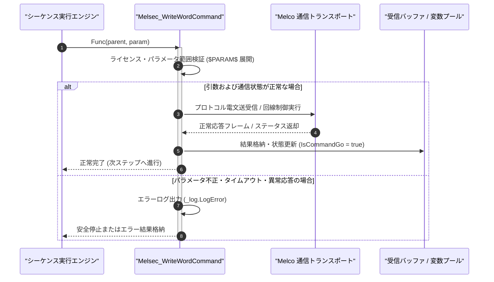

# コマンドリファレンス：Melsec_WriteWord

## 概要

**Melsec_WriteWord** は、三菱電機 MELSEC シーケンサ（計算機リンクユニット / 通信ポート）に対してワード単位の一括書込要求（`WW` コマンド）を実行し、指定された値を書き込む高水準通信コマンドです。

複雑な計算機リンクのデバイスコード指定（`0D0100` 等）やプロトコルフレーム（形式 1 〜 5）、ヘッダ/フッタおよびサムチェック計算を意識することなく、`"D100"` や `"W0010"` といった直感的なデバイス表記で通信を行うことができます。

> 💡 **補足**: 内部で使用される専用プロトコル形式（P1 / P2 / P3 / P4 / P5）および伝送待ち時間は、[Melsec_Mode](Melsec_Mode.Md) コマンドで設定された値（未指定時は P1 / 待ち時間 0ms）に自動追従します。

### 🔄 対象ワードデバイス仕様

| デバイス種別 | 表記例 | デバイスコード変換 | アドレス進数 |
| :--- | :--- | :--- | :--- |
| データレジスタ | `D100` | `0D0100` | 10 進 |
| リンクレジスタ | `W0010` | `0W0010` | 16 進 |
| ファイルレジスタ | `R50` | `0R0050` | 10 進 |
| タイマ現在値 | `TN0` | `TN0000` | 10 進 |
| カウンタ現在値 | `CN0` | `CN0000` | 10 進 |

---

## 💡 書式・パラメータ仕様

### コマンド構文

```csv
,SEQUENCE, [ステップキー], Melsec_WriteWord, [Device], [Points], [Data], "[StationNo: 00]"
```

### パラメータ（引数）一覧

| 引数位置 | 引数名 | 必須/任意 | 説明・制約 |
| :--- | :--- | :---: | :--- |
| 第 1 引数 | `Device` | **必須** | 書き込みを開始する先頭ワードデバイス名（例: `"D100"`, `"W10"`, `"R50"`, `"TN0"`, `"CN0"`）。 |
| 第 2 引数 | `Points` | **必須** | 連続して書き込むワード点数（`1`〜`64` の整数）。 |
| 第 3 引数 | `Data` | **必須** | 書き込む数値または 16 進ワード列（例: `"03E8"`, `"100,200"`）。 |
| 第 4 引数 | `StationNo` | 任意 | 送信先の局番 2 桁 16 進文字列（省略時既定値: `"00"`）。 |

---

## 🔄 特殊置換規約・分岐規約の適用

本コマンドの引数における特殊記法および解釈ルールです。
* **動的置換（`$`）**: 引数内で `$PARAMキー$` のように記述すると、実行時に変数プール（PARAM）の値へ動的置換されます。（適用可能な引数: 全引数対応）
* **ジャンプ先指定（`#`）**: 本コマンドはジャンプ制御を行わないため適用されません。（適用可能な引数: 非適用）
* **共通コマンド指定（`@`）**: 本コマンドは外部マクロを呼び出さないため、共通コマンド呼び出し記法は適用されません。（適用可能な引数: 非適用）
* **カンマのエスケープ**: 通信条件文字列（例: `"9600,E,7,1"`）や複数データのカンマ区切り値を単一引数として渡す場合は、必ず `"..."` と二重引用符で囲んで記述します。
* **エイリアス（別名）**: `Analysis_Melsec_WriteWord`, `Sqn_Melsec_WriteWord`

---

## 💡 動作例（正しい構文での記述例）

### スクリプト記述例

※COMMAND ブロック配下の子要素行（PARAM, SEQUENCE）は必ず行頭カンマから開始し、スペースインデントや行末コメント（`;`）は記述しないでください。

```csv
COMMAND, "MELSEC_WRITE_WORD_DEMO", ""
,PARAM, "WRITE_VAL", Text, "書込ワード値", "03E8"
,SEQUENCE, 010, Melsec_Mode, "9600,E,7,1", "NONE", "P1"
,SEQUENCE, 020, Melsec_Open
; D100 へ 1 ワード（03E8h）を書込（局番 00）
,SEQUENCE, 030, Melsec_WriteWord, "D100", 1, "$WRITE_VAL$", "00"
; D200 から 2 ワード連続書込（局番 00）
,SEQUENCE, 040, Melsec_WriteWord, "D200", 2, "0064,00C8", "00"
,SEQUENCE, 050, Melsec_Close
,SEQUENCE, 060, Exit
```

### 実行時の挙動・変数変化

* **実行前の状態**: MELSEC 計算機リンク回線がオープン済みで、`"WRITE_VAL"` に `"03E8"` が設定されている状態。
* **実行後の状態**: ステップ `030` で `D100` に `03E8h` が書き込まれ、ステップ `040` で `D200`〜`D201` に 2 ワード値が一括書き込みされ ACK 応答が確認されます。

---

## 🔄 動作フロー（シーケンス図）



---

## 🚫 エラーハンドリング・安全設計（仕様制限）

入力データの異常や実行時エラーに対し、解析・実行エンジンが実行するセーフティ規約です。

1. **引数範囲・プロトコル書式バリデーション保護**:
   - 必須引数の欠落、デバイス表記・数値範囲の不正、または余剰引数が指定された場合は `_log.LogError` に詳細を記録し、`SetErrorAndHalt` により異常電文の送出を未然に遮断します。
2. **通信タイムアウト・異常応答・排他ドメイン保護**:
   - 相手機器の無応答タイムアウト、NAK／異常終了コード応答、または他通信ドメインとの排他競合が発生した場合は、例外クラッシュを起こさず安全にエラーハンドリングを行います。

---

## 🧪 ユニットテスト仕様

本コマンドクラス（`Melsec_WriteWordCommand.cs`）に実装されている `RunUnitTest()` メソッドが検証するユニットテストの仕様です。

### テスト実行前提条件

* **実行トリガー**: `RunUnitTest()` メソッドの呼び出し
* **有効化条件**: システム全体の最小ログレベル（`ErrorLogger.MinimumLevel`）が `LogLevel.Test` であること（それ以外の場合は無効化ガードにより早期リターン）
* **検証結果出力**: `_log.LogTest` によるログ出力。検証失敗時は `_log.LogError`、予期せぬ例外発生時は `_log.LogCritical` で記録し、`finally` ブロックで `Melsec_ModeCommand.DefaultProtocolType` および `UartTransportCore.Shared.IsSimulationMode` を開始前の状態へ復元します。

### テストケース一覧

| No | テストカテゴリ | テスト条件（入力値） | 期待される結果（出力値） | 検証の目的 / 観点 |
| :---: | :--- | :--- | :--- | :--- |
| **1** | 正常系 | `IsSimulationMode = true`・`DefaultProtocolType = "P1"` 環境下で引数 `"D100"`, `"2"`, `"0x1234, 0x5678"`, `"00"` および擬似応答 `"ACK"` を与えて実行 | `!param.HasError` かつ `param.IsCommandGo == true`、`param.SndData` に `"00FFWW00D01000212345678"` が含まれる | `WW` ワード一括書込フレーム生成（4 桁 HEX 変換・サムチェック付与）および `ACK` 検証 |
| **2** | 異常系 | 指定点数とデータ要素数の不一致、引数範囲外（`ValidateParamRange(3, 4)` 違反）、または `NAK`／無応答タイムアウト | `_log.LogError`／`_log.LogCritical` を記録し、`SetErrorAndHalt` により安全に停止する | 点数整合性チェックおよび書込異常応答時のフェイルセーフ検証 |
