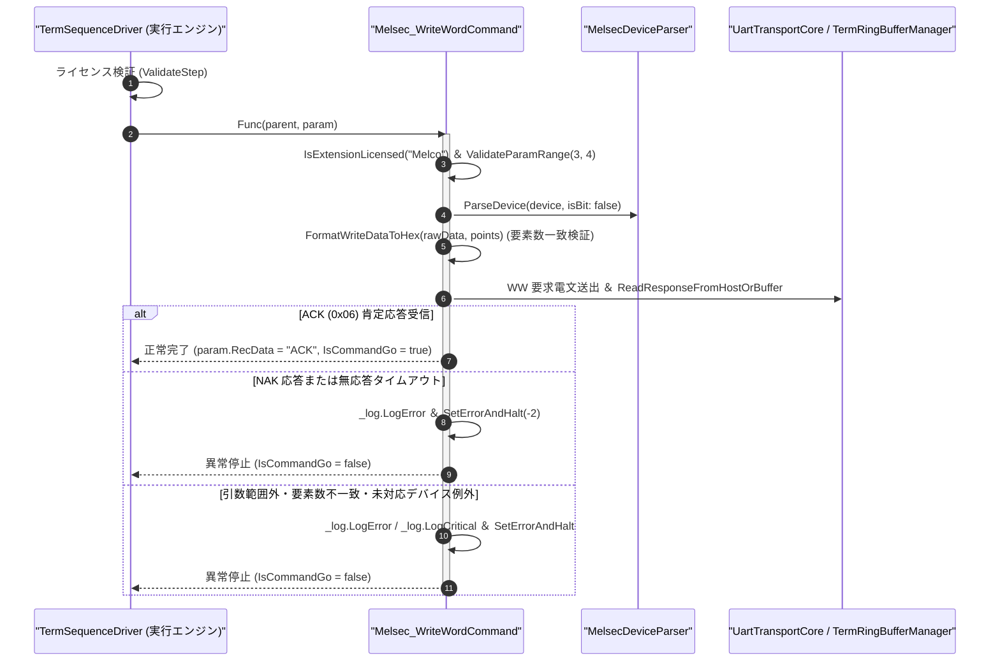

# コマンドリファレンス：Melsec_WriteWord

## 概要

**Melsec_WriteWord** は、三菱電機 MELSEC シーケンサ（計算機リンクユニット / 通信ポート）に対してワード単位の一括書込要求（`WW` コマンド）を実行し、指定された値を書き込む高水準通信制御系コマンドです。
複雑な計算機リンクのデバイスコード指定（`0D0100` 等）や ASCII プロトコルフレーム（形式 1 〜 4）、サムチェック計算を意識することなく、`"D100"` や `"W0010"` といった直感的なデバイス表記で通信を行うことができます。

> 💡 **補足**: 本コマンドの送信フレーム構築は **ASCII コード通信方式である形式 1 〜 形式 4（`P1` / `P2` / `P3` / `P4`）専用** であり、[Melsec_Mode](Melsec_Mode.Md) コマンドの設定値（未指定時は `P1` / 伝送待ち時間 `0`）に自動追従します。 **バイナリコード通信方式の形式 5（`P5`）には非対応** であるため、形式 5 を使用する場合は [`Melsec_P5s_S`](Melsec_P5s_S.Md) / [`Melsec_Res_P5s_R`](Melsec_Res_P5s_R.Md) を使用してください。

### 🔄 対象ワードデバイス仕様

| デバイス種別 | 表記例 | デバイスコード変換 | アドレス進数 |
| :--- | :--- | :--- | :--- |
| データレジスタ | `D100` | `0D0100` | 10 進 |
| リンクレジスタ | `W0010` | `0W0010` | 16 進 |
| ファイルレジスタ | `R50` | `0R0050` | 10 進 |
| タイマ現在値 | `TN0` | `TN0000` | 10 進 |
| カウンタ現在値 | `CN0` | `CN0000` | 10 進 |

---

## 💡 書式・パラメータ仕様

### コマンド構文

```csv
,SEQUENCE, [ステップキー], Melsec_WriteWord, [Device], [Points], [Data], "[StationNo: 00]"
```

### パラメータ（引数）一覧

| 引数位置 | 引数名 | 必須/任意 | 説明・制約 |
| :--- | :--- | :---: | :--- |
| 第 1 引数 | `Device` | **必須** | 書き込みを開始する先頭ワードデバイス名（例: `"D100"`, `"W10"`, `"R50"`, `"TN0"`, `"CN0"`）。 |
| 第 2 引数 | `Points` | **必須** | 連続して書き込むワード点数（正の整数。C# 実装では分割トークン数との一致［`tokens.Length == Points`］を検証します。なお C# 側での `64` 上限チェックは行いませんが、計算機リンク `WW` コマンド仕様上の PLC 推奨上限は `1`〜`64` 点であり、超過時は PLC 側で `NAK` 応答となります）。 |
| 第 3 引数 | `Data` | **必須** | 書き込む 10 進整数または `"0x"` 付き 16 進ワード列（カンマまたは空白区切り、例: `"100,200"` または `"0x03E8"`, `"0x0064,0x00C8"`）。※数字のみの文字列（例: `"0388"` 等）は 10 進整数（`short`）として解釈されるため、16 進数指定時は必ず `"0x"` を付与してください。 |
| 第 4 引数 | `StationNo` | 任意 | 送信先の局番 2 桁 16 進文字列（省略時既定値: `"00"`、自局 PC 番号 `"FF"` は自動補完）。 |

---

## 🔄 特殊置換規約・分岐規約の適用

本コマンドの引数における特殊記法および解釈ルールです。
* **動的置換（`$`）**: 引数内で `$PARAMキー$` のように記述すると、実行時に変数プール（PARAM）の値へ動的置換されます。（適用可能な引数: 全引数対応）
* **ジャンプ先指定（`#`）**: 本コマンドはジャンプ制御を行わないため適用されません。（適用可能な引数: 非適用）
* **共通コマンド指定（`@`）**: 本コマンドは外部マクロを呼び出さないため、共通コマンド呼び出し記法は適用されません。（適用可能な引数: 非適用）
* **カンマのエスケープ**: 複数データのカンマ区切り値（例: `"0x0064,0x00C8"`）を単一引数として渡す場合は、必ず `"..."` と二重引用符で囲んで記述します。
* **エイリアス（別名）**: `Analysis_Melsec_WriteWord`, `Sqn_Melsec_WriteWord`

---

## 💡 動作例（正しい構文での記述例）

### スクリプト記述例

※COMMAND ブロック配下の子要素行（PARAM, SEQUENCE）は必ず行頭カンマから開始し、スペースインデントや行末コメント（`;`）は記述しないでください。

```csv
COMMAND, "MELSEC_WRITE_WORD_DEMO", ""
,PARAM, "WRITE_VAL", Text, "書込ワード値", "0x03E8"
,SEQUENCE, 010, Melsec_Mode, "9600,E,7,1", "NONE", "P1"
,SEQUENCE, 020, Melsec_Open
; D100 へ 1 ワード（0x03E8 = 1000）を書込（局番 00）
,SEQUENCE, 030, Melsec_WriteWord, "D100", 1, "$WRITE_VAL$", "00"
; D200 から 2 ワード連続書込（0x0064 = 100, 0x00C8 = 200、局番 00）
,SEQUENCE, 040, Melsec_WriteWord, "D200", 2, "0x0064,0x00C8", "00"
,SEQUENCE, 050, Melsec_Close
,SEQUENCE, 060, Exit
```

### 実行時の挙動・変数変化

* **実行前の状態**: MELSEC 計算機リンク回線がオープン済みで、`"WRITE_VAL"` に `"0x03E8"` が設定されている状態。
* **実行後の状態**: ステップ `030` で `D100` に `03E8h`（1000）が書き込まれ、ステップ `040` で `D200`〜`D201` に 2 ワード値が一括書き込みされ、シーケンサからの `ACK` 応答確認後に `param.IsCommandGo = true` となります。

---

## 🔄 動作フロー（シーケンス図）



---

## 🚫 エラーハンドリング・安全設計（仕様制限）

入力データの異常や実行時エラーに対し、解析・実行エンジンが実行するセーフティ規約です。

1. **引数範囲・データ要素数整合およびデバイス検証**:
   - 引数個数不正（`ValidateParamRange(3, 4)` 違反）やデバイス空指定時は `_log.LogError` と `SetErrorAndHalt` で停止します。また、`Points` と `Data` の要素数が一致しない場合や、未対応デバイス・16 ビット整数変換失敗時は例外が捕捉され、`_log.LogCritical` と `SetErrorAndHalt(-1, ex.Message)` により送信前に遮断されます。
2. **書込 NAK 応答および無応答タイムアウト時の停止**:
   - シーケンサから `ACK`（`0x06`）以外の応答（`NAK` 等）が返された場合やタイムアウト時は、`_log.LogError` に記録し `SetErrorAndHalt(-2, ...)` で即座に安全停止します。

---

## 🧪 ユニットテスト仕様

本コマンドクラス（`Melsec_WriteWordCommand.cs`）に実装されている `RunUnitTest()` メソッドが検証するユニットテストの仕様です。

### テスト実行前提条件

* **実行トリガー**: `RunUnitTest()` メソッドの呼び出し
* **有効化条件**: システム全体の最小ログレベル（`ErrorLogger.MinimumLevel`）が `LogLevel.Test` であること（それ以外の場合は無効化ガードにより早期リターン）
* **検証結果出力**: `_log.LogTest` によるログ出力。検証失敗時は `_log.LogError`、予期せぬ例外発生時は `_log.LogCritical` で記録し、`finally` ブロックで `Melsec_ModeCommand.DefaultProtocolType` および `UartTransportCore.Shared.IsSimulationMode` を開始前の状態へ復元します。

### テストケース一覧

| No | テストカテゴリ | テスト条件（入力値） | 期待される結果（出力値） | 検証の目的 / 観点 |
| :---: | :--- | :--- | :--- | :--- |
| **1** | 正常系 | `IsSimulationMode = true`・`DefaultProtocolType = "P1"` 環境下で引数 `"D100"`, `"2"`, `"0x1234, 0x5678"`, `"00"` および擬似応答 `"ACK"` を与えて実行 | `!param.HasError` かつ `param.IsCommandGo == true`、`param.SndData` に `"00FFWW00D01000212345678"` が含まれる | `WW` ワード一括書込フレーム生成（4 桁 HEX 変換・サムチェック付与）および `ACK` 検証 |
| **2** | 異常系 | 指定点数とデータ要素数の不一致（引数 `"D100"`, `"3"`, `"0x1234"`）を指定して `Func(null, invalidParam)` を実行 | `FormatWriteDataToHex` の要素数検証例外が捕捉されて `SetErrorAndHalt(-1, ex.Message)` が呼ばれ、`invalidParam.HasError == true` かつ `!invalidParam.IsCommandGo` となる | 点数とデータ個数の不整合検出および安全停止検証 |
